<p align="center"><picture><source media="(prefers-color-scheme: dark)" srcset="assets/brand/axlr-bots-emblem-stacked-dark.svg"></picture></p>

<p align="center"><strong>The control panel of AXLR Bots: see the fleet, send tasks, say yes or no to a bot, from one window.</strong></p>

[](LICENSE)

AXLR Bots Panel is a native desktop application for [AXLR Bots](https://github.com/underpass-ai/axlr-bots), Underpass's control plane for bots that live as infrastructure. It talks to a running control plane through its operator API (HTTPS with the fleet CA, the bearer token from its file) and shows nodes, bots, tasks and executions with status pills, icons and colour, in few words. It is written in Rust with [Iced](https://iced.rs) and draws with the GPU or without one.

<p align="center">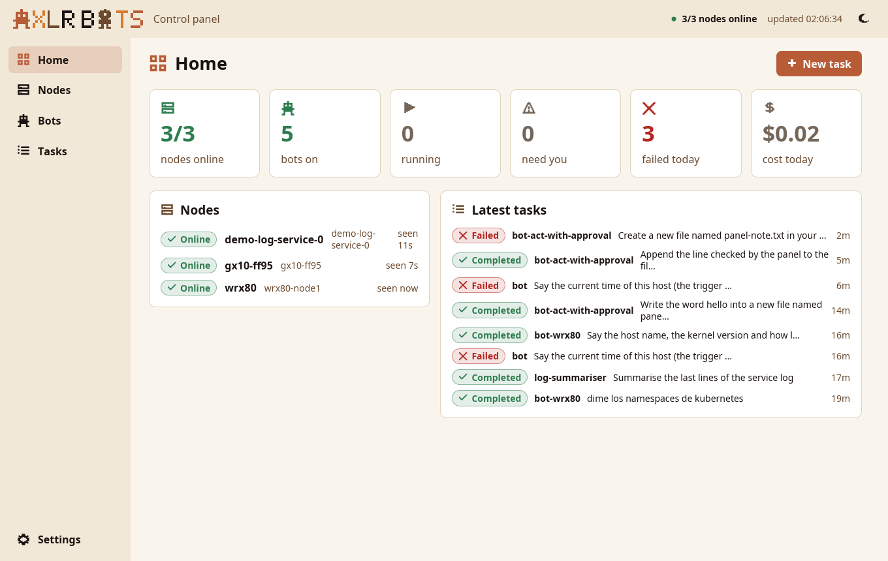</p>

## Install

User-level, no root. You need Rust 1.88 or newer and a control plane with its operator address on (`axlr-bots serve --api-listen 127.0.0.1:7879`, as the [install runbook](https://github.com/underpass-ai/axlr-bots/blob/main/docs/runbooks/install.md) sets up).

```bash
make install        # ~/.local/bin/axlr-bots-panel, the icon, and the menu entry "AXLR Bots"
```

`cargo install --path .` installs the binary alone. `make uninstall` removes what `make install` put.

## Run

```bash
axlr-bots-panel
```

The first run opens **Settings** with three values read from this host's install: the API address (`https://127.0.0.1:7879`), the fleet CA (`~/.local/state/axlr-bots/ca/ca.crt`) and the token file (`~/.local/state/axlr-bots/api.token`). **Connect** checks them against the control plane and saves them in `~/.config/axlr-bots-panel/config.toml`. The token stays in its file: the panel reads it and never shows or logs it.

| Flag or variable | Does |
|---|---|
| `--theme light\|dark` | start in that theme (the sun and moon button switches it) |
| `--screen overview\|nodes\|bots\|bot:<id>\|tasks\|task:<id>\|settings` | open that screen once connected |
| `ICED_BACKEND=tiny-skia` | draw on the CPU, for a host without a working GPU driver |

The panel reads the control plane every 3 seconds, in the background; the window never waits on the network.

## Screens

| Screen | Light | Dark |
|:--|:--:|:--:|
| **Home**: nodes online, bots on, tasks running, waiting and failed today, cost today; the tasks that need you; the nodes; the latest tasks |  | 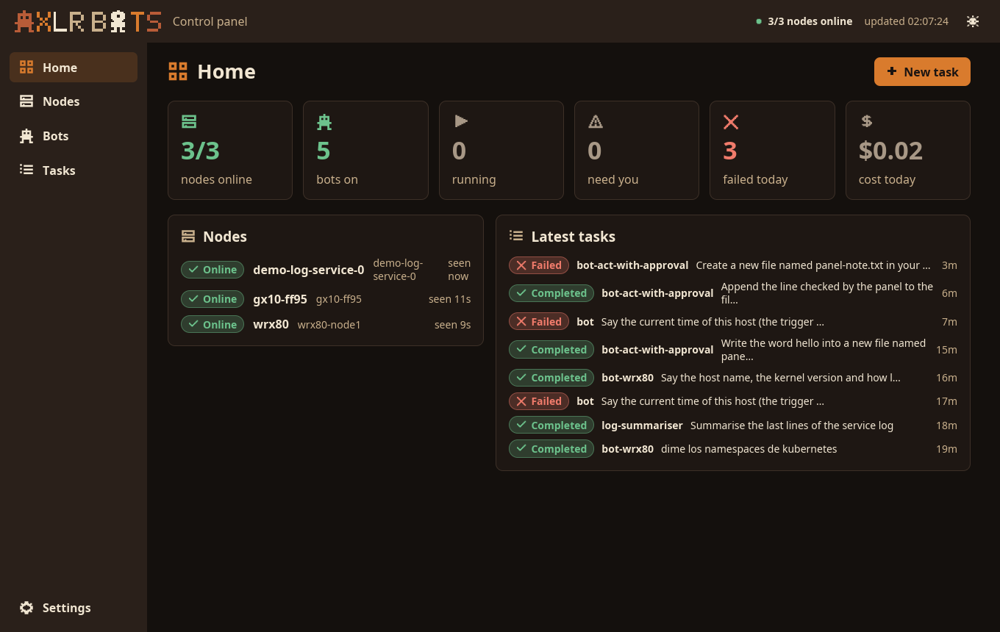 |
| **Nodes**: status, labels, last heartbeat, certificate expiry, AXLR version; a one-time host token with copy buttons; revoke with a second click | 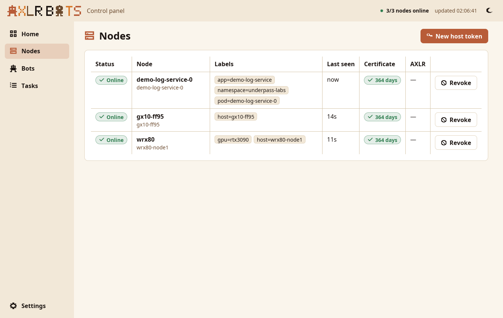 | 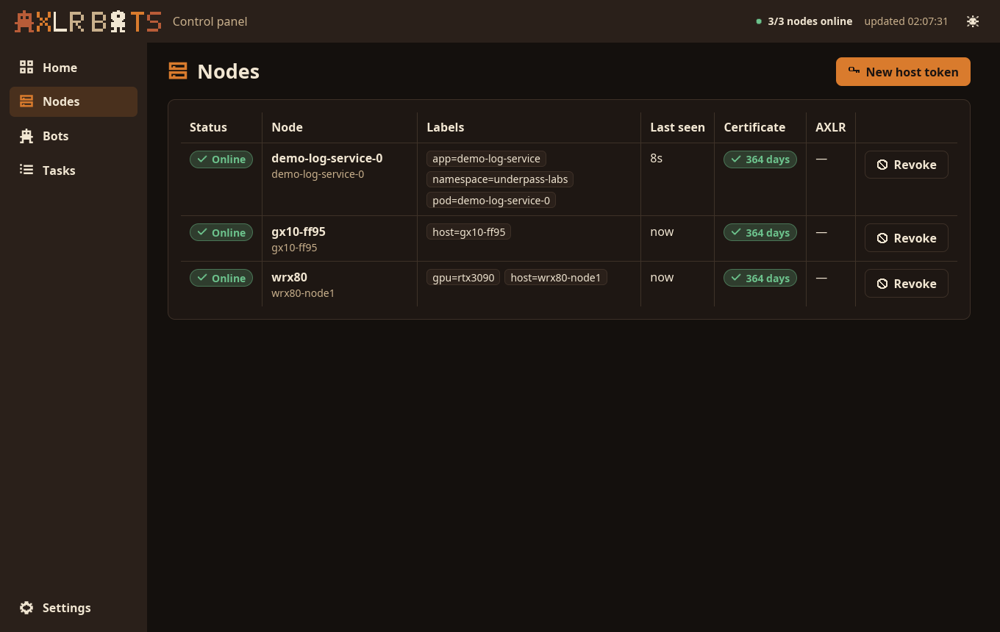 |
| **Bots**: status, level, model, placement, triggers; turn on or pause; add one from a form or a definition file | 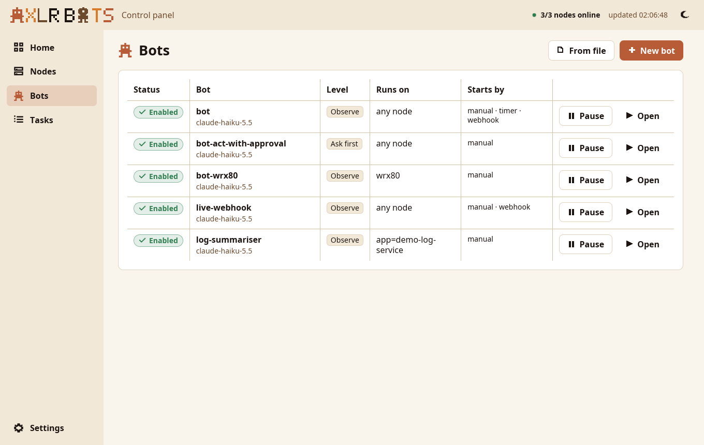 | 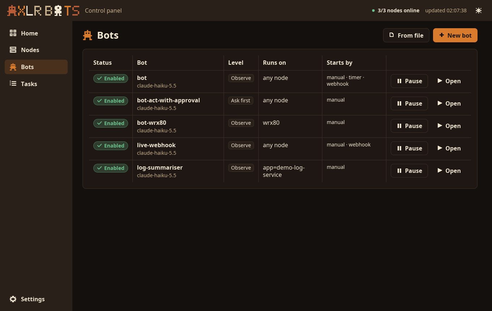 |
| **Bot**: mission, model, tools and tool rules, level, budgets, placement, triggers, its events as they happen, its latest tasks | 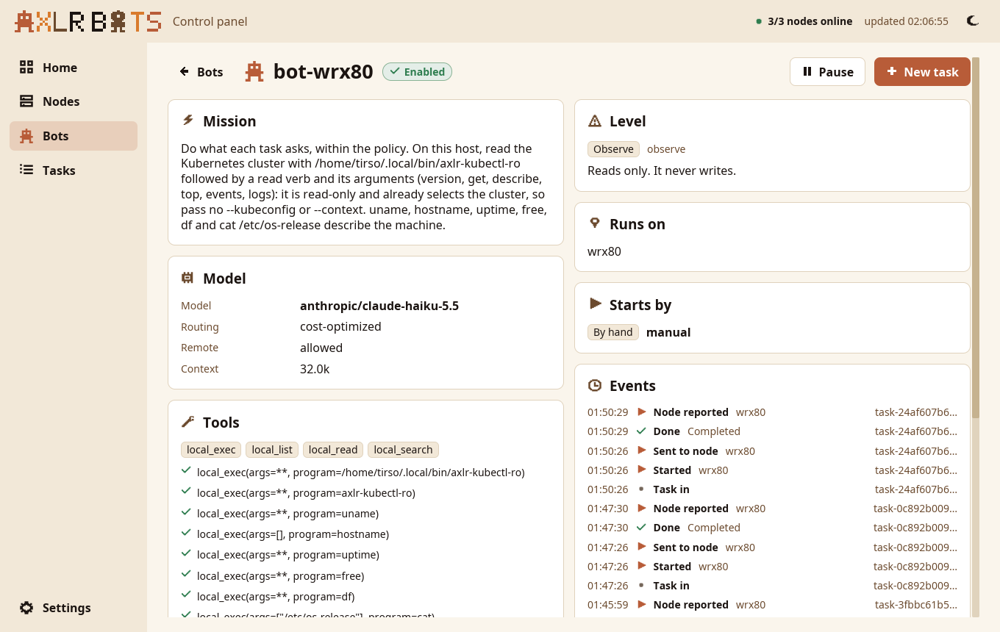 | 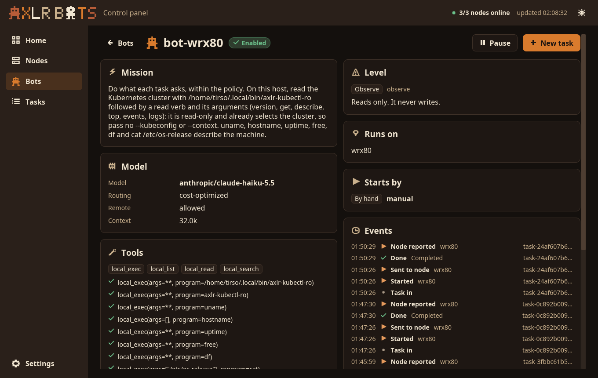 |
| **Tasks**: across bots, filtered by status and bot; send a task (one idempotency key per form); stop one | 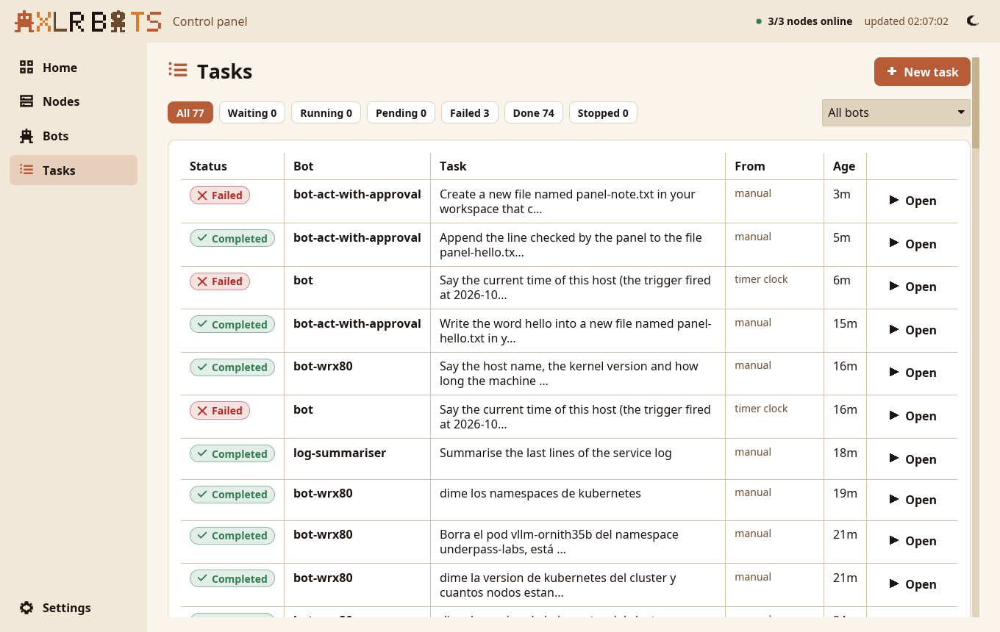 | 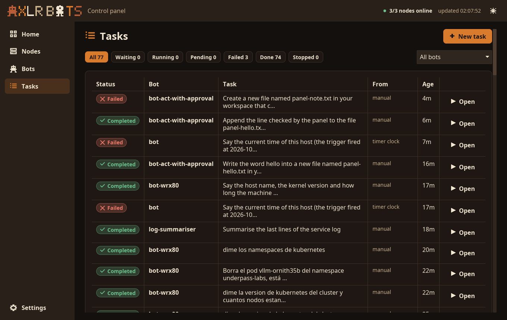 |
| **Task, waiting**: the call the bot stopped on and its arguments, Approve or Deny | 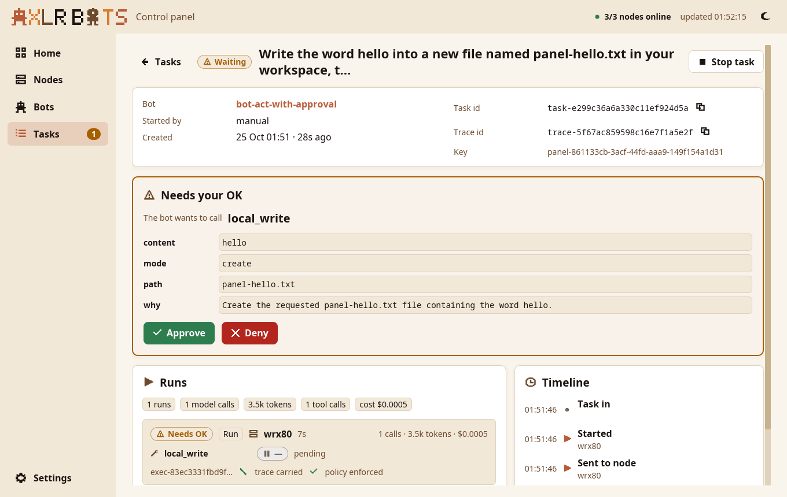 | 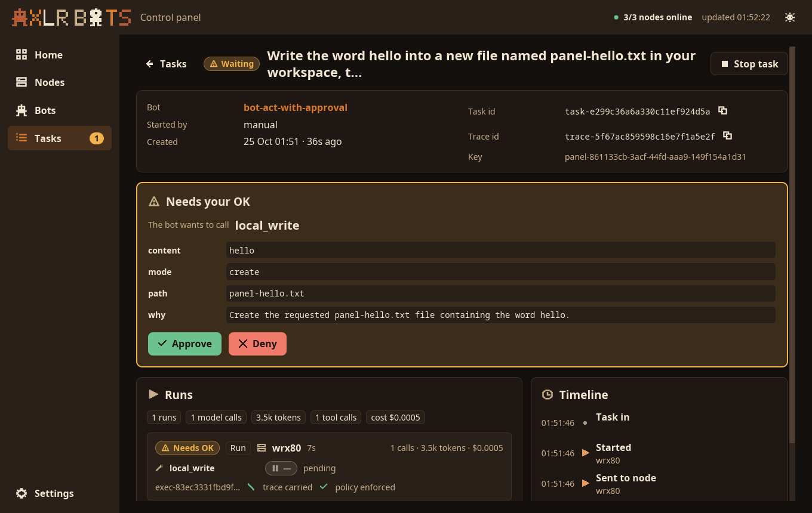 |
| **Task, done**: the answer, every run with its node, outcome, tool calls and their decisions, usage and cost, trace and policy; the timeline | 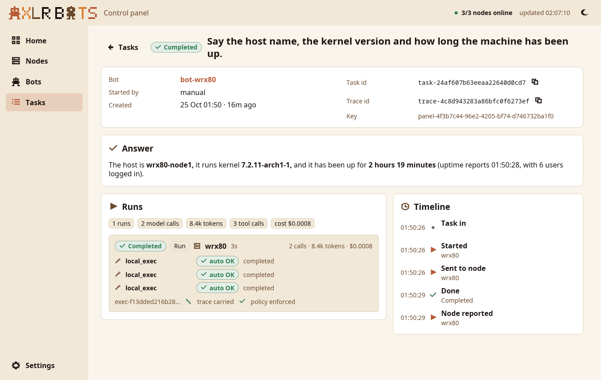 | 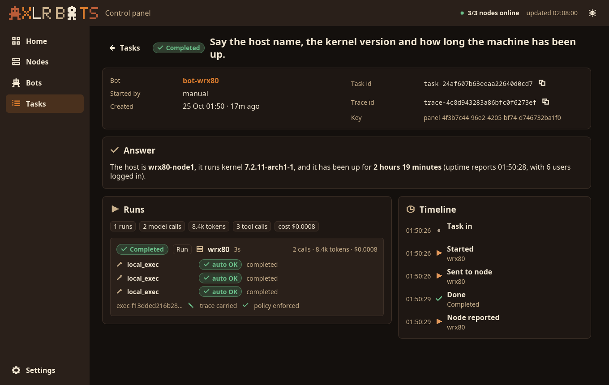 |
| **Settings**: the API address, the CA and the token file; the theme | 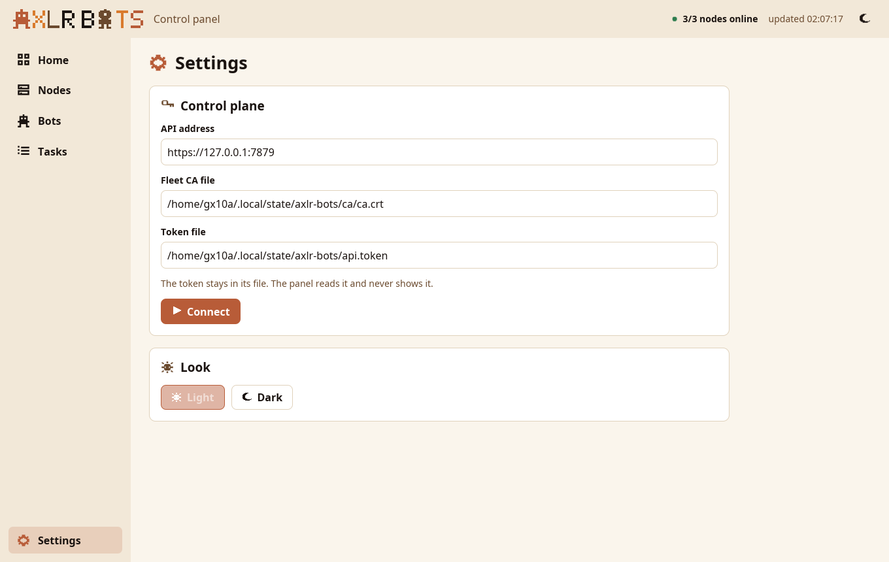 | 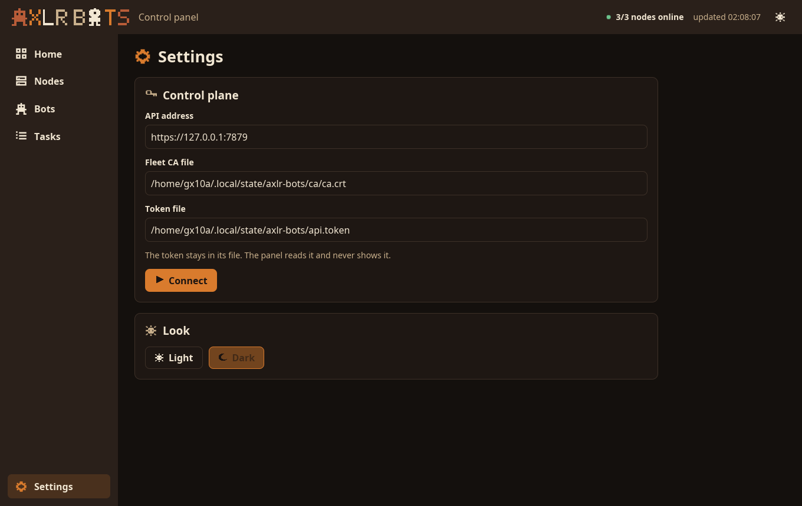 |

The screenshots are a live control plane with three nodes: `gx10-ff95` (the panel's host, aarch64), `wrx80` (x86_64, enrolled over mutual TLS) and `demo-log-service-0` (a node agent beside a service in a pod). [The live run](docs/live-run.md) shows a task sent to `wrx80` and a write approved, both from the panel.

## Made to be read fast

Every status is a pill with a colour, an icon and one or two words: green ✓ done or on, copper ▶ working, amber ⚠ needs a person, red ✕ failed or off, grey ⏸ stopped or waiting its turn. Text is 16 px or larger, left-aligned, never italic; numbers are big. The two themes keep every text colour at 4.5:1 or more against its background (a test checks it). The icons are 16 × 16 pixel glyphs in the house style of the AXLR Bots emblem (`assets/icons/make_icons.py` draws them).

## How it works

```text
 ui (Iced)          App::apply(message) → state + effects      views draw the state
    │                                    │
    ▼                                    ▼
 application        use cases: RefreshFleet · LoadTaskDetail · SubmitTask · DecideTask · CancelTask · SwitchBot
                    RegisterBot · MintEnrollmentToken · RevokeNode · FollowBotEvents · Connect …
    │  ports: ControlPlane · Clock · KeySource · FilePicker · DefinitionReader · ConfigStore · Connector
    ▼
 adapters           http (reqwest + rustls, fleet CA only, bearer token) · system (clock, uuid keys, files,
                    XDG file dialog) · config (TOML settings, defaults from the axlr-bots unit) · fake (in memory)
    │
    ▼
 domain             Node · Bot · Task · Execution · ExecutionResult · Event · Overview · EnrollmentToken …
                    value types mirroring the operator API's JSON, validated as they are read
```

- **Hexagonal, one file per type.** The domain depends on nothing but serde and chrono; the use cases see the control plane through the `ControlPlane` port; the adapters implement the ports; `main.rs` wires them.
- **The update logic does no input or output.** `App::apply` turns a message into the new state and a list of effects; the runtime runs the effects as Iced tasks. Tests drive `apply` message by message against the in-memory control plane, and draw every screen with Iced's headless simulator.
- **Nothing twice.** A task form keeps one idempotency key from the moment it opens, so sending twice names one task. A refresh carries a generation, and an older answer is dropped.
- **Acts that cannot be undone ask twice**: revoking a node, stopping a task, denying a call.

The routes the panel reads beyond the original operator API (the task list across bots, a task's timeline, the overview, pausing a bot, a node's certificate expiry) come from [underpass-ai/axlr-bots#3](https://github.com/underpass-ai/axlr-bots/pull/3).

## Development

```bash
make check          # cargo fmt --check, cargo clippy -D warnings, cargo test (two jobs)
make coverage       # cargo llvm-cov over domain, application, adapters and the update logic
AXLR_PANEL_LIVE=1 cargo test --test live_control_plane -- --nocapture   # read the running control plane
```

The HTTPS adapter is tested against a local TLS server with a CA made for the test, including a server whose certificate chains to another CA (refused) and a wrong token (`401`).

## License

Apache License 2.0; see [LICENSE](LICENSE) and [NOTICE](NOTICE). Part of [Underpass AI](https://underpassai.com).
