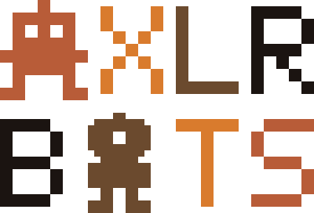
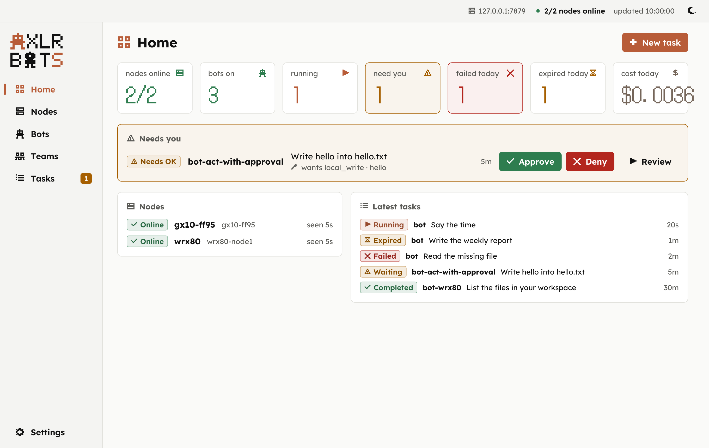
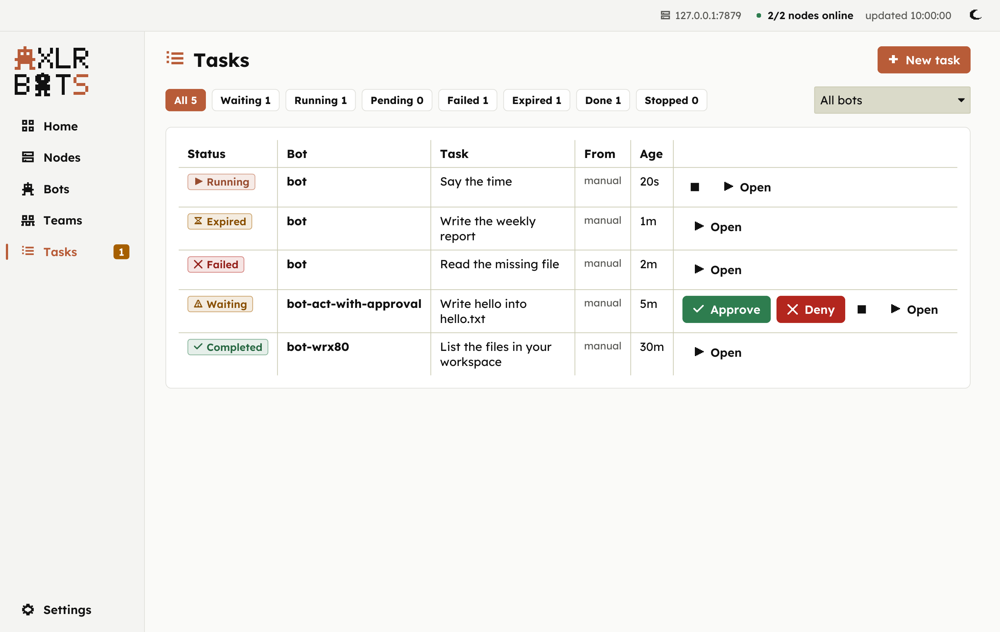
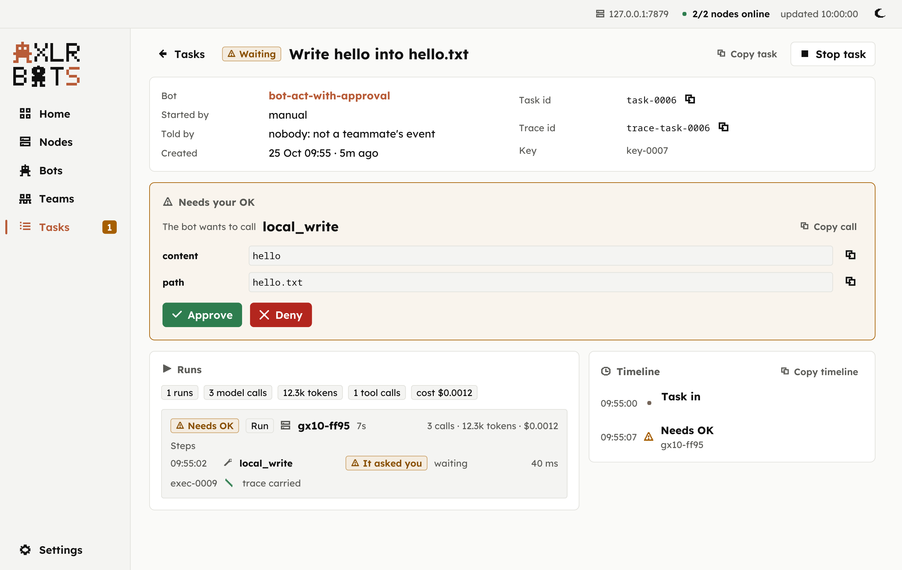
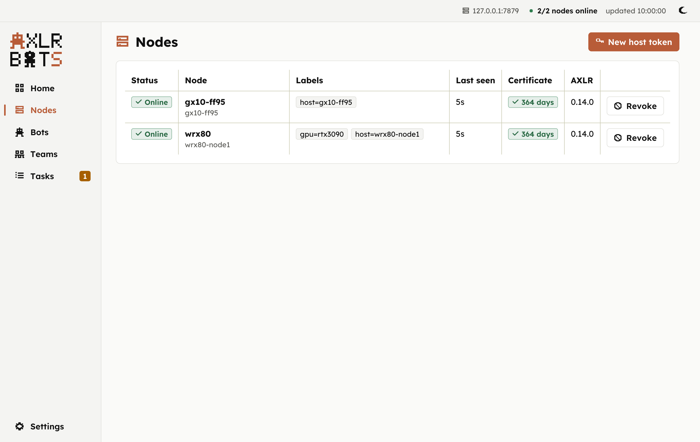

<p align="center"><picture><source media="(prefers-color-scheme: dark)" srcset="docs/assets/brand/axlr-bots-emblem-stacked-dark.svg"></picture></p>

<p align="center"><strong>Deploy bots like services: give each one a job, a policy and a host, and it keeps working.</strong></p>

[](https://github.com/underpass-ai/axlr-bots/actions/workflows/ci.yml) [](https://github.com/underpass-ai/axlr-bots/actions/workflows/panel.yml) [](LICENSE)

AXLR Bots is Underpass's control plane for bots that live as infrastructure: one control plane, N hosts, N bots per host. A bot is a declared resource with a mission, a model, tools, an autonomy level, triggers, budgets and a placement; it exists without running anything, and when a task arrives (by hand, from a webhook, on a timer, or asked by another bot) the control plane starts an execution on the host the bot is placed on. [AXLR](https://github.com/underpass-ai/AXLR) runs each execution: the LLM proposes, the policy decides, outside the model. The [vision note](docs/architecture/vision.md) is the design; this repository is what exists today.

## Install

User-level, no root, two systemd user services. You need Go 1.26, an `axlr-tui` from AXLR v0.14.0 or later (it has `--exec`) and a model key.

```bash
go build -o bin/ ./cmd/...
OPENROUTER_API_KEY=... bin/axlr-bots install --axlr-bin /path/to/axlr-tui
systemctl --user enable --now axlr-bots.service axlr-node.service
```

`systemctl --user status axlr-bots axlr-node` shows both active; `axlr-bots node list` shows this host Online. The [install runbook](docs/runbooks/install.md) has the TLS install for a fleet, the system-wide variant, the environment file and the uninstall.

## Your first bot

```bash
axlr-bots bot register --file cmd/axlr-bots/testdata/bot.json                                  # reads its workspace, manual trigger, any node
axlr-bots bot enable bot
axlr-bots task submit bot --objective "List the files in your workspace" --key first-1
axlr-bots task get task-…                                                        # Pending → Running on this host → Completed
axlr-bots task report task-…                                                     # the answer, kept as the task's artifact
axlr-bots bot events bot                                                         # bot.task.submitted … bot.task.completed, with the trace id
```

## The control panel

A desktop window over the operator API, in [`panel/`](panel/README.md): see the fleet, send tasks, say yes or no to a bot. Rust and [Iced](https://iced.rs), light and dark, no root.

<p align="center"></p>

| Tasks | A call waiting for you | Nodes |
|:--:|:--:|:--:|
|  |  |  |

```bash
cd panel
make install        # ~/.local/bin/axlr-bots-panel, the icon and the menu entry; needs Rust 1.88
axlr-bots-panel     # the first run reads this host's axlr-bots install and asks to Connect
```

The [panel's README](panel/README.md) has every screen, the flags and how it is built.

## How it works

```text
operator · webhooks · timers ──▶ axlr-bots  (control plane: bots · tasks · executions · nodes · timers · events · audit)
                                     ▲  register · heartbeat · poll · lease · report      every call outbound, mutual TLS
                                     │
                     axlr-node on host-1 … host-N  ──▶  axlr-tui --exec --policy  (AXLR)  ──▶  your model provider
```

- **A bot is not an execution.** The bot is the durable resource; each task runs as an execution that ends, and the bot, its tasks and its events survive every restart.
- **Nodes connect outward, with mutual TLS.** The control plane runs the fleet CA; a host joins with a one-time token and is its certificate from then on. The control plane never reaches into a host.
- **Everything is idempotent.** Submissions carry a key, webhook fires derive theirs from the delivery, timers from the slot, reports are accepted once: a retry, a redelivery or a restart creates nothing twice.
- **The policy lives outside the model.** The bot's level and tool rules go to AXLR as a policy file; a forbidden call is refused before any approval card, and `act-with-approval` stops for a person, who is notified (a signed webhook or a local command); past its deadline the call is denied or the task cancelled, and a late approval authorises nothing.

## Choose a path

| You want to… | Read |
|:--|:--|
| Install for one host or a fleet, keep it running after logout, uninstall | [Install](docs/runbooks/install.md) |
| Write a bot: mission, model, tools, autonomy level, triggers, budgets, placement | [Bot definition](docs/reference/bot-definition.md) |
| Start tasks from a webhook or on a timer, without duplicates | [Triggers](docs/runbooks/triggers.md) |
| Approve or deny the write a bot wants to make, be notified of it, let it expire | [Approvals](docs/runbooks/approvals.md) |
| Let a bot ask another bot to do a task, within depth and budget limits that stop loops | [Delegation](docs/reference/bot-definition.md#delegation), [ADR](docs/architecture/delegation.md) |
| Put bots in a team so they know each other and ask each other without naming targets | [Teams](docs/reference/bot-definition.md#teams), [ADR](docs/architecture/groups-and-events.md) |
| Let a bot warn or recall its teammates with an event, and follow the team's timeline | [Events](docs/reference/bot-definition.md#events), [ADR](docs/architecture/groups-and-events.md) |
| Add a host: enrollment token, mutual TLS, revocation | [Add a host](docs/runbooks/add-a-host.md) |
| Run the node agent as a sidecar beside a service in a Kubernetes pod, with Helm | [Sidecar](docs/runbooks/sidecar.md) |
| Watch the fleet and approve calls from a desktop window | [Control panel](panel/README.md) |
| Call the control plane over HTTP | [Operator API](docs/reference/operator-api.md) |
| See what a node and the control plane say to each other | [Node protocol](docs/reference/node-protocol.md) |
| See how a node runs AXLR and reads the result | [Runtime contract](docs/architecture/runtime-contract.md) |
| Look up a command, read a report | [Command reference](docs/reference/cli.md) |
| Recover after a crash, a silent node or a lost control plane | [Recovery](docs/runbooks/recovery.md) |
| Understand who keeps, decides and trusts what; what is next and left out | [Control plane, node and AXLR](docs/architecture/control-plane-node-axlr.md) |
| Bring a world of your own to the bots (a simulation, a camera, a sensor, a hand) as text, with an adapter beside it and nothing new in the control plane | [Input adapters](docs/architecture/input-adapters.md) (its template: `world-adapter/` in the private repo `axlr-bots-examples`) |
| Read the live run on a real host and the demo script | [Live run](docs/live-run.md) |

[Documentation home](docs/index.md) lists every guide.

## What runs where

| Component | Runs | Does |
|---|---|---|
| `axlr-bots` (control plane) | one host, `systemctl --user` | keeps the bots, tasks, executions, nodes and timers; serves the CLI on a Unix socket, the nodes on a TLS address, operators and webhooks on another; fires the timers; reconciles what a crash left running |
| `axlr-node` (node agent) | every host that runs bots, under systemd; or in a pod beside a service, as a sidecar (`charts/axlr-bots-node`) | enrolls with a token, registers, heartbeats, polls for the executions of the bots placed on its host, runs them, reports |
| AXLR (`axlr-tui --exec`) | on the node, one process per execution | the model loop, the tools, the policy and the approvals; writes the result object the node reports |
| `axlr-bots-panel` (control panel) | an operator's desktop | reads and drives the control plane over the operator API, with the fleet CA and the bearer token |
| your model provider | wherever it is | answers the model calls with the key in that host's environment file |

## Project status

Pre-1.0, one Go module and a Rust desktop panel, Linux with systemd or Kubernetes. What works today, exercised live with the real AXLR: user-level install, bots with the four autonomy levels and tool rules, manual, webhook and timer triggers with deduplication, the approval path with its expiry and notifications, artifacts uploaded by the node and served by the control plane, a bot asking another bot through the control plane with the loop cut by depth and by the chain ([live run](docs/live-run.md#delegation-between-bots-gx10-25-oct-2026)), node enrollment with one-time tokens and mutual TLS, revocation, placement by node or label, the operator API behind a bearer token, correlation ids on every task, execution and event, recovery of the tasks a crash left running, budgets passed to a runtime that takes them, and the node agent as a sidecar in a pod (a Helm chart, no CRDs), enrolled from a Secret on its first start, reading the service's log read-only under a NetworkPolicy ([live run](docs/live-run.md#the-sidecar-on-kubernetes)).

Next: one sandbox per execution (a Job with its own identity, filesystem and limits), budgets enforced by the runtime recorded on every execution, and a durable store in place of one JSON file per aggregate. [Control plane, node and AXLR](docs/architecture/control-plane-node-axlr.md#what-is-left-out) says what is left out.

## License

Apache License 2.0; see [LICENSE](LICENSE) and [NOTICE](NOTICE). Part of [Underpass AI](https://underpassai.com).
