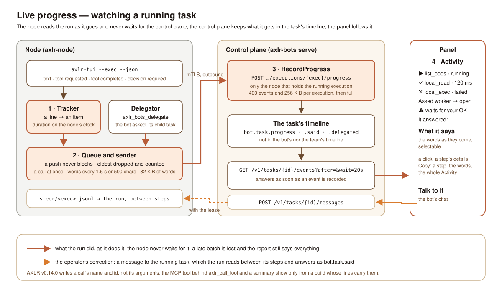

# ADR: live progress of a running task

Status: accepted, 2 November 2026 (the product owner asked to watch, in the panel, what a running bot does: each tool call as it starts and ends, the bots it asks, the call that waits for a person and the model's words as they come, and to correct the bot from there). Vision §11.2 (the events of a task), §12.3 (the execution's evidence), §14.8 (an execution reconstructed from its ids).

## Context

Until now the panel showed what a run did only when it ended: the execution's report carries the tool calls, the answer and the usage, and the task's timeline said *started*, *sent to node* and then *done* or *failed*. A run can work for minutes. The node already read `axlr-tui --exec --json` line by line as the run wrote it (the trace, and since steering the replies to an operator's message, `bot.task.said`), so the information was there, on the wrong side of the network.

Three constraints shaped the answer:

- **The run comes first.** Whatever tells the operator what happens must never slow down, block or fail the run. The control plane may be slow, restarting or older than the feature.
- **The control plane is the record.** The panel talks to the control plane only, and the node talks to it only outbound, over its mutual-TLS channel. A node is never trusted for anything but what it ran.
- **Little leaves the node.** AXLR's lines carry a call's name and id, and in a later build maybe its arguments; arguments can hold secrets or a whole file. The operator needs to see *what* is called, not every byte of it.

## Decision

### 1. The node reads the run into items

The AXLR adapter feeds every line it reads to a progress tracker (`adapters/axlr/progress_tracker.go`), beside the trace and the said tracker. Each line that tells something becomes one item:

| Line | Item | Fields |
|---|---|---|
| `tool.requested` | `tool.started` | `tool`, `callId`; for `axlr_call_tool` the MCP tool its arguments name (`mcpTool`); a summary of the arguments, one line of JSON cut at 120 characters, when the line carries them |
| `tool.completed` | `tool.ended` | `tool`, `callId`, `status` (`ok`, `denied` when the decision is `deny`, `failed` when the line says so), `error`, the first line of a failure as AXLR wrote it, cut at 240 characters, and `durationMs` on the node's clock since its `tool.requested` |
| `decision.required` | `decision.required` | the `tool` and `callId` waiting for a person |
| `text` | `text` | the model's words, up to 32 KiB per run; then one `text.truncated` and no more words |

AXLR v0.14.0 writes `{"type","tool","call_id","decision"}` on its tool lines and no arguments (`trace_payloads: false` keeps them out of the trace as well), so with it an item has the tool's name and nothing more. Later builds write the call's `arguments` on `tool.requested` and its `status` and `error` on `tool.completed`: the item then names the MCP tool, summarizes its arguments and says why a call failed, with no change to the adapter. A full set of arguments never leaves the node.

The delegation tool adds its own item when the control plane answered: `delegation` with the `bot` asked and the child's `taskId`, or the refusal's `reason` (`adapters/nodeagent/delegator.go`).

### 2. A queue that never blocks the run

The tracker hands each item to the node agent's sender of that execution (`adapters/nodeagent/progress_sender.go`) and returns at once:

- **The queue** (`progress_queue.go`) holds at most 256 items. Past that, the oldest is dropped and counted; the next batch carries the count (`dropped`) and the node logs it. Words join the text item at the queue's end, so a stream of tokens is one growing item, not thousands.
- **One goroutine sends.** A tool call, a decision or a delegation goes at once with whatever waits; words alone wait until 500 characters or 1.5 seconds have gathered. At most 64 items go in a batch.
- **Before the report** the sender sends what is left and stops: the report ends the execution, and the control plane takes no progress after it.
- **A batch that does not go is lost**, logged once per execution; a control plane older than the route (its mux's plain `404`), or one that answers `full`, closes the queue for the execution. The run is never told: its report still carries every tool call, the answer and the usage, as before.

### 3. The control plane keeps it in the task's timeline

`POST /v1/nodes/{id}/executions/{exec}/progress` with `{items, dropped?}` ([node protocol](../reference/node-protocol.md#messages)). `RecordProgress` (`application/record_progress.go`):

- takes it only from the node that holds the execution, while the execution runs (`409 state` otherwise), as `said`;
- keeps of each item only its kind's fields, cut to their bounds (names 200 characters, the summary 160, a text item 4000), and drops an item of a kind it does not know;
- records the batch as **one `bot.task.progress` event** with the bot, task, execution and trace ids, `{"items": […], "dropped": n}`;
- bounds what an execution keeps: **400 events and 256 KiB of items**. The event that reaches the bound keeps what fits and says `"truncated": true`; later batches are answered `{"recorded": false, "full": true}` and the node stops sending. A run is at most 15 minutes by default, its words at most 32 KiB, its tool calls bounded by its budget: the bound is reached only by a run that would drown its own timeline.

Progress belongs to the task's timeline alone: the event log's index leaves `bot.task.progress` out of the bot's timeline (`GET /v1/bots/{id}/events`) and the team's (`GET /v1/groups/{name}/events`), where a working bot would push its teammates' warnings out of the window.

`GET /v1/tasks/{id}/events` takes `after` and `wait` with the semantics of a team's timeline: the events after the one `after` names (all of the newest `limit` when it is absent or out of the window), and with `wait` (up to 30 s) an answer as soon as any event is recorded, or `[]` when it passes. A recorded event wakes every waiting read, so a batch reaches the panel within the time of one request.

### 4. The panel follows it

On a task's page the panel reads the task's timeline with `after` and `wait=20s` while the task may still run (`FollowTaskEvents`, `ui/app_live.rs`): a read that brings something starts the next at once, one that waited for nothing is started again by the next tick. Once the task ended, one more read takes what came last and the following stops; the history stays on the page.

The **Activity** pane folds the timeline (`application/activity.rs`):

- each tool call by the name a person knows it, the MCP tool a bridged call names, with a short summary of its arguments, its state (▶ running, ✓ ok, ✕ denied or failed, ⚠ waits for you, no end seen for a call of a task that ended), how long it took and, when it failed, its error;
- each bot asked, with **Open task** to the child's own page, which follows the child live the same way; the node's `delegation` item and the control plane's `bot.task.delegated` and `bot.delegation.refused` are shown once;
- a call that waits for a person, with its tool;
- what the operator wrote to the run (`bot.task.message`) and what it said back (`bot.task.said`);
- **What it says**: the model's words as they come, in a read-only text editor where a part can be selected and copied.

A click on a step opens its details (tool, MCP tool, state, time, summary, call id) with **Copy step**; **Copy words** and **Copy activity** copy the words and the whole pane as text. The timeline beside it leaves the progress events out.

**Talk to it**, in the pane's title while the task runs, opens the bot's page, whose chat already writes to the running task (`POST /v1/tasks/{id}/messages`, the run reads it between its steps through `--steer-file`). The answer comes back as `bot.task.said`, which the Activity shows in place: the panel has one way to correct a running bot, not two.

## Consequences

- One more node route on the existing mutual-TLS channel and two query parameters on an operator route; no change to AXLR.
- **Upgrade the control plane first.** An older control plane answers the new route with its plain `404`: the new node logs it once per execution and runs as before. An older node never calls it. An older panel ignores the new event type (the contract's enums are open).
- The control plane writes one event per batch: about one every 1.5 seconds while a model writes, one per tool call, at most 400 per execution. Each wakes the long polls on the timelines, which read again and find nothing new outside the task.
- The task's timeline now holds most of an execution's events; `GET /v1/tasks/{id}/events` without `limit` still answers the newest 100, and the panel reads up to 1000.

## Left out

- **The Jev runtime** tells no progress yet: a program's steps are its tool calls and its questions to Jev, and its trace already lists them; the same items fit when it needs them.
- **The control plane's in-process runs** (single-process mode) are not watched live: the executor there has no sender.
- **Arguments in full**, tool results and the model's reasoning stay on the node, in the trace.
- A step lost on the way (the queue full, the control plane down) is counted, not resent.
