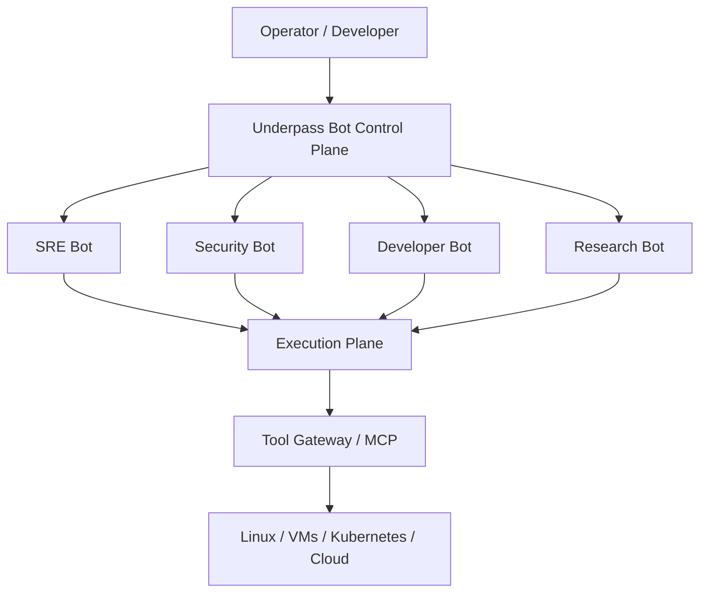
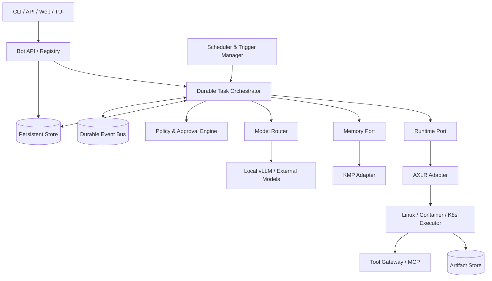
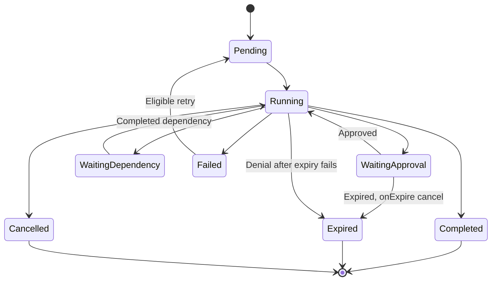
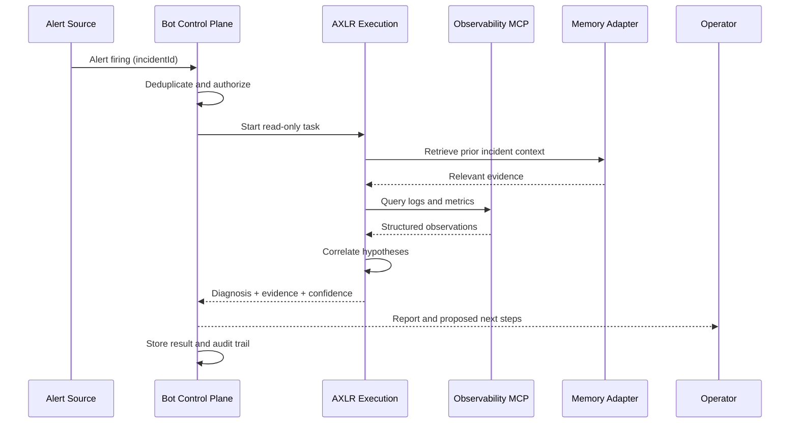

> **Underpass Bots: product and architecture vision** (Spanish), the note of 21 October 2026 that AXLR Bots implements; copied as written, section numbers are those the other pages cite.

# Underpass Bots

## Infrastructure-Native Autonomous Agents

**Documento de visión de producto y arquitectura — Propuesta conceptual**  
**Fecha:** 21 de octubre de 2026  
**Estado:** Visión y diseño preliminar; no implica funcionalidades implementadas  
**Ecosistema:** Underpass · AXLR · KMP · MADE · Jev

> **Underpass doesn't just run AI agents. It makes agents part of the infrastructure.**

---

## 1. Resumen ejecutivo

**Underpass Bots** propone transformar los agentes de IA en **recursos persistentes y gobernables de infraestructura**, desplegables en servidores Linux, máquinas virtuales, contenedores y Kubernetes. En vez de concebir un agente como una sesión conversacional efímera, el bot se define como una entidad con **identidad, responsabilidad permanente, capacidades, permisos, memoria, disparadores y ciclo de vida propio**.

Un bot puede existir sin estar ejecutando un proceso continuamente. Cuando recibe trabajo —un evento, una programación, una petición humana o una delegación de otro bot— la plataforma activa una ejecución en un runtime, aplica las políticas, almacena el estado y conserva las evidencias. Al terminar, la ejecución desaparece o queda suspendida, pero **el bot continúa existiendo**.

La propuesta se inspira en la tendencia de los agentes persistentes —entre ellos Grok Bot y proyectos abiertos similares—, sin pretender reproducir ninguna implementación propietaria. El objetivo diferencial de Underpass es llevar la autonomía al plano de infraestructura: **self-hosted, interoperable, auditable, con modelos intercambiables y capaz de ejecutarse sin una interfaz de chat**.

### Hipótesis central

> Del mismo modo que hoy desplegamos un servicio, un worker o una base de datos, deberíamos poder **declarar, instalar, operar, supervisar, actualizar y retirar un bot autónomo** como parte de la plataforma.

### Resultado buscado

Que un operador pueda definir «necesito un bot SRE en este servidor» y obtener un componente que:

1. Conozca su función, alcance y límites.
2. Se active ante eventos relevantes o según una programación.
3. Utilice herramientas autorizadas (MCP, APIs, CLI o herramientas especializadas).
4. Mantenga memoria contextual y evidencias de ejecuciones anteriores.
5. Se coordine con otros bots sin perder trazabilidad ni autoridad.
6. Sea detenible, auditable y recuperable tras fallos.
7. Consuma recursos de forma proporcional al trabajo real.

---

## 2. Problema que queremos resolver

Las soluciones de agentes se centran frecuentemente en uno de estos modelos:

- **Chat-centric:** el agente nace alrededor de una conversación y de la presencia del usuario.
- **Task-centric:** un proceso o API ejecuta una tarea puntual y termina, sin identidad operacional persistente.
- **Framework-centric:** el desarrollador compone prompts y herramientas, pero debe resolver por su cuenta despliegue, estado, seguridad, escalado y observabilidad.

Esto produce varios problemas cuando se pretende operar agentes como infraestructura:

- **Ciclo de vida difuso:** no existe una noción operativa clara de alta, estado, suspensión, migración, versión y baja de un bot.
- **Acoplamiento:** memoria, runtime, scheduler, herramientas y UI aparecen combinados en un único proceso o framework.
- **Recuperación frágil:** tareas largas fallan cuando se reinicia el proceso o desaparece el contenedor.
- **Seguridad insuficiente:** las instrucciones del LLM se confunden con mecanismos reales de autorización.
- **Costes difíciles de controlar:** los agentes pueden mantener procesos o consumir tokens sin presupuestos ni límites.
- **Poca interoperabilidad:** dificultad para utilizar distintos modelos, proveedores, entornos de ejecución y herramientas.
- **Ausencia de operaciones de plataforma:** no hay equivalentes maduros de health checks, políticas, eventos, cuotas, auditoría y gestión declarativa.

**Oportunidad:** definir una capa de plataforma que trate al bot como un recurso operacional, no como un prompt dentro de un chat.

---

## 3. Tesis de producto y diferenciación

### 3.1. Qué es Underpass Bots

Una plataforma para **crear, desplegar y operar bots autónomos persistentes dentro de la infraestructura del usuario**, con ejecución bajo demanda y seguridad verificable.

### 3.2. Qué NO es

- No es otro proveedor de modelos fundacionales.
- No es un clon de una interfaz de agentes conversacionales.
- No es un scheduler de prompts disfrazado de plataforma.
- No es obligatorio que cada bot tenga su propia máquina virtual o su propio modelo cargado.
- No obliga a utilizar Kubernetes, KMP, MADE o Jev para tareas sencillas.
- No concede permisos de administrador al modelo por el mero hecho de desplegarlo en un servidor.

### 3.3. Diferenciadores aspiracionales

| Dimensión | Posicionamiento de Underpass Bots |
|---|---|
| **Infrastructure-native** | Recurso operativo declarativo, con identidad, versión, políticas y estados observables. |
| **Self-hosted first** | Despliegue en Linux y Kubernetes, sin dependencia obligatoria de infraestructura externa. |
| **Headless first** | API y eventos antes que interfaz gráfica; chat y TUI son clientes, no el núcleo. |
| **Runtime-neutral** | AXLR como ejecución preferente, mediante una interfaz que permita otros runtimes. |
| **Model-neutral** | LLM local o remoto según capacidad, coste, latencia y política de datos. |
| **Policy-driven** | Permisos efectivos independientes del prompt y de la decisión del LLM. |
| **Durable by design** | Tareas recuperables, deduplicación y gestión explícita de fallos. |
| **Composable** | MCP, integraciones de infraestructura, memoria y coordinación opcionales. |
| **Observable** | Costes, traces, acciones y decisiones correlacionadas end-to-end. |
| **Federation-ready** | Posibilidad futura de coordinación entre servidores sin un control plane único obligatorio. |

**Advertencia de alcance:** estos diferenciadores son objetivos de producto y arquitectura; requieren implementación y validación.

---

## 4. Principios arquitectónicos

1. **Bot ≠ Task ≠ Execution ≠ Sandbox.** Cada concepto tiene identidad y ciclo de vida independientes.
2. **Persistencia lógica, ejecución efímera por defecto.** La existencia de un bot no exige un proceso residente permanente.
3. **Control Plane separado de Execution Plane.** Registro, políticas, scheduling y estado no pertenecen al bucle de inferencia.
4. **Fail closed.** Las acciones no autorizadas se bloquean aunque el modelo las solicite.
5. **Estado durable, efectos explícitos.** Reanudar tareas no equivale a repetir operaciones externas sin control.
6. **Modelo y herramientas sustituibles.** Dependencias externas tras puertos definidos y testeables.
7. **Mínimo privilegio.** Identidad y permisos por tenant, bot, tarea y ejecución.
8. **Conocimiento con procedencia.** Memorias y evidencias contienen origen, alcance, fecha y reglas de expiración.
9. **Observabilidad como contrato de producto.** Toda acción puede trazarse a bot, tarea, decisión y resultado.
10. **Progressive autonomy.** Los permisos aumentan solo tras validación operativa, no mediante promesas de un prompt.
11. **Simplicidad primero.** Una sola tarea debe ejecutarse con un runtime ligero sin obligar a desplegar todo el ecosistema.
12. **Portabilidad.** La misma definición lógica debe funcionar en servidor único, VM o Kubernetes, con adaptadores específicos.
13. **El operador se siente al mando: bots automáticos y a la vez controlables.** Un bot puede ser automático (trabaja solo dentro de su política), manual (actúa solo cuando la persona se lo pide) o automático e interactivo (trabaja solo y la persona puede hablar con él mientras trabaja, preguntarle qué hace y reorientarlo). En los tres casos la persona puede ver, frenar, retirar o cambiar su autonomía en cualquier momento. Todo lo que el control plane permite hacer se puede hacer desde el panel: crear y cambiar bots y grupos, dar órdenes en lenguaje llano, aprobar o denegar, parar o retirar un bot al momento, y ver qué hace cada bot y por qué. Con respuesta inmediata y estado en vivo. La API sigue siendo el núcleo (*headless first*); el panel es la forma en que una persona lo controla.

---

## 5. Concepto fundamental: bots como recursos de infraestructura

Un bot es una **entidad persistente** definida por su responsabilidad y sus contratos operacionales.



### 5.1. Componentes del bot

| Campo conceptual | Responsabilidad |
|---|---|
| **Identity** | Identificador, tenant, nombre, propietario y versión. |
| **Mission** | Responsabilidad declarativa, objetivos y límites funcionales. |
| **Capabilities** | Herramientas, skills y tipos de operaciones accesibles. |
| **Policies** | Autorización, aprobaciones, scopes, límites y presupuestos. |
| **Triggers** | Mensajes, eventos, calendarios, webhooks y delegaciones. |
| **Memory** | Conocimiento persistente autorizado y contexto de trabajo. |
| **RuntimeProfile** | Motor de agente, sandbox y requisitos de ejecución. |
| **ModelPolicy** | Proveedor, selección de modelo, límites y fallback. |
| **Status** | Estado deseado, observado y condiciones de salud. |
| **Audit** | Historial de versiones, tareas, acciones y resultados. |

### 5.2. Distinción de identidades

- **Bot:** sujeto persistente responsable de una función.
- **Task:** trabajo concreto con objetivo, contexto y plazo.
- **Execution:** intento concreto de realizar una tarea, con resultados y métricas.
- **Sandbox:** entorno computacional que ejecuta herramientas y código.
- **Routine:** política de activación recurrente o por evento.
- **Skill:** procedimiento reutilizable, versionado y, preferiblemente, verificable.
- **Artifact:** resultado persistente: informe, diff, archivo, evidencia o dataset.

**Invariante:** un bot puede tener cero o muchas tareas; una tarea puede requerir varios intentos de ejecución; un sandbox puede ser efímero o persistente. Ninguna de estas identidades debe confundirse con el proceso del sistema operativo.

---

## 6. Arquitectura de referencia



### 6.1. Control Plane

**Responsabilidades:**

- Registro y versionado de bots.
- Validación y reconciliación del estado deseado.
- Recepción de comandos/eventos de activación.
- Planificación, colas y asignación de tareas.
- Persistencia del estado y recuperación tras fallos.
- Gestión de políticas, aprobaciones y presupuestos.
- Identidad, tenancy y auditoría.

El Control Plane **no debe** contener el razonamiento de los modelos ni ejecutar comandos arbitrarios en el host.

### 6.2. Execution Plane

**Responsabilidades:**

- Crear y destruir ejecuciones.
- Arrancar AXLR u otro runtime compatible.
- Proporcionar acceso a herramientas autorizado.
- Aplicar límites de recursos, tiempo y red.
- Persistir checkpoints y artefactos.
- Emitir telemetría y resultados.

### 6.3. Puertos arquitectónicos propuestos

- `BotRepository`
- `TaskRepository`
- `EventPublisher`
- `TaskScheduler`
- `RuntimeExecutor`
- `ModelGateway`
- `MemoryPort`
- `ToolGateway`
- `PolicyDecisionPoint`
- `ApprovalRepository`
- `ArtifactRepository`
- `AuditSink`

Se definen contratos antes de elegir implementaciones; los adaptadores pueden ser HTTP, gRPC, NATS, PostgreSQL, APIs del runtime o Kubernetes.

---

## 7. Integración con el ecosistema Underpass

La arquitectura debe reutilizar productos existentes **sin presuponer interfaces ya implementadas**. Cada integración se trata aquí como una propuesta sujeta a revisión del repositorio actual.

| Proyecto | Rol propuesto | Condición importante |
|---|---|---|
| **AXLR** | Runtime ligero de ejecución del agente y coordinación de tools. | No introducir el Control Plane dentro del runtime. |
| **KMP** | Memoria semántica/episódica y recuperación contextual. | Acceso por interfaz opcional, con permisos y procedencia. |
| **MADE** | Diseño de ceremonias o colaboraciones complejas. | No intervenir en ejecuciones simples. |
| **Jev** | Evaluación, experimentación y optimización de ejecución/costes. | Operar inicialmente fuera del camino crítico del bot. |
| **MCPs** | Conexión con sistemas, datos y acciones reales. | Tool gateway obligatorio para autorización y auditoría. |
| **NATS** | Distribución de tareas/eventos y comunicación asíncrona. | Consumer idempotente y estado durable independiente. |
| **vLLM** | Inferencia self-hosted de modelos compatibles. | Selección y límites mediante Model Router. |

### 7.1. Papel de AXLR

AXLR debería ser capaz de ejecutar una unidad de trabajo con:

- Contexto de entrada con límites de tokens.
- Catálogo de herramientas filtradas por política.
- Modelo seleccionado por el router.
- Límites de tiempo, tokens, llamadas y delegación.
- Emisión de eventos estructurados y resultados.
- Interrupción, cancelación y checkpoints definidos.

El Control Plane gestiona **cuándo, dónde, con qué identidad y bajo qué permisos** se invoca AXLR; AXLR gestiona **cómo un agente razona y usa herramientas**.

### 7.2. Papel de KMP

Separar memoria en:

- **Working memory:** información temporal de una ejecución.
- **Episodic memory:** historial de tareas, eventos, errores y resultados.
- **Semantic memory:** conocimiento consolidado con contexto, relaciones y procedencia.

No mezclar recuerdos de diferentes tenants ni permitir que documentos externos adquieran autoridad como instrucciones permanentes.

### 7.3. Papel de MADE y Jev

MADE puede proponer y ejecutar colaboraciones multiagente solo cuando su valor compense el coste. Jev puede comparar estrategias, presupuestos y resultados mediante harnesses de evaluación. El MVP **no depende** de que estén presentes.

---

## 8. Flujo de vida y ejecución

### 8.1. Ciclo de vida del bot

Estados lógicos propuestos:

`Draft → Registered → Enabled ↔ Paused → Decommissioning → Deleted`

El estado del bot **no refleja necesariamente** si hay un proceso ejecutándose. Un bot `Enabled` puede no tener ejecuciones activas.

### 8.2. Ciclo de vida de una tarea



### 8.3. Flujo operativo

1. Un evento externo, comando o rutina solicita una tarea para el bot.
2. El Control Plane valida identidad, alcance, quotas e idempotencia.
3. Se crea la tarea y se persiste junto con el evento de activación.
4. El orquestador asigna el trabajo a un executor compatible.
5. Se recupera contexto autorizado y se instancia AXLR.
6. Toda tool call pasa por autorización y validación de parámetros.
7. Si existe aprobación pendiente, se guarda el estado y se libera la ejecución cuando proceda.
8. Se almacenan evidencias, telemetría, outputs y checkpoints.
9. Se verifica el resultado y se publica el evento final.
10. El bot continúa registrado y disponible para el próximo trabajo.

### 8.4. Durabilidad

La ejecución durable exige:

- **Idempotency key** por tarea y por operación externa sensible.
- **Optimistic locking** o equivalente para transiciones de estado.
- **Lease con fencing token** para evitar propietarios simultáneos tras particiones.
- **Transactional outbox** si se utiliza base de datos + broker.
- **Reintentos acotados** con backoff, clasificación de errores y DLQ.
- **Checkpoints** en fronteras recuperables, no instantáneas arbitrarias del razonamiento.
- **Compensaciones** para efectos que no puedan revertirse automáticamente.

**Nota:** la entrega *at least once* del bus exige idempotencia; no existe garantía universal de *exactly once* sobre APIs externas.

---

## 9. Modos de despliegue

### 9.1. Servidor Linux único: primer objetivo

**Perfil recomendado para el MVP.** Control Plane y executor en una máquina con almacenamiento local durable (por ejemplo, SQLite para un modo estrictamente mononodo, o PostgreSQL si se prevé evolución) y runtime AXLR en proceso/contenedor aislado.

- Instalación simple.
- Bots definidos por configuración y API.
- Systemd para la supervivencia del servicio de plataforma.
- Sandbox ligero por tarea.
- Triggers de sistema, webhooks y planificaciones.
- Sin necesidad de Kubernetes.

**Importante:** persistencia local de metadatos y estado no equivale automáticamente a tolerancia a pérdida del servidor. Se requiere backup y restauración verificable.

### 9.2. Contenedores y Docker/Podman

El Control Plane es un servicio estable; cada ejecución se realiza con una identidad de proceso, filesystem y límites de recursos definidos. Los volúmenes del bot son explícitos y las credenciales no se comparten por defecto.

### 9.3. Kubernetes

El Bot Registry mantiene el dominio; un operador o adaptador puede traducir el estado deseado en recursos Kubernetes.

Posibles recursos declarativos futuros:

- `Bot`
- `BotRoutine`
- `BotPolicy`
- `BotExecution`

No deben introducirse CRDs en el MVP si un servicio convencional resuelve el problema. Kubernetes no sustituye al motor de estados, permisos o memoria.

### 9.4. Bots federados entre servidores: futura diferenciación

Múltiples nodos Underpass pueden anunciar **capabilities**, disponibilidad y restricciones para que un Control Plane o una federación asignen trabajo.

Requiere previamente:

- Identidad y autenticación mutua entre nodos.
- Delegación y scopes verificables.
- Descubrimiento y revocación de capacidades.
- Cifrado en tránsito y segmentación de red.
- Control de la localización de datos y ejecución.
- Resistencia a particiones y reintentos.

**No incluir federación en el MVP**: es un objetivo estratégico posterior, no un requisito de la primera demostración.

---

## 10. Seguridad y modelo de confianza

### 10.1. Regla no negociable

> **El LLM puede proponer una acción, pero nunca es la autoridad que concede el permiso para ejecutarla.**

### 10.2. Evaluación de cada herramienta

La decisión de ejecución debe considerar:

- `tenant_id`, `bot_id`, `task_id`, `execution_id`.
- Identidad del solicitante original y delegaciones vigentes.
- Herramienta, operación y parámetros normalizados.
- Recurso objetivo, entorno y sensibilidad.
- Perfil de riesgo, presupuesto y ventana temporal.
- Política efectiva y aprobación humana requerida.

**Deny by default** para operaciones no declaradas, cambios en producción y cualquier escalada de privilegios.

### 10.3. Controles mínimos

- Separación de permisos de lectura y escritura.
- Tokens de corta duración y credenciales por ámbito.
- No exponer secretos al contexto del modelo salvo necesidad estrictamente controlada.
- Aislamiento del filesystem, procesos y red de los sandboxes.
- Restricciones de egress hacia Internet y redes internas.
- Revisión de operaciones destructivas.
- Tiempo y presupuesto máximos por tarea.
- Límite de profundidad y presupuesto de delegación.
- Protección frente a *prompt injection* y *memory poisoning*.
- Logging con redacción de secretos e información sensible.
- Auditoría inmutable o resistente a manipulación para acciones críticas.

### 10.4. Niveles de autonomía

| Nivel | Permisos | Uso recomendado |
|---|---|---|
| **Observe** | Herramientas read-only autorizadas. | Primer MVP, inspección y diagnóstico. |
| **Propose** | Observación y generación de plan/diff. | Cambio revisado por humanos. |
| **Act-with-approval** | Escrituras específicas aprobadas. | Automatizaciones empresariales controladas. |
| **Act-within-policy** | Escrituras de bajo riesgo acotadas por política. | Automatización madura con pruebas y monitorización. |

La subida de nivel exige evidencias operativas, límites explícitos y posibilidad de revocación.

---

## 11. Modelo declarativo de un bot

**Ejemplo ilustrativo:** sintaxis propuesta; no es un CRD ni una API implementada.

```yaml
apiVersion: underpass.ai/v1alpha1
kind: Bot
metadata:
  name: server-incident-investigator
  namespace: engineering
spec:
  identity:
    role: "Diagnose server and application incidents"
    owner: "platform-team"

  runtime:
    engine: axlr
    executionMode: ephemeral
    sandboxProfile: restricted
    maxConcurrentTasks: 2

  model:
    routingPolicy: cost-optimized
    allowRemoteProviders: false
    maxContextTokens: 32000

  triggers:
    - type: event
      source: observability.alert.firing
    - type: manual

  tools:
    allow:
      - observability.query_logs
      - observability.query_metrics
      - kubernetes.get_pods
      - kubernetes.get_events

  memory:
    scope: bot
    retentionDays: 90

  policies:
    defaultAction: deny
    productionWrites: forbidden
    requireApprovalForWrites: true

  budgets:
    maxModelCallsPerTask: 20
    maxToolCallsPerTask: 60
    maxDelegationDepth: 2
    taskTimeoutSeconds: 900
```

### 11.1. API lógica mínima

```text
POST   /v1/bots
GET    /v1/bots
GET    /v1/bots/{botId}
PATCH  /v1/bots/{botId}
POST   /v1/bots/{botId}/tasks
GET    /v1/tasks/{taskId}
GET    /v1/tasks/{taskId}/executions
POST   /v1/tasks/{taskId}/cancel
GET    /v1/bots/{botId}/events
```

No se incluyen rutas de aprobación ni federación hasta definir formalmente su modelo de autenticación, autorización, estados y revocación.

### 11.2. Ejemplo de evento

```json
{
  "eventId": "evt-123",
  "type": "bot.task.assigned",
  "tenantId": "underpass",
  "botId": "server-incident-investigator",
  "taskId": "task-789",
  "correlationId": "trace-abc",
  "createdAt": "2026-10-21T15:00:00Z",
  "payload": {
    "objective": "Investigate an HTTP 500 spike",
    "environment": "staging",
    "readOnly": true
  }
}
```

El evento debe incluir versión de esquema en una implementación real y disponer de mecanismos para deduplicación y validación de autenticidad.

---

## 12. Caso de uso de referencia: Server Incident Bot

### 12.1. Objetivo

Un bot residente **lógicamente** en un servidor o plataforma que investiga incidentes de forma autónoma sin modificar producción.

### 12.2. Flujo de demostración



### 12.3. Evidencias que debe producir

- Alerta inicial y timestamps.
- Servicios implicados y dependencias identificadas.
- Consultas ejecutadas y fuentes de cada dato.
- Logs y métricas relevantes con referencias y ventanas temporales.
- Hipótesis ordenadas por evidencia, no solo por seguridad aparente del LLM.
- Acciones propuestas, sin ejecución de cambios en producción.
- Traza completa y costes de inferencia/ejecución.

### 12.4. Por qué es un buen primer bot

Reutiliza herramientas MCP de observabilidad; aporta un caso de uso tangible; permite iniciar en modo **read-only**; ofrece indicadores objetivos de calidad; y demuestra la persistencia del bot sin requerir un ordenador gráfico.

---

## 13. Roadmap propuesto

### Fase 0 — Contratos y prueba técnica

**Entregables:** modelo de dominio, contratos runtime/task/tool, alcance de seguridad y un POC local con una tarea.

**Salida:** demostrar que el bot persistente y la ejecución AXLR son entidades separadas.

### Fase 1 — MVP en un solo servidor

- Registro y administración de bots.
- Scheduler básico y ejecución manual.
- Persistencia de tareas y estados.
- AXLR adapter.
- Herramientas MCP read-only.
- Políticas estáticas `allow/deny`.
- Logs, métricas y artefactos.
- Recuperación tras reinicio del servicio.

**Salida:** `Server Incident Bot` operativo de extremo a extremo en un único host.

### Fase 2 — Durabilidad y autonomía gobernada

- Idempotencia robusta y leases.
- Aprobaciones durables.
- Retries controlados, cancelación y deadlines.
- Memoria persistente con integración KMP opcional.
- Presupuestos y evaluación de resultados.

**Salida:** ejecuciones de larga duración recuperables y auditables sin acciones privilegiadas no autorizadas.

### Fase 3 — Kubernetes y colaboración

- Executor Kubernetes y perfiles de sandbox.
- Placement y cuotas por nodo/tenant.
- Delegación de tareas bot-a-bot.
- Coordinación asíncrona con NATS.
- Skills versionadas y catálogo interno.

**Salida:** múltiples bots colaboran y escalan sin depender de un único proceso.

### Fase 4 — Producto y diferenciación

- UI/TUI de administración.
- Catálogo de bots y plantillas.
- Skills enseñables/replicables con harnesses.
- Optimización de estrategias y costes con Jev.
- MADE para workflows complejos.
- Evaluación de federación entre servidores.

**Salida:** plataforma reutilizable por desarrolladores, equipos de plataforma y operadores.

---

## 14. Criterios de aceptación del MVP

El MVP solo se considerará técnicamente validado cuando cumpla **todos** los siguientes criterios:

1. **Persistencia:** un bot registrado sigue existiendo tras reiniciar el servicio.
2. **Activación:** una tarea puede iniciarse por API y por al menos un disparador automático.
3. **Ejecución:** AXLR recibe configuración, contexto y tools autorizadas y produce un resultado estructurado.
4. **Aislamiento:** dos bots no pueden leer memoria ni artefactos del otro sin permiso explícito.
5. **Autorización:** una herramienta no permitida es bloqueada fuera del razonamiento del modelo.
6. **Recuperación:** un proceso interrumpido no deja indefinidamente una tarea marcada como `Running`; el estado se reconcilia o la tarea falla de forma explícita.
7. **Idempotencia:** reentregar el evento de activación no genera efectos externos duplicados.
8. **Observabilidad:** una ejecución puede reconstruirse por `botId`, `taskId` y `traceId`.
9. **Presupuestos:** las cuotas de tiempo y llamadas se cumplen incluso ante herramientas fallidas.
10. **Portabilidad:** el modo mononodo no depende de Kubernetes.
11. **No regresión:** pruebas automatizadas verifican contratos, errores y escenarios límite.
12. **Seguridad inicial:** no se ejecutan cambios en producción en el escenario de demostración.

### Pruebas de fallo obligatorias

| Escenario | Resultado esperado |
|---|---|
| Se reinicia el Control Plane | Se reconstruye el estado desde almacenamiento persistente. |
| Muere el executor | La tarea se recupera de forma segura o queda fallida con diagnóstico. |
| Se duplica el evento de activación | Se deduplica por identidad de evento o clave idempotente. |
| Una tool tarda indefinidamente | Se aplica timeout y se libera la capacidad de ejecución. |
| Un modelo solicita un comando prohibido | La capa de políticas lo rechaza. |
| Llega una aprobación caducada | No autoriza la operación. |
| Una respuesta MCP incluye instrucciones hostiles | Se trata como dato no confiable. |
| Se pierde conexión con el bus | No se pierde silenciosamente el estado persistido. |
| Se produce una delegación circular | Se corta por presupuesto y profundidad. |
| Se intenta acceder a secretos ajenos | Se deniega y se registra el intento sin exponerlos. |

---

## 15. Riesgos, trade-offs y decisiones pendientes

### 15.1. Riesgos de arquitectura

| Riesgo | Impacto | Mitigación |
|---|---|---|
| Plataforma demasiado extensa desde el inicio | Alto | MVP mononodo y contratos mínimos. |
| Acoplamiento de AXLR al scheduler o Kubernetes | Alto | Runtime Port y control plane externo. |
| Reejecución de acciones externas | Alto | Idempotencia, leases, outbox, compensaciones. |
| Escalada de privilegios vía tool calling | Crítico | Policy Engine determinista, sandbox y mínimos permisos. |
| Contaminación de memoria entre bots | Alto | Ámbitos, procedencia, controles de acceso y expiración. |
| Costes imprevisibles de inferencia | Medio/alto | Model Router, cuotas y evaluación de valor. |
| Fragmentación entre MADE/KMP/Jev | Medio/alto | Integraciones opcionales y contratos versionados. |
| Dependencia de un único proveedor | Medio | Abstracciones de runtime, modelo y herramientas. |
| Complejidad de operación de microVMs | Medio/alto | Comenzar con sandbox acotado en laboratorio. |

### 15.2. Decisiones que requieren ADR

1. Persistencia inicial: SQLite mononodo frente a PostgreSQL desde la fase 1.
2. Cola/orquestación: NATS JetStream + motor propio mínimo frente a Temporal.
3. Granularidad de identidad y autorización: bot, tarea, ejecución y humano delegante.
4. Sandbox MVP: proceso restringido, contenedor rootless o microVM.
5. Checkpointing: granularidad y recuperación de operaciones no idempotentes.
6. Contrato de comunicación de AXLR: gRPC, proceso local o protocolo sobre streams.
7. Contrato y versionado de skills.
8. Política de retención, cifrado y eliminación de memorias/artefactos.
9. Multi-tenancy: incluida de inicio en el dominio, aunque el primer deployment sea single-tenant.
10. Estrategia de federación y discovery, diferida a una fase posterior.

---

## 16. Validación de propuesta de valor

La diferenciación debe medirse, no asumirse. Probar con desarrolladores y operadores si Underpass Bots resuelve problemas reales:

- **Time to first bot:** tiempo desde instalación hasta primera tarea autónoma con un MCP.
- **Recovery rate:** porcentaje de tareas recuperadas correctamente tras fallos inducidos.
- **Security enforcement:** porcentaje de acciones prohibidas efectivamente bloqueadas.
- **Cost per resolved task:** recursos y tokens por resultado útil.
- **Operational overhead:** cantidad de componentes que exige el despliegue mononodo.
- **Diagnostic usefulness:** evaluaciones humanas de informes con evidencia suficiente.
- **Developer adoption:** instalaciones activas, bots creados y casos de uso completados.

### Pregunta comercial central

**¿Por qué usar Underpass Bots en vez de un cronjob que invoca un LLM o un framework agentic existente?**

Porque, si la hipótesis se valida, Underpass proporciona un **sistema operativo de agentes**: identidades persistentes, políticas verificables, eventos, memoria, recuperación, trazabilidad y portabilidad como capacidades comunes. La propuesta solo tiene valor si esa plataforma es sensiblemente más fácil de operar y más fiable que implementar cada bot desde cero.

---

## 17. Narrativa de producto

### Mensaje corto

**Deploy bots like services. Give them responsibilities, not just prompts.**

### Mensaje ampliado

Underpass Bots turns autonomous AI agents into infrastructure-native resources. Define their responsibilities, grant explicit capabilities, attach memory, connect tools, and let them react to events — on your own servers, with your own models and operational policies.

### Promesa técnica

**Persistent identity. Ephemeral execution. Governed autonomy. Self-hosted infrastructure.**

### Visión de largo plazo

Una infraestructura en la que los bots no son únicamente consumidores de recursos: **participan en la observabilidad, investigación, mantenimiento, seguridad y evolución controlada de los propios sistemas**.

---

## 18. Próximo experimento recomendado

**Construir un solo Bot SRE read-only, instalado en Linux, activado por una alerta simulada y ejecutado mediante AXLR.**

**Demostración mínima:**

1. Registrar el bot y visualizar su estado.
2. Reiniciar el servicio y comprobar que permanece registrado.
3. Publicar una alerta con `incidentId`.
4. Activar una ejecución AXLR con acceso solamente a dos MCPs de observabilidad.
5. Obtener un informe de diagnóstico con enlaces a evidencias.
6. Repetir la alerta y verificar la deduplicación.
7. Inyectar un fallo de executor y observar recuperación o fallo explícito.
8. Intentar ejecutar una tool prohibida y confirmar el rechazo del Policy Engine.
9. Inspeccionar tiempos, trazas, consumo de tokens y coste.

**Criterio de éxito de producto:** que otro desarrollador pueda instalar el sistema, declarar el bot y reproducir el experimento sin conocer el funcionamiento interno de Underpass.

---

## 19. Autoverificación de la propuesta

### Completitud

- [x] Define el problema, la tesis y la propuesta de valor.
- [x] Distingue dominio, control plane, ejecución y sandbox.
- [x] Establece el papel propuesto de AXLR, KMP, MADE y Jev.
- [x] Describe servidor único, contenedores y Kubernetes.
- [x] Incluye seguridad, durabilidad, operativa, MVP y criterios de aceptación.
- [x] Separa visión futura y alcance inicial.

### Corrección y límites

- [x] No equipara persistencia de bot con proceso siempre activo.
- [x] No presupone permisos concedidos por el prompt.
- [x] No presenta el YAML, API ni integraciones como código ya implementado.
- [x] No asume semántica exactly-once sobre herramientas externas.
- [x] No impone Kubernetes, federación o memoria avanzada al primer MVP.
- [ ] **Pendiente:** contrastar interfaces reales de AXLR, KMP, MADE y Jev con sus repositorios actuales.
- [ ] **Pendiente:** benchmark de latencia, coste, recuperación y aislamiento en un entorno de pruebas.
- [ ] **Pendiente:** threat model formal y revisión de decisiones de persistencia/sandbox.

### Estado final

**Documento de visión suficientemente delimitado para comenzar una fase de arquitectura y experimentación. No constituye validación técnica de la implementación.**

---

## 20. Idea condensada

> **Underpass Bots** es una capa de infraestructura para desplegar agentes autónomos persistentes con identidad, responsabilidad, memoria, herramientas y permisos. El bot existe como recurso lógico mientras sus ejecuciones son aisladas, recuperables y activadas bajo demanda. AXLR aporta el runtime ligero; KMP, MADE y Jev se integran mediante contratos cuando aportan valor. La plataforma está pensada para servidores propios y Kubernetes, con autonomía gobernada y observabilidad nativa. Su primer objetivo es demostrar que un bot SRE puede vivir en la infraestructura, reaccionar a incidentes y producir diagnósticos fiables sin depender de una conversación.
