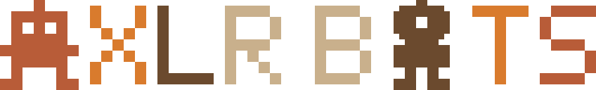

# AXLR Bots identity

<p align="center"></p>

The emblem is the mark the README uses, in the Underpass pixel Emblem style of the KMP, MADE and AXLR emblems: 2-pixel strokes on a 16-row grid, one colour per letter from AXLR's palette (copper `#B85C38`, gold `#D97B2D`, brown `#6B4A2E`, sand `#C9B08C`), BOTS in the same palette reversed. The A of AXLR is an invader bot and the O of BOTS a one-eye bot. The background is transparent and the colours read on light and dark alike, so one file serves both. There are no Spectrum bars in any AXLR Bots mark.

| Mark | Files | Size | Use |
|---|---|---|---|
| Emblem, one line | `assets/brand/axlr-bots-emblem.{svg,png}` | 848 × 128 | the README's head, the organisation profile, anywhere the name must read at a glance |
| Emblem, two lines | `assets/brand/axlr-bots-emblem-stacked.{svg,png}` | 400 × 272 | square places: cards, avatars with room for the name |
| Icon | `assets/brand/axlr-bots-icon.{svg,png}` | 112 × 128 | the one-eye bot alone, for favicons and small squares |

Preserve each asset's aspect ratio. For text-only contexts, write **AXLR Bots**. Decided with the author on 24 October 2026.

## Source and regeneration

`assets/brand/emblem.py` is the one source: the grid, the font, the two bots and the palette. It writes the six files beside itself (SVG always, PNG through Pillow):

```bash
python3 docs/assets/brand/emblem.py
```

Change the script, not the exports.
