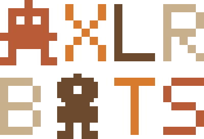

# AXLR Bots identity

<p align="center"></p>

The official mark is the stacked emblem: two lines, AXLR over BOTS, in the Underpass pixel Emblem style of the KMP, MADE and AXLR emblems (2-pixel strokes on a 16-row grid). AXLR is set in its palette, one colour per letter, copper `#B85C38`, gold `#D97B2D`, brown `#6B4A2E` and sand `#C9B08C`; BOTS takes the same palette reversed. The A of AXLR is an invader bot and the O of BOTS a one-eye bot. The background is transparent and the colours work on light and dark alike, so there is one version of each mark and no variants. There are no Spectrum bars in any AXLR Bots mark. Decided with the author on 24 October 2026.

| Mark | Files | Size | Use |
|---|---|---|---|
| Emblem, stacked (official) | `assets/brand/axlr-bots-emblem-stacked.{svg,png}` | 400 × 272 | the README's head, the organisation profile, cards |
| Emblem, one line | `assets/brand/axlr-bots-emblem.{svg,png}` | 848 × 128 | narrow headers where the name must read in one line |
| Icon | `assets/brand/axlr-bots-icon.{svg,png}` | 112 × 128 | the invader alone, for avatars and favicons |

Preserve each asset's aspect ratio. For text-only contexts, write **AXLR Bots**.

## Source and regeneration

`assets/brand/emblem.py` is the one source: the grid, the font, the two bots and the palette. It writes the six files beside itself (SVG always, PNG through Pillow):

```bash
python3 docs/assets/brand/emblem.py
```

Change the script, not the exports.
