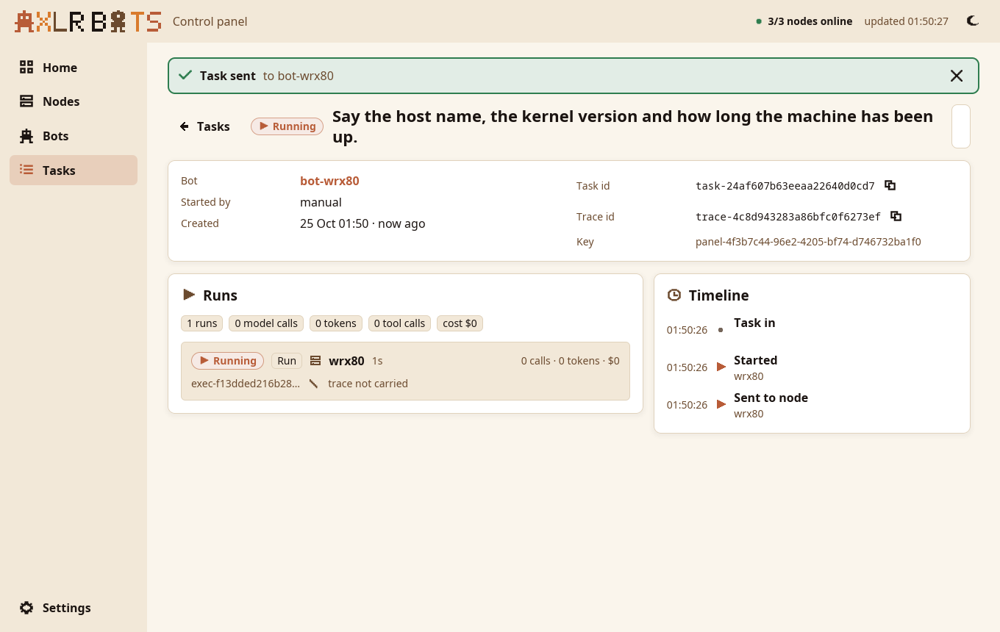
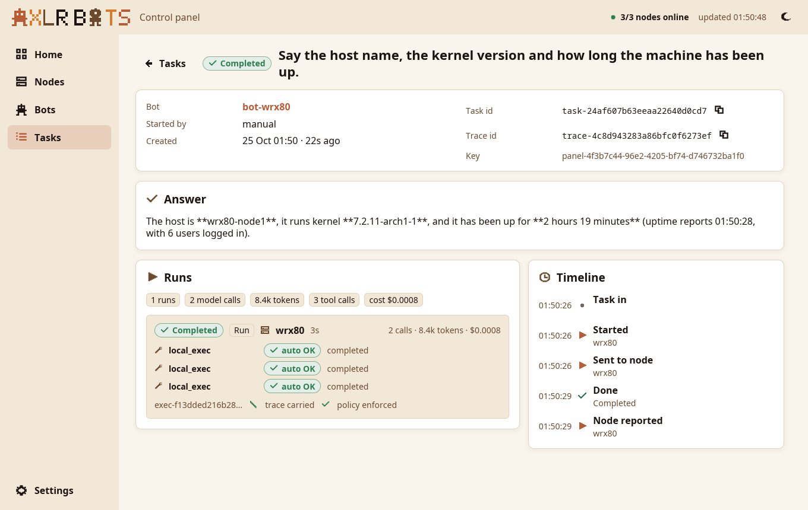
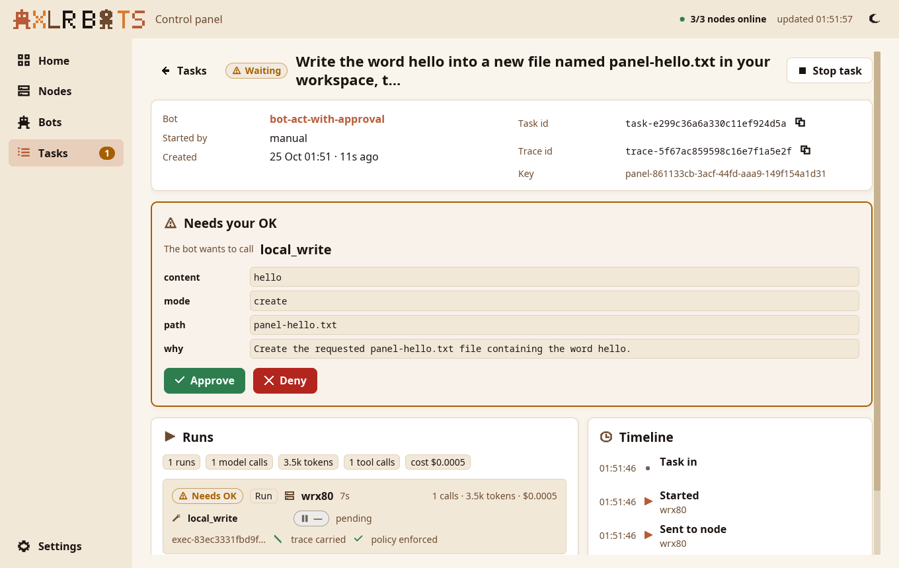
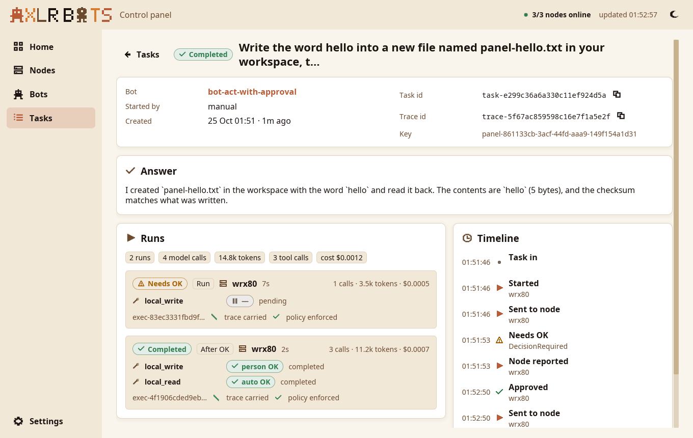

# Live run

The panel against the control plane of one host, on 25 October 2026: `axlr-bots` from the branch of [underpass-ai/axlr-bots#3](https://github.com/underpass-ai/axlr-bots/pull/3) as a user service on `gx10-ff95` (aarch64, X11), with three nodes Online: `gx10-ff95` itself, `wrx80` (x86_64, enrolled over mutual TLS) and `demo-log-service-0` (a node agent beside a service in a pod, joined during the run). Everything below was done by clicking in the panel; the screenshots are the window as it was.

## First run

No `~/.config/axlr-bots-panel/config.toml` yet, so the panel opened **Settings** with the values of this host's `axlr-bots` unit: `https://127.0.0.1:7879`, `~/.local/state/axlr-bots/ca/ca.crt`, `~/.local/state/axlr-bots/api.token`. **Connect** reached the control plane over TLS with the fleet CA alone, saved the file and opened **Home**.

## A task to wrx80

On the page of `bot-wrx80` (placed on `wrx80`), **New task** opened the task form with the bot chosen and a fresh idempotency key, `panel-4f3b7c44-…`. The objective, *Say the host name, the kernel version and how long the machine has been up.*, went with Enter. The panel opened the task at once: Running, the run sent to `wrx80`.

Three seconds later the task was Completed: three `local_exec` calls, each allowed by the bot's tool rules (`auto OK`), the trace id carried by the runtime, the policy enforced, 8.4k tokens, $0.0008. The answer: the host is `wrx80-node1`, kernel `7.2.11-arch1-1`, up 2 hours 19 minutes.

## An approval

`bot-act-with-approval` (level *act-with-approval*, any node) got *Write the word hello into a new file named panel-hello.txt in your workspace, then read it back.* Its run stopped on the write: the task turned **Waiting**, the side bar showed `1` beside Tasks, and the task page showed the call, `local_write`, with its arguments (`content: hello`, `mode: create`, `path: panel-hello.txt`, and the bot's reason).

**Approve** sent the decision; the control plane handed the session to the node with a decide execution, the write ran (`person OK`), the bot read the file back (`auto OK`), and the task completed: two runs, the first `Needs OK`, the second `After OK`, and the timeline from *Task in* to *Approved* and *Done*.

The pending call shows as `asking` in builds after these screenshots; it showed `—` here.

## What the run turned up

- A task of a bot placed on *any node* can land on the sidecar node `demo-log-service-0`, which failed it with `mkdir /var/lib/axlr-node/workspaces/…: permission denied`. The panel shows it as Failed with the reason; the fix belongs to the sidecar's chart.
- `axlrVersion` is empty on all three nodes, so the AXLR column shows `—`: the agents do not report the version yet.
- The control plane's own "today" (`GET /v1/overview` without `since`) is UTC midnight under the user service; the panel always passes the operator's local midnight.

## Both renderers

The window starts with the GPU (`wgpu`) by default and with `ICED_BACKEND=tiny-skia` on the CPU; both drew the same screens on this host.
