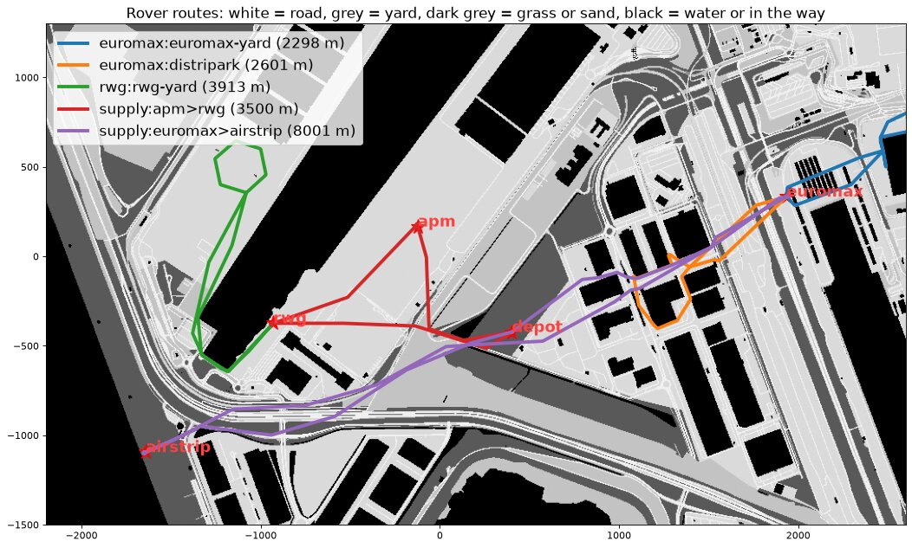
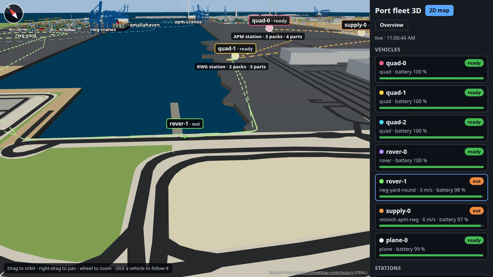
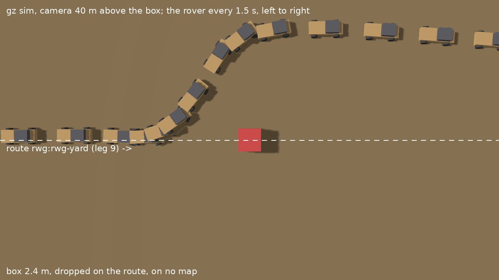
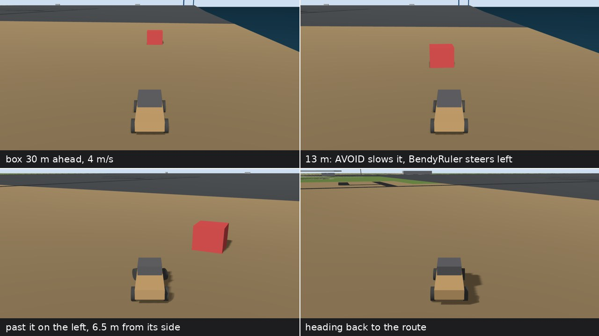
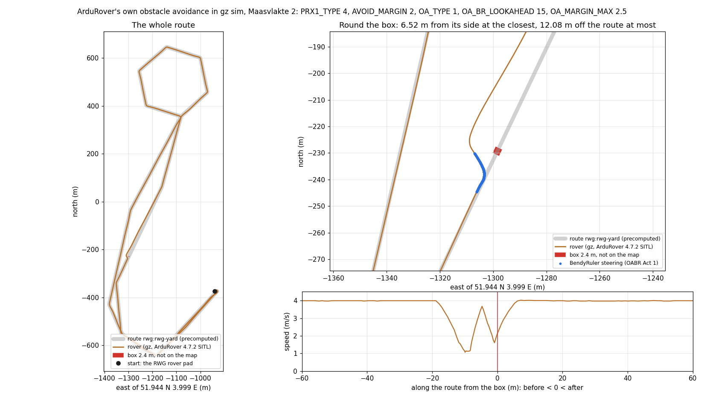

# Runbook: a port's fleet of autonomous vehicles

A fleet of simulated autonomous vehicles at the Port of Rotterdam (Maasvlakte 2), operated by AXLR Bots: quadcopters, ground rovers, a supply rover and a fixed-wing plane, each an ArduPilot 4.7.2 SITL with the node agent as its sidecar, maintenance stations that run out of battery packs and parts, and a live map. Every launch waits for a person's approval in the panel. The chart is [`examples/helm/drone-fleet`](../../examples/helm/drone-fleet), the services and the bots are in [`examples/drone-fleet`](../../examples/drone-fleet).

```text
 operator (panel) ──approve──┐                               flota.<domain> (live map)
                              ▼                                       ▲
 webhook / timer ──▶ fleet-cp (axlr-bots, in the namespace) ◀──mTLS── fleet-base-0: fleet_base.py + axlr-node
                      │  dispatcher, logistics: delegate          │   stations' stock, bays, depot, RTK base
                      ▼                                           │   bots: dispatcher, logistics (observe)
   quad-0..2, rover-0..1, supply-0, plane-0 (one pod per vehicle) ─┘
   ├─ sitl      ArduCopter X / ArduRover / ArduPlane, RTK GPS, lidars, optical flow, camera
   ├─ router    mavlink-router: 5770 for the pilot and anyone else
   ├─ pilot     vehicle_pilot.py, the companion computer: telemetry.json, the limits, MCP run_mission on 127.0.0.1:8765
   └─ axlr-node the sidecar: the bot pilot-<pod> (act-with-approval) and AXLR, whose mcp.json names the pilot's tool
```

## What each piece does

| Piece | Does |
|---|---|
| `dispatcher` bot | reads `fleet.json`, picks the ready vehicles for the zones a mission needs, and delegates one objective to each pilot (`wait: false`) |
| `logistics` bot | reads the stations' stock and sends the supply rover on a delivery run |
| `pilot-<vehicle>` bots | read `telemetry.json`; a quad's or the plane's plans the route in metres from home, a rover's picks one of its precomputed routes; call `run_mission` once: that call waits for a person |
| `vehicle_pilot.py` | refuses a route outside the geofence, the altitude band or the speed range, and a vehicle that is not ready; uploads the mission over MAVLink, launches it, and after landing queues the vehicle at its station: inspection, then a fresh battery pack |
| `fleet_base.py` | polls every vehicle, hands out the bays (a service takes a pack and a part from the station), moves the supply rover's cargo when it reaches a station, writes `fleet.json` for the two bots and serves the map |

The safety limits live in the companion computer, not in the model: a refused route is the tool's error, which the model reads, and nothing moved.

## Before you start

- A cluster with a StorageClass (`local-path` here), an ingress controller and cert-manager for the map, `helm` and `kubectl`.
- The images in a registry the cluster pulls from. On wrx80 they were built with podman and pushed to the lab registry:

```bash
podman build -t $R/fleet-app:0.2.0 examples/drone-fleet                                         # vehicle_pilot.py, fleet_base.py, the map, the 3D view
podman build -t $R/fleet-sitl:4.7.2 examples/drone-fleet/sitl                                    # SITL (checked sha256) + mavlink-router
podman build -f examples/drone-fleet/control-plane.Dockerfile -t $R/control-plane:0.1.0-fleet .  # axlr-bots
```

- The node image of [the sidecar runbook](sidecar.md) and a model provider key.

## 1. Install

```bash
kubectl create namespace port-fleet
grep '^OPENROUTER_API_KEY=' ~/.config/axlr-bots/env | cut -d= -f2- | tr -d '\n' \
  | kubectl -n port-fleet create secret generic fleet-model --from-file=OPENROUTER_API_KEY=/dev/stdin
helm dependency update examples/helm/drone-fleet
helm install fleet examples/helm/drone-fleet -n port-fleet \
  --set base.ingress.enabled=true --set base.ingress.host=flota.example.com --set base.ingress.clusterIssuer=letsencrypt
```

The release must be called `fleet`: the nodes dial `https://fleet-cp:7878` (`axlr-bots-node.controlPlane.url`). The control plane's first start runs `ca init`; the sidecars wait for their tokens.

## 2. Enroll the eight nodes

One token per pod, into one Secret, without printing them:

```bash
python3 - <<'EOF'
import base64, json, subprocess
nodes = ["fleet-base-0", "quad-0", "quad-1", "quad-2", "rover-0", "rover-1", "supply-0", "plane-0"]
cli = ["kubectl", "-n", "port-fleet", "exec", "fleet-cp-0", "-c", "control-plane", "--", "/usr/local/bin/axlr-bots", "--state", "/var/lib/axlr-bots"]
data = {n: base64.b64encode(json.loads(subprocess.run(cli + ["node", "enroll-token", "--node-id", n, "--ttl", "2h"], capture_output=True, text=True, check=True).stdout)["token"].encode()).decode() for n in nodes}
secret = {"apiVersion": "v1", "kind": "Secret", "metadata": {"name": "fleet-enrollment", "namespace": "port-fleet"}, "data": data}
subprocess.run(["kubectl", "apply", "-f", "-"], input=json.dumps(secret), text=True, check=True)
EOF
```

Check: `node list` (through the control plane pod, below) shows the eight `Online` within a minute or two, as kubelet refreshes the Secret's volume.

## 3. Register the bots

```bash
reg() { kubectl -n port-fleet exec -i fleet-cp-0 -c control-plane -- /busybox/sh -c \
  "cat > /tmp/bot.json && axlr-bots --state /var/lib/axlr-bots bot register --file /tmp/bot.json && axlr-bots --state /var/lib/axlr-bots bot enable $1"; }
cd examples/drone-fleet/bots
reg dispatcher < dispatcher.json
reg logistics < logistics.json
for v in quad-0 quad-1 quad-2 plane-0; do sed "s/VEHICLE/$v/g" pilot.json | reg pilot-$v; done
for v in rover-0 rover-1; do sed "s/VEHICLE/$v/g" rover-pilot.json | reg pilot-$v; done
sed "s/VEHICLE/supply-0/g" supply-pilot.json | reg pilot-supply-0
```

The pilots are `act-with-approval` with `local_read` (only `telemetry.json`) and `run_mission`; a rover's pilot picks one of its rover's precomputed routes and never plans waypoints; the dispatcher and logistics are `observe`, with the vehicles' pilots as their delegation targets.

## 4. The panel

The operator API is the control plane Service's port 7879. From a workstation, through the host that runs the cluster:

```bash
ssh -L 127.0.0.1:17879:127.0.0.1:17879 wrx80 kubectl -n port-fleet port-forward svc/fleet-cp 17879:7879
```

Copy the CA (`/var/lib/axlr-bots/ca/ca.crt`) and the token (`/var/lib/axlr-bots/api.token`, mode 0600) from the pod, and point a panel profile at `https://127.0.0.1:17879` (the control plane's certificate names `127.0.0.1` for this): `XDG_CONFIG_HOME=~/.config/axlr-fleet-panel axlr-bots-panel`.

## 5. A mission

```bash
kubectl -n port-fleet exec fleet-cp-0 -c control-plane -- axlr-bots --state /var/lib/axlr-bots \
  task submit dispatcher --key storm-check-1 \
  --objective "Storm passed: check the quay cranes of both terminals, the Euromax yard lanes and the sea defence."
```

The dispatcher delegates; each chosen pilot plans and stops in `WaitingApproval` with its `run_mission` call (the route, the speed, the photo spacing) on the panel's task screen. Approve: the vehicle takes off on the map; deny: it stays on its pad and the pilot says so. After landing the vehicle waits at its station for a bay, is inspected and gets a fresh pack; a station without packs or parts keeps it waiting, which is the `logistics` bot's cue (`task submit logistics …`).

## 6. The port in 3D

`https://flota.<domain>/3d` (the map's **3D view** button) draws the same stream over a model of Maasvlakte 2: each vehicle at its altitude (5 m of quay plus its `alt_m`), its trail, its planned route with a line down from each waypoint, the stations, the depot and the zones. Click a vehicle to follow it; **Overview** goes back. It needs WebGL; the 2D map does not.


The model is `examples/drone-fleet/app/static/port.glb` (3 MB), built from OpenStreetMap by [`examples/drone-fleet/port3d`](../../examples/drone-fleet/port3d): the coastline, the harbours, land use, roads, rail, buildings, tanks, the quay cranes and the stacking cranes' blocks come from OSM; heights, container stacks and ships are made up. The same build writes a gz sim (Harmonic) world with the port's origin in its `spherical_coordinates`, for ArduPilot SITL in Gazebo later.

```text
Overpass ─▶ fetch_osm.py ─▶ prepare.py (shapely) ─▶ build_scene.py (Blender, on wrx80) ─┬─▶ app/static/port.glb  (/3d)
                                                                                       └─▶ port3d/gazebo/…     (gz sim)
```

To rebuild it, follow the [port3d README](../../examples/drone-fleet/port3d/README.md), then the fleet-app image and the digest in `values.yaml`:

```bash
podman build -t $R/fleet-app:0.2.0 examples/drone-fleet
podman push --digestfile /tmp/digest $R/fleet-app:0.2.0
helm upgrade fleet examples/helm/drone-fleet -n port-fleet -f values-in-use.yaml   # helm get values fleet -n port-fleet -o yaml
```

The image is the vehicles' too: an upgrade restarts every vehicle, and a task paused for approval does not survive it (its AXLR session is in the sidecar's `/tmp`).


## 7. The rovers' routes

A rover's bot does not plan a route: it picks one its rover's companion computer has precomputed, by name, and the vehicle pilot drives it. The routes keep to the roads and yards, clear of sheds, container blocks, tanks, coal piles and water, with corners a car can drive; a supply run is the route through its stations in the order the deliveries name, turning round in a loop at each.



| Who | Routes | The bot sends |
|---|---|---|
| rover-0 (Euromax) | `euromax:euromax-yard`, `euromax:distripark` | `{name, route, speed_m_s, photo_every_m}` |
| rover-1 (RWG) | `rwg:rwg-yard` | the same |
| supply-0 (depot) | `supply:<station>>…`, every order of the four stations | `{name, deliveries, speed_m_s}`, as before |

`examples/drone-fleet/port3d/routes.py` writes them into `app/routes.json` (in the image) from the port model and `values.yaml`; run it again when a station or a zone moves (the [port3d README](../../examples/drone-fleet/port3d/README.md) has the method). A zone beyond a rover's 1500 m geofence gets no route from that rover. Each route says the tightest corner it keeps and how much of it passes within the clearance of an obstacle.

Live, on a first run: rover-1 drove `rwg:rwg-yard` (3.9 km) at most 0.1 m off the route, supply-0 drove `supply:apm>rwg` (3.5 km) at most 1.3 m off it and unloaded at both stations.



The rover pilots' bot is `bots/rover-pilot.json`. On a running fleet, change their mission in place:

```bash
python3 -c 'import json; print(json.dumps({"mission": json.load(open("rover-pilot.json"))["mission"]}))' > /tmp/patch.json
for v in rover-0 rover-1; do kubectl -n port-fleet exec -i fleet-cp-0 -c control-plane -- /busybox/sh -c \
  "cat > /tmp/patch.json && axlr-bots --state /var/lib/axlr-bots bot update pilot-$v --file /tmp/patch.json" < /tmp/patch.json; done
```

The rovers avoid what the map knows. What it does not (a truck, a person) is for ArduPilot's own avoidance with the depth camera and the lidars: section 8.

## 8. Obstacles no map knows

ArduRover avoids them by itself, from its forward rangefinders: simple avoidance slows it and stops it short, BendyRuler steers round and hands back the route. The chart's `files/rover.parm` turns it on:

| Parameter | Value | Why, for a car of 3.6 × 1.8 m at 4 m/s |
|---|---|---|
| `RNGFND1/2/4_ORIENT` | 0, 7, 1 | the D455's 87° in three columns of 29°: centre, left, right; ArduPilot files each at the 45° sector it faces |
| `RNGFND1/2/4_MAX` | 16 m | past that the D455's depth is noise; the aft lidar (`RNGFND3`) keeps 40 m |
| `PRX1_TYPE` | 4 | proximity from those rangefinders: SITL's backends here; on the real rover the companion sends the D455's columns as MAVLink rangefinders (`RNGFNDn_TYPE 10`), or its whole image as `OBSTACLE_DISTANCE` with `PRX1_TYPE 2` |
| `AVOID_ENABLE` | 3 | fence and proximity (ArduRover's default, written down) |
| `AVOID_MARGIN` | 2 m | stop 2 m short of what is ahead; at 4 m/s and AVOID's 3 m/s² that leaves room to brake inside the D455's reach |
| `OA_TYPE` | 1 | BendyRuler: steer round what is seen, then back to the leg's end |
| `OA_BR_LOOKAHEAD` | 15 m | ArduPilot's default, written down: about what the D455 sees well, nearly four seconds at 4 m/s; 8 and 10 m swung the rover round the box no less (below) |
| `OA_MARGIN_MAX` | 2.5 m | half the car (0.9 m) and 1.6 m to spare; the routes keep 1.5 m clear of what the map knows, so the default 5 m would swerve from every stack beside a lane |

Shown in gz sim before the chart takes it (the [port3d README](../../examples/drone-fleet/port3d/README.md#a-rover-that-avoids-what-the-map-does-not-know) has the setup): a car-sized rover with ArduRover 4.7.2 SITL and these parameters drives `rwg:rwg-yard` as the vehicle pilot sends it, and a 2.4 m box, on no map, drops onto the route 120 m into its longest leg while the rover is on its way there.







| The run (3.9 km, 19 min, 4 m/s) | |
|---|---|
| sees the box | 17.9 m before it: proximity reads 15.0 m |
| slows | from 4.0 to 1.1 m/s, 10 m before it |
| BendyRuler steers | 8 s, to the left, keeping margins of 2.5 to 2.9 m |
| passes it | 6.5 m from its side, 12.1 m off the route at most |
| comes back | within 5 m of the route 187 m past the box, within 1 m 308 m past it, at the leg's end (321 m) |
| the rest of the route | within 1.9 m of it |

The dataflash log's `OABR` records, once a second (`t`: seconds since the SITL started; `Act` 1: steering round; `DYaw`: the bearing to the leg's end; `Yaw`: the bearing BendyRuler chose; `Mar`: the margin it found, m):

```text
 t (s)  Act  DYaw  Yaw   Mar
 303.4   0    25    24    -
 304.4   1    25    25   2.63
 306.4   1    25    29   2.62
 308.4   1    25     7   2.85
 310.4   1    25   344   2.73
 311.4   1    26   334   2.56
 312.4   0    26   328   4.29
 314.4   0    27   346   8.25
```

Why it comes back so late: when BendyRuler lets go, ArduRover 4.7.2 draws a straight line to the leg's end from where it could stop, still turned out on its detour (`AR_WPNav_OA` and `AR_WPNav::set_desired_location`; going back to the old line is a to-do there). On this 441 m leg that is a long, shallow way back. Points every 50 m or so on long legs would bring it back sooner; the routes do not have them yet.

The swing differs from run to run, and the lookahead does not decide it. Nine runs, the box in the same place:

| `OA_BR_LOOKAHEAD` | Off the route at most | Closest to the box's side |
|---|---|---|
| 15 m (the chart) | 10.2, 12.1, 9.8 m | 6.5, 6.5, 7.6 m |
| 10 m | 8.2, 7.2, 11.3 m | 7.0, 6.0, 6.5 m |
| 8 m | 6.5, 11.1, 7.3 m | 5.3, 8.0, 6.1 m |

A bare SITL rover, as the live fleet runs it, arms with the new `rover.parm` and drives as before: its forward rangefinders read nothing in range, so proximity is healthy and empty.

## Limits

- The vehicles are SITL: the sensors are SITL's backends (rangefinders, optical flow, camera trigger), RTK is SITL's fix 6 with no correction link, and the map's hardware labels describe what the vehicles stand for.
- The rovers' obstacle avoidance is on but blind in the live fleet: a bare SITL rover's rangefinders see nothing. It is shown in gz (section 8), which runs beside the fleet, not in it.
- Each sidecar's AXLR reads its MCP configuration from its own state volume (`~/.config/axlr/mcp.json`, written by an init container): the pilot's tool is per node, not per bot. An `act-with-approval` bot asks for every MCP call.
- The bays and the stock live in the base's memory: a restart of `fleet-base-0` starts them over.
