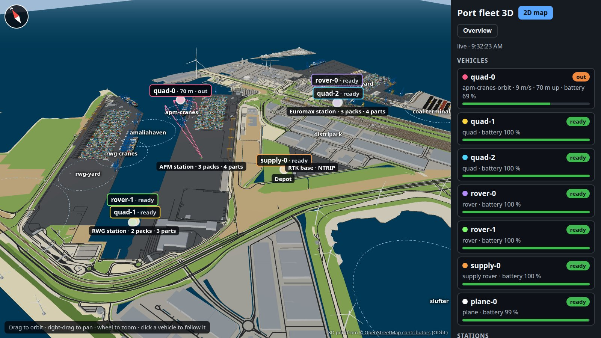
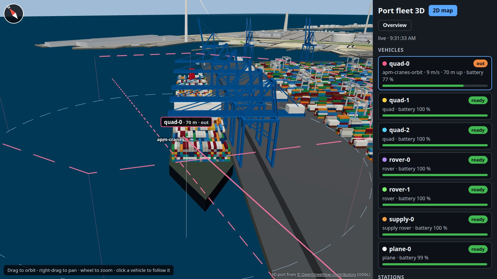
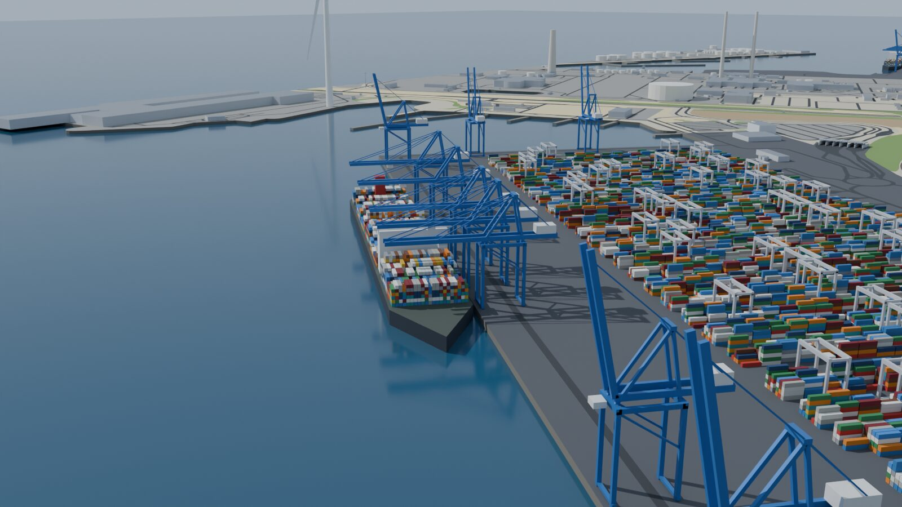
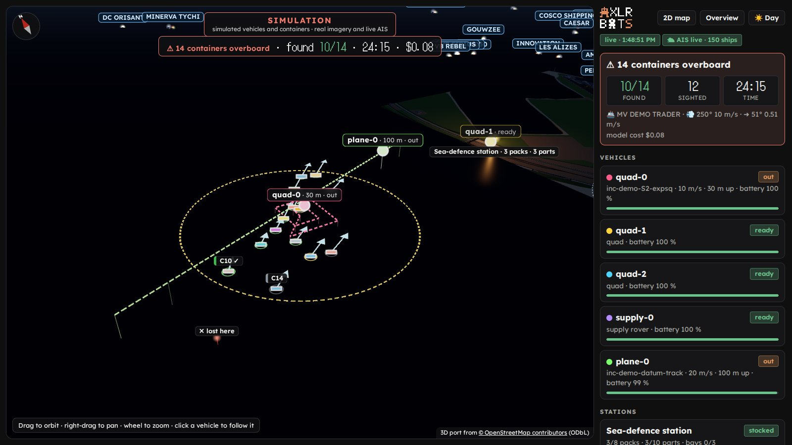
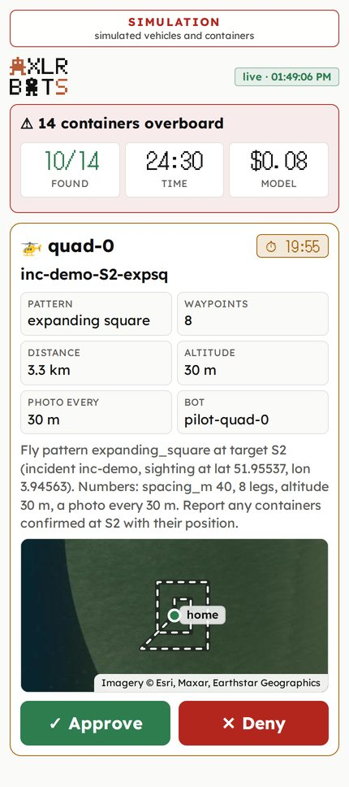
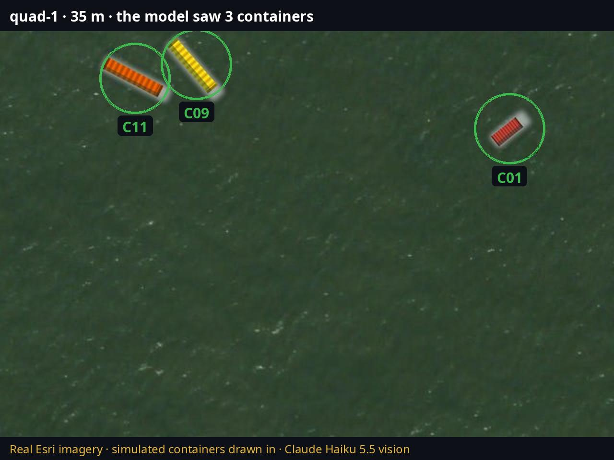
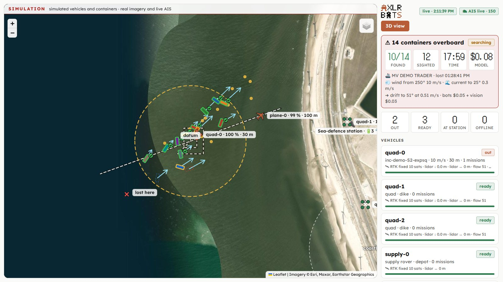
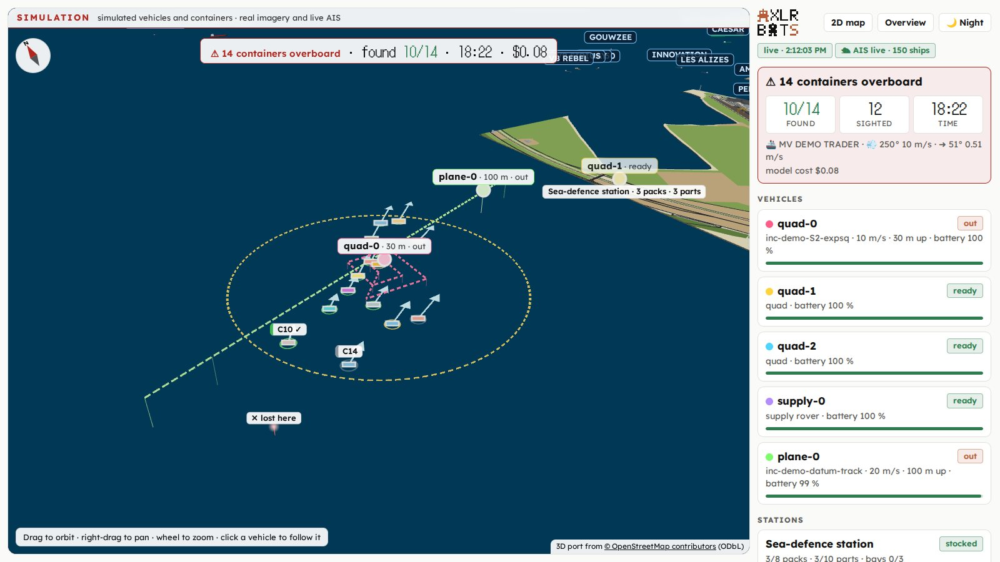
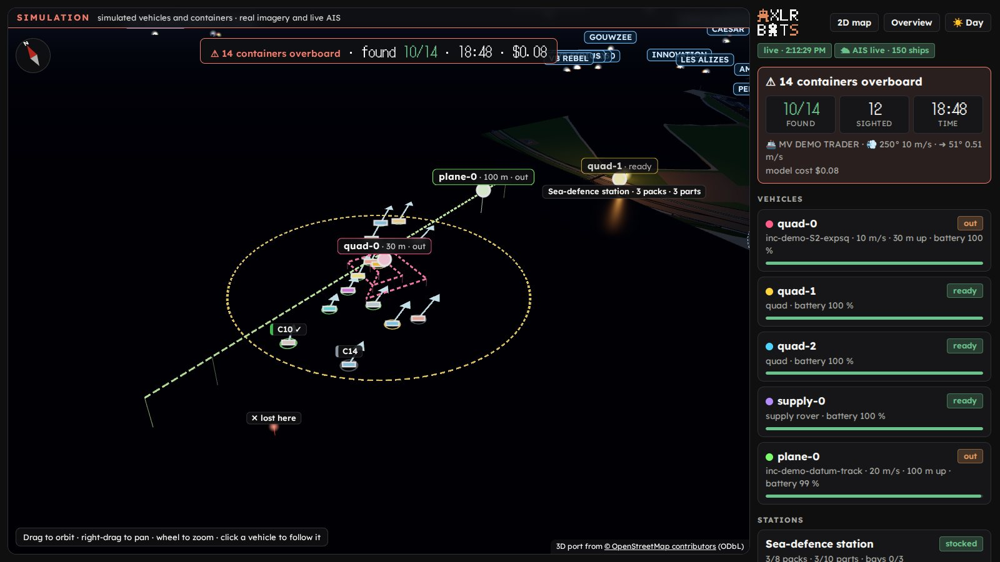
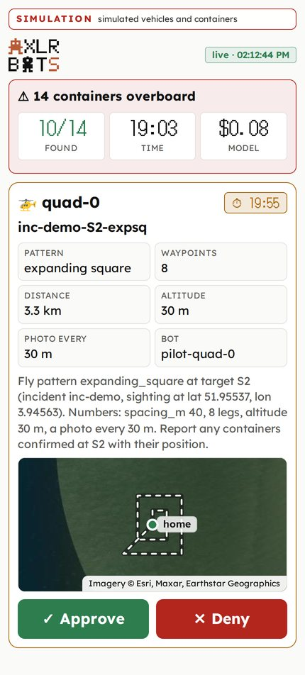

# Runbook: a port's fleet of autonomous vehicles

A fleet of simulated autonomous vehicles at the Port of Rotterdam (Maasvlakte 2), operated by AXLR Bots: quadcopters, ground rovers, a supply rover and a fixed-wing plane, each an ArduPilot 4.7.2 SITL with the node agent as its sidecar, maintenance stations that run out of battery packs and parts, and a live map. Every launch waits for a person's approval in the panel. The chart is [`examples/helm/drone-fleet`](../../examples/helm/drone-fleet), the services and the bots are in [`examples/drone-fleet`](../../examples/drone-fleet).

```text
 operator (panel) ──approve──┐                               flota.<domain> (live map)
                              ▼                                       ▲
 webhook / timer ──▶ fleet-cp (axlr-bots, in the namespace) ◀──mTLS── fleet-base-0: fleet_base.py + axlr-node
                      │  dispatcher, logistics: delegate          │   stations' stock, bays, depot, RTK base
                      ▼                                           │   bots: dispatcher, logistics (observe)
   quad-0..2, rover-0..1, supply-0, plane-0 (one pod per vehicle) ─┘
   ├─ sitl      ArduCopter X / ArduRover / ArduPlane, RTK GPS, lidars, optical flow, camera
   ├─ router    mavlink-router: 5770 for the pilot and anyone else
   ├─ pilot     vehicle_pilot.py, the companion computer: telemetry.json, the limits, MCP run_mission on 127.0.0.1:8765
   └─ axlr-node the sidecar: the bot pilot-<pod> (act-with-approval) and AXLR, whose mcp.json names the pilot's tool
```

## What each piece does

| Piece | Does |
|---|---|
| `dispatcher` bot | reads `fleet.json`, picks the ready vehicles for the zones a mission needs, and delegates one objective to each pilot (`wait: false`) |
| `logistics` bot | reads the stations' stock and sends the supply rover on a delivery run |
| `pilot-<vehicle>` bots | read `telemetry.json`, plan the route in metres from home, call `run_mission` once: that call waits for a person |
| `vehicle_pilot.py` | refuses a route outside the geofence, the altitude band or the speed range, and a vehicle that is not ready; uploads the mission over MAVLink, launches it, and after landing queues the vehicle at its station: inspection, then a fresh battery pack |
| `fleet_base.py` | polls every vehicle, hands out the bays (a service takes a pack and a part from the station), moves the supply rover's cargo when it reaches a station, writes `fleet.json` for the two bots and serves the map |

The safety limits live in the companion computer, not in the model: a refused route is the tool's error, which the model reads, and nothing moved.

## Before you start

- A cluster with a StorageClass (`local-path` here), an ingress controller and cert-manager for the map, `helm` and `kubectl`.
- The images in a registry the cluster pulls from. On wrx80 they were built with podman and pushed to the lab registry:

```bash
podman build -t $R/fleet-app:0.4.0 examples/drone-fleet                                         # vehicle_pilot.py, fleet_base.py, the map, the 3D view, the search
podman build -t $R/fleet-sitl:4.7.2 examples/drone-fleet/sitl                                    # SITL (checked sha256) + mavlink-router
podman build -f examples/drone-fleet/control-plane.Dockerfile -t $R/control-plane:0.1.0-fleet .  # axlr-bots
```

- The node image of [the sidecar runbook](sidecar.md) and a model provider key.

## 1. Install

```bash
kubectl create namespace port-fleet
grep '^OPENROUTER_API_KEY=' ~/.config/axlr-bots/env | cut -d= -f2- | tr -d '\n' \
  | kubectl -n port-fleet create secret generic fleet-model --from-file=OPENROUTER_API_KEY=/dev/stdin
helm dependency update examples/helm/drone-fleet
helm install fleet examples/helm/drone-fleet -n port-fleet \
  --set base.ingress.enabled=true --set base.ingress.host=flota.example.com --set base.ingress.clusterIssuer=letsencrypt
```

The release must be called `fleet`: the nodes dial `https://fleet-cp:7878` (`axlr-bots-node.controlPlane.url`). The control plane's first start runs `ca init`; the sidecars wait for their tokens.

## 2. Enroll the eight nodes

One token per pod, into one Secret, without printing them:

```bash
python3 - <<'EOF'
import base64, json, subprocess
nodes = ["fleet-base-0", "quad-0", "quad-1", "quad-2", "rover-0", "rover-1", "supply-0", "plane-0"]
cli = ["kubectl", "-n", "port-fleet", "exec", "fleet-cp-0", "-c", "control-plane", "--", "/usr/local/bin/axlr-bots", "--state", "/var/lib/axlr-bots"]
data = {n: base64.b64encode(json.loads(subprocess.run(cli + ["node", "enroll-token", "--node-id", n, "--ttl", "2h"], capture_output=True, text=True, check=True).stdout)["token"].encode()).decode() for n in nodes}
secret = {"apiVersion": "v1", "kind": "Secret", "metadata": {"name": "fleet-enrollment", "namespace": "port-fleet"}, "data": data}
subprocess.run(["kubectl", "apply", "-f", "-"], input=json.dumps(secret), text=True, check=True)
EOF
```

Check: `node list` (through the control plane pod, below) shows the eight `Online` within a minute or two, as kubelet refreshes the Secret's volume.

## 3. Register the bots

```bash
reg() { kubectl -n port-fleet exec -i fleet-cp-0 -c control-plane -- /busybox/sh -c \
  "cat > /tmp/bot.json && axlr-bots --state /var/lib/axlr-bots bot register --file /tmp/bot.json && axlr-bots --state /var/lib/axlr-bots bot enable $1"; }
cd examples/drone-fleet/bots
reg dispatcher < dispatcher.json
reg logistics < logistics.json
for v in quad-0 quad-1 quad-2 rover-0 rover-1 plane-0; do sed "s/VEHICLE/$v/g" pilot.json | reg pilot-$v; done
sed "s/VEHICLE/supply-0/g" supply-pilot.json | reg pilot-supply-0
```

The pilots are `act-with-approval` with `local_read` (only `telemetry.json`) and `run_mission`; the dispatcher and logistics are `observe`, with the vehicles' pilots as their delegation targets.

## 4. The panel

The operator API is the control plane Service's port 7879. From a workstation, through the host that runs the cluster:

```bash
ssh -L 127.0.0.1:17879:127.0.0.1:17879 wrx80 kubectl -n port-fleet port-forward svc/fleet-cp 17879:7879
```

Copy the CA (`/var/lib/axlr-bots/ca/ca.crt`) and the token (`/var/lib/axlr-bots/api.token`, mode 0600) from the pod, and point a panel profile at `https://127.0.0.1:17879` (the control plane's certificate names `127.0.0.1` for this): `XDG_CONFIG_HOME=~/.config/axlr-fleet-panel axlr-bots-panel`.

## 5. A mission

```bash
kubectl -n port-fleet exec fleet-cp-0 -c control-plane -- axlr-bots --state /var/lib/axlr-bots \
  task submit dispatcher --key storm-check-1 \
  --objective "Storm passed: check the quay cranes of both terminals, the Euromax yard lanes and the sea defence."
```

The dispatcher delegates; each chosen pilot plans and stops in `WaitingApproval` with its `run_mission` call (the route, the speed, the photo spacing) on the panel's task screen. Approve: the vehicle takes off on the map; deny: it stays on its pad and the pilot says so. After landing the vehicle waits at its station for a bay, is inspected and gets a fresh pack; a station without packs or parts keeps it waiting, which is the `logistics` bot's cue (`task submit logistics …`).

## 6. The port in 3D

`https://flota.<domain>/3d` (the map's **3D view** button) draws the same stream over a model of Maasvlakte 2: each vehicle at its altitude (5 m of quay plus its `alt_m`), its trail, its planned route with a line down from each waypoint, the stations, the depot and the zones. Click a vehicle to follow it; **Overview** goes back. It needs WebGL; the 2D map does not.





The model is `examples/drone-fleet/app/static/port.glb` (3 MB), built from OpenStreetMap by [`examples/drone-fleet/port3d`](../../examples/drone-fleet/port3d): the coastline, the harbours, land use, roads, rail, buildings, tanks, the quay cranes and the stacking cranes' blocks come from OSM; heights, container stacks and ships are made up. The same build writes a gz sim (Harmonic) world with the port's origin in its `spherical_coordinates`, for ArduPilot SITL in Gazebo later.

```text
Overpass ─▶ fetch_osm.py ─▶ prepare.py (shapely) ─▶ build_scene.py (Blender, on wrx80) ─┬─▶ app/static/port.glb  (/3d)
                                                                                       └─▶ port3d/gazebo/…     (gz sim)
```

To rebuild it, follow the [port3d README](../../examples/drone-fleet/port3d/README.md), then the fleet-app image and the digest in `values.yaml`:

```bash
podman build -t $R/fleet-app:0.4.0 examples/drone-fleet
podman push --digestfile /tmp/digest $R/fleet-app:0.4.0
helm upgrade fleet examples/helm/drone-fleet -n port-fleet -f values-in-use.yaml   # helm get values fleet -n port-fleet -o yaml
```

The image is the vehicles' too: an upgrade restarts every vehicle, and a task paused for approval does not survive it (its AXLR session is in the sidecar's `/tmp`).



## 7. Containers overboard

A search at sea, run by the same bots on a fleet of its own: a vessel calls in that it lost containers off Maasvlakte 2, the containers drift with the wind and the current, a plane sweeps the area and quads confirm what it saw, every takeoff waits for a person on a phone, and a report comes back at the end. **It is a simulation**: the vehicles and the containers are simulated; the aerial imagery and the AIS ships are real. Every page shows it, and so does the report's first line. The precedent is real: in January 2019 the MSC Zoe lost about 342 containers north of the Wadden Islands.

```text
 vessel ──POST /api/incident──▶ fleet base: drift.py starts the sea at the loss, runs it to now
                                    │ webhook incident (datum, wind, current)
                                    ▼
                               dispatcher ──delegate──▶ pilot-plane-0: parallel_track on the datum
                                    ▲                └─▶ pilot-quad-n: expanding_square on the datum
   webhook sightings (S1, S2…) ─────┘                         │ run_mission waits for a person (phone /m or panel)
         ▲                                                   ▼
 fleet base ◀── vision.py: real imagery + the containers drawn in (sprites.py) ── each photo
    │  a sighting from high up marks a container sighted; one from a quad below 60 m confirms it
    ├──webhook restock──▶ logistics ──delegate──▶ pilot-supply-0: packs and parts to the station
    └──webhook report (the end)──▶ reporter: incident-report.md through axlr_deliver
```

| Piece | Does |
|---|---|
| `drift.py` | each container's leeway from its immersion (about 5 % of the 10 m wind at 40 % immersion, nothing at 100 %: Daniel et al. 2002; Breivik et al. 2012, arXiv:1201.0603) plus a cross-wind part, carried by the current; a container that crosses the shoreline is ashore. The planner's datum is a cloud of 400 particles drawn from the same uncertainties: its centre, the radius holding nine in ten, its drift |
| `sprites.py` | draws each container that the photo's frame holds into the Esri imagery, at its true size for the photo's scale, turned to its heading, low in the water with foam |
| `vision.py` | during a search, every photo: the model answers with the containers it sees and where in the frame; the base maps them back to the sea and matches them to the simulation's containers within 10 % of the frame (25 m at least). An unmatched spot at sea is a sighting too (a false one); one on land is dropped |
| `incident.py` | the sea, the sightings, the counters; fires `sightings` (a sighting 20 s old that no quad confirmed, at most every 75 s) and `report` at the end (every container confirmed or ashore, the time limit, or `POST /api/incident/end`) |
| `patterns.py` | `run_mission`'s `pattern`: `expanding_square` or `parallel_track` aimed at a target the base names (`datum`, `S3`), led by the target's drift for the time the vehicle needs to get there, checked like any route |
| `control_plane.py`, `approvals.py` | the base fires the bots' webhooks, adds up the model cost of every task since the call, and relays the phone's decisions, with the operator token from a Secret |
| `ais.py` | one websocket to aisstream.io for the port and its approaches; the ships go into the map's stream |
| `bots/sar/` | `dispatcher` (observe: the plane sweeps, the nearest quad within 1800 m confirms), `logistics` (with a `restock` webhook), `reporter` (propose: writes the report inline with `axlr_deliver`) |

The bots never read the truth: `fleet.json` gives them the datum, its drift, the open sightings with their predicted position and each vehicle's distance to each target. The containers on the map are labelled as the simulation's.

### Install it in a namespace of its own

```bash
kubectl create namespace sar-demo
grep '^OPENROUTER_API_KEY=' ~/.config/axlr-bots/env | cut -d= -f2- | tr -d '\n' \
  | kubectl -n sar-demo create secret generic fleet-model --from-file=OPENROUTER_API_KEY=/dev/stdin
head -c 24 /dev/urandom | base64 | tr -d '/+=\n' | kubectl -n sar-demo create secret generic fleet-webhook --from-file=SECRET=/dev/stdin
tr -d '\n' < ~/.config/axlr-bots/sar-incident-secret | kubectl -n sar-demo create secret generic fleet-incident --from-file=SECRET=/dev/stdin
tr -d '\n' < ~/.config/axlr-bots/sar-approver-code | kubectl -n sar-demo create secret generic fleet-approver --from-file=CODE=/dev/stdin
tr -d '\n' < ~/.config/axlr-bots/aisstream.key | kubectl -n sar-demo create secret generic fleet-ais --from-file=AISSTREAM_API_KEY=/dev/stdin
helm install fleet examples/helm/drone-fleet -n sar-demo -f examples/helm/drone-fleet/values-sar.yaml
```

`values-sar.yaml` puts three quads on the sea defence (10 Ah packs, a 2 km geofence), the plane on the beach airstrip and the supply rover at the depot, turns on `incident` and `ais`, and gives the base three bots (`base.bots`). Every Secret is optional to the pod, so it starts without them and picks them up when kubelet refreshes the volume.

Then enroll the six nodes (step 2, with `fleet-base-0 quad-0 quad-1 quad-2 supply-0 plane-0`) and give the base the operator API, without printing the token:

```bash
python3 - <<'PY'
import base64, json, subprocess
ns = "sar-demo"
cat = lambda p: subprocess.run(["kubectl", "-n", ns, "exec", "fleet-cp-0", "-c", "control-plane", "--", "/busybox/cat", p], capture_output=True, check=True).stdout
data = {"ca.crt": base64.b64encode(cat("/var/lib/axlr-bots/ca/ca.crt")).decode(), "api.token": base64.b64encode(cat("/var/lib/axlr-bots/api.token").strip()).decode()}
subprocess.run(["kubectl", "apply", "-f", "-"], input=json.dumps({"apiVersion": "v1", "kind": "Secret", "metadata": {"name": "fleet-operator", "namespace": ns}, "data": data}), text=True, check=True)
PY
```

Register the bots with the webhook secret put in where the definitions say `WEBHOOK_SECRET` (the `reg` function of step 3, with its namespace changed):

```bash
SECRET=$(kubectl -n sar-demo get secret fleet-webhook -o jsonpath='{.data.SECRET}' | base64 -d)
cd examples/drone-fleet/bots
for b in dispatcher logistics reporter; do sed "s/WEBHOOK_SECRET/$SECRET/g" sar/$b.json | reg $b; done
for v in quad-0 quad-1 quad-2 plane-0; do sed "s/VEHICLE/$v/g" pilot.json | reg pilot-$v; done
sed "s/VEHICLE/supply-0/g" supply-pilot.json | reg pilot-supply-0
unset SECRET
```

The dispatcher's budget is sized for the way grants work today: each child gets `floor(share × (pool − granted))`, so a call that delegates to four pilots of 10 model calls and 6 tool calls needs a pool of about 2 × 4 × that, 80 and 48. [axlr-bots#14](https://github.com/underpass-ai/axlr-bots/issues/14) proposes an even split instead.

### Run a search

The map, the 3D view and the phone page are the base's port 8080 (`kubectl -n sar-demo port-forward svc/fleet-base 18090:8080`); the panel is the control plane's 7879, as in step 4. A vessel's call:

```bash
curl -X POST http://127.0.0.1:18090/api/incident -H "X-Incident-Secret: $(cat ~/.config/axlr-bots/sar-incident-secret)" \
  -H 'Content-Type: application/json' -d '{"vessel": "MV DEMO TRADER", "count": 14, "lat": 51.951, "lon": 3.937,
  "lost_minutes_ago": 20, "wind_from_deg": 250, "wind_m_s": 10, "current_to_deg": 25, "current_m_s": 0.25,
  "vessel_heading_deg": 220, "spread_m": 600, "max_minutes": 40}'
```

| Where | What you see |
|---|---|
| `/` | the containers (outlines: the simulation's truth), their drift arrows, the datum and its track, the sightings, the plane's track and the quads' squares, the AIS ships, the counters |
| `/3d?night=1` | the same at night over the port model; `&tour=1` circles the datum, `&hud=0` leaves only the canvas |
| `/m` | the calls waiting for a person, each with its route on a map: **Approve** or **Deny**. It asks once for the approver's code |
| `/api/incident/report` | the report, once the reporter has delivered it |

`POST /api/incident/end` (same header) ends a search early; the report follows.

### The first run (26 Oct 2026, a rehearsal)

| | |
|---|---|
| dispatcher | read `fleet.json`, sent the plane a `parallel_track` on the datum across the drift (heading 139°, 1208 × 966 m, 170 m apart, 100 m up) and the nearest quad an `expanding_square` (60 m, 10 legs, 35 m) |
| sightings | the plane sighted 11 containers, the quads confirmed 8 in 9.5 minutes; 215 photos analysed |
| refusals | a quad sent to a sighting 2.4 km away was refused by its own companion computer ("outside the 2000 m geofence") after the person approved it; another pilot read the distance and did not call `run_mission` at all. The dispatcher now reads each quad's distance to each target |
| false positive | something white on the beach, seen by a quad on its way out: denied. Unmatched spots on land are now dropped |
| cost | $0.039 of bot models and $0.044 of vision, $0.08 in all |
| report | `incident-report.md`, delivered by the reporter through `axlr_deliver` and stored by the control plane |

### The recorded run (26 Oct 2026, `inc-20261026-103457`)

The same call, recorded with OBS. Every takeoff waited on the phone page (`/m`); in this recording its Approve button was pressed by Claude, acting as the operator, over the browser's DevTools protocol, a few seconds after each card appeared.

| | |
|---|---|
| the call | MV DEMO TRADER, 14 containers at 51.951 N 3.937 E, lost 20 minutes before the call; wind from 250° at 10 m/s, current to 25° at 0.25 m/s |
| first wave | the plane: `parallel_track` on the datum, heading 140°, 1258 × 1006 m; quad-1, the only quad within 1800 m of the datum: `expanding_square` |
| sightings | 12 sightings, every one matched to a container (no false ones); quad-0 and quad-2 sent to S2 and S3, then quad-0 and quad-1 to S12 and S8 once they were serviced |
| logistics | the sea-defence station ran down to one pack after two services; the base called `logistics`, the supply rover drove 5 packs and 7 parts from the depot (approved on the phone) while the station sat at zero |
| result | 12 of 14 confirmed in 27 minutes 24 seconds; 2 never seen (C12, C13); ended by the operator |
| photos | 418 analysed |
| cost | $0.048 of bot models (dispatcher, pilots, logistics, reporter) and $0.081 of vision: $0.129 |
| report | `incident-report.md` through `axlr_deliver`, 45 seconds after the end |
| AIS | off: no aisstream.io key yet, so the pages said "real imagery" only |







## The look

The map, the 3D view and the phone page share one stylesheet, [`app/static/theme.css`](../../examples/drone-fleet/app/static/theme.css): the AXLR Bots emblem, ink on a warm white page (graphite with `?theme=dark` or a dark system theme), the emblem's copper as the one accent, one colour per status in a pill that names it, [Lexend](https://www.lexend.com) for words and [DotGothic16](https://github.com/fontworks-fonts/DotGothic16) for the counters (both SIL Open Font License, served from `app/static/fonts` with their licences). The viewer sits in a rounded frame; `?hud=0` drops the frame and the side column for a recording. The **SIMULATION** label and the imagery's attribution stay on every page, the phone's route maps included; the panel's own look is the same palette ([axlr-bots-panel](https://github.com/underpass-ai/axlr-bots-panel)).









These four pictures are a replay of a captured `/api/fleet` with a synthetic incident, taken to show the theme; the pictures of the recorded run below are the run itself.

## Limits

- The vehicles are SITL: the sensors are SITL's backends (rangefinders, optical flow, camera trigger), RTK is SITL's fix 6 with no correction link, and the map's hardware labels describe what the vehicles stand for.
- Each sidecar's AXLR reads its MCP configuration from its own state volume (`~/.config/axlr/mcp.json`, written by an init container): the pilot's tool is per node, not per bot. An `act-with-approval` bot asks for every MCP call.
- The bays and the stock live in the base's memory: a restart of `fleet-base-0` starts them over.
- The search's sea, sightings and counters live in the base's memory too; a restart of `fleet-base-0` ends the search without a report.
- The drift is one wind and one current for the whole area and the whole search; the containers are drawn into imagery taken on a calm day, so the sea in the photos does not match the storm.
- The vision model sees the containers the simulation draws; how well it would see a real one in a real sea is not measured here.
- aisstream.io allows a few connections per key; the base keeps one and drops a ship after 15 minutes without news.
