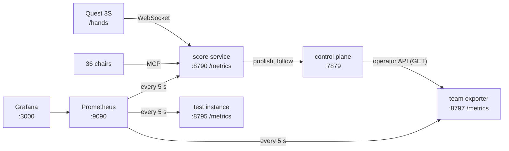

# Observability: Prometheus and Grafana for the orchestra

Three dashboards to keep open while you conduct.

| Dashboard | What it shows |
|---|---|
| **Conductor** | readings per gesture, Jev's latency, levels pending · kept · reverted, gains per section, the expression |
| **Orchestra** | the take and its bar, chairs playing per section, gains, characters, cues, late phrases, the chairs' task failures |
| **Pipeline** | hands → publish → echo → delivery, the bus to the sound, Jev's cost, the WebSocket, the render loop |



## Start

Docker on gx10, user-level, everything bound to `127.0.0.1`:

```bash
cd examples/orchestra/observability
cp grafana.env.example grafana.env      # set GF_SECURITY_ADMIN_PASSWORD; the file is git-ignored
docker compose up -d
```

| What | Where |
|---|---|
| Grafana | http://127.0.0.1:3000 (opens on *Conductor*; viewers need no login, `admin` edits) |
| Prometheus | http://127.0.0.1:9090 (targets: `/targets`) |
| The score service's metrics | http://127.0.0.1:8790/metrics |
| The team's metrics (the exporter) | http://127.0.0.1:8797/metrics |

Stop: `docker compose down` (the data stays in two volumes; `down -v` drops them).

## From the headset

Grafana listens on gx10's loopback only. The Quest reaches it as it reaches the score service:

```bash
adb reverse tcp:3000 tcp:3000
```

Then `http://localhost:3000` in the Quest Browser, beside `/hands`. Anonymous viewing is on only because of the loopback bind: `GF_AUTH_ANONYMOUS_ENABLED=false` in `grafana.env` before Grafana listens anywhere else.

## Try it without the headset

A second score service on 8795 (scrape job `score-test`), never the live one, and a rehearsal that plays its chairs and conducts it:

```bash
cd ../score-service
python server.py --listen 127.0.0.1:8795 --hands-dry-run --jev-log ~/orchestra-logs/
python3 ../observability/rehearse.py --url http://127.0.0.1:8795 --minutes 5
```

In Grafana, pick *Score service* `score-test`. The rehearsal asks Jev for real: about one reading every 1.4 s, about $0.0015 a minute.

## What each part measures

| Source | Metrics | Prefix |
|---|---|---|
| score service `/metrics` (`telemetry.py`) | the take, the chairs' MCP calls, the hands, Jev, the bus, the WebSocket, the render loop | `orchestra_` |
| team exporter (`team_exporter.py`) | tasks by state and failure reason, deliveries, fan-out, budget use, cost, bots by status | `axlr_team_` |
| both | CPU, memory, threads | `process_` |

`--jev-log FILE` (or a directory: one file per run) writes each question to Jev and its answer as one JSON line, beside the hands' own `--hands-log`.

## Known limits

| Limit | Why |
|---|---|
| Job `score` (8790) is down | the live service runs an older version: restart it from a branch with `/metrics` |
| Publish, echo and delivery stay empty on a dry run | a dry run publishes nothing |
| Levels pending · kept · reverted, double pinch | arrive with PR #79 (`claude/orchestra-confirm`); nothing to change here |
| Budget used | only for runs started after the bot's last update: a run carries no budget of its own |
| Delivery latency | the control plane's `createdAt` against the service's clock: one host here |

## Change a dashboard

The JSON in `grafana/dashboards/` is written by `dashboards.py`; Grafana does not save over it.

```bash
python3 dashboards.py               # rewrite the three files
python3 dashboards.py --check       # 1 if a file is out of date
```

`score-service/test_observability.py` checks every metric a panel asks for exists.
