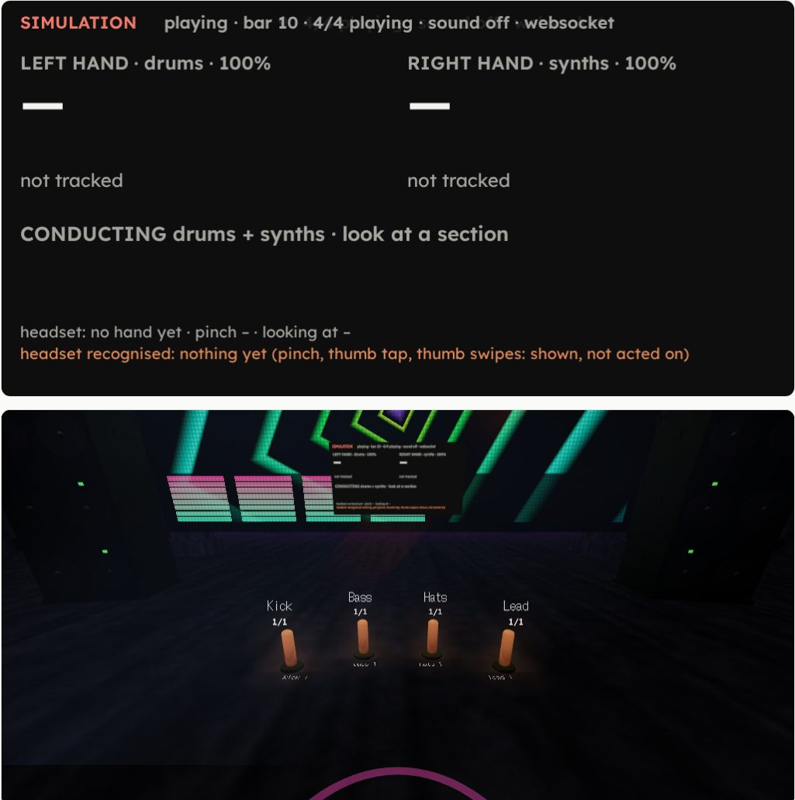

# rave-service

The orchestra's architecture, playing techno: four chairs, each one bot, that **live-code** their part as a [Strudel](https://strudel.cc) pattern instead of playing a line of a score. Same four tools per chair, same bus, same `/api/state`, the same `/hands` page lit by it; the sound is superdough, Strudel's synthesizer, headless.

> **SIMULATION.** Each chair is one LLM bot that live-codes its part as a Strudel pattern, one phrase at a time, as Jev picks them. The sound is superdough, Strudel's synthesizer, headless; the clock is the service's.

```text
chair's node ── AXLR ─┬─ POST /mcp/kick-1 ──▶ rave-service ──▶ strudel/evaluate.mjs (Node, one-shot): the pattern's events
                      │   phrases · play · listen · stop   │ clock, chairs, patterns ──▶ strudel/sound.mjs (Node, superdough) ──▶ GET /audio.wav
                      └─ axlr_judge ──▶ Jev                │ (the service never sees Jev; the bot reports its pick in play)
operator ─ POST /v1/groups/rave/events ─▶ control plane ───┘ the service follows the team's bus (bus.py, the orchestra's):
                                                              info.cue.* → a take with a count-in; stop.all → silence; info.tempo {bpm}
          POST /api/event ─────────────────────────────────▶ the same events applied locally, for a check without a control plane
/hands?world=rave (Quest 3S, or ?view=1) ── GET /api/state, /ws/hands ─▶ bar, beat, bpm, each chair's state: the lanterns, the lasers, the crowd
```

## 1. Which live-coding language

Three were tried on gx10 (NVIDIA GB10, aarch64, Ubuntu 24.04, no sudo), 31 Oct 2026, by installing, not from memory:

| | **Strudel** (`@strudel/core` + `@strudel/mini`, JavaScript) | **TidalCycles** (Haskell + SuperCollider/SuperDirt, OSC) | **Sonic Pi** (Ruby DSL, OSC in) |
|---|---|---|---|
| Install on gx10 | `npm install`: 15 packages, **2 s**. One resolve hook needed: `@kabelsalat/web` 0.4.1 ships no `exports` map and Node misses its named exports ([`strudel/hooks.mjs`](strudel/hooks.mjs)) | not installed: `ghc` 9.4.7 and `cabal` 3.8 are apt packages (sudo), or GHC by ghcup in user space; Tidal 1.10.3 on Hackage compiles on top; the sound needs SuperDirt = `sclang` (apt, Qt5 even headless) + Quarks + the Dirt-Samples | not installed: `sonic-pi` 3.2.2 (2020) pulls Qt5; its server alone needs erlang, ruby and nine gems, osmid, sc3-plugins, supercollider-server, jackd (apt, sudo) |
| Headless on ARM Linux | yes: Node only. **superdough renders with no sound card** on `node-web-audio-api` 2.2.0 (prebuilt aarch64 binary) with an `AudioContext` whose sink is `none`: it runs at the wall clock's speed and a tap at its output gives the PCM | `scsynth` 3.13 **does boot headless without root**: the apt `.deb`s extracted into a folder, `jackd -d dummy`, "SuperCollider 3 server ready" (checked). SuperDirt on top was not attempted | its server is `scsynth` + jackd too, and the Ruby server expects the GUI's boot; headless is unsupported upstream |
| A stream for `/audio.wav` | the tap writes 16-bit stereo PCM blocks to the service: the same open-ended WAV as the orchestra's | the output is a JACK port: a capture client (`jack_rec`, or one of our own) would have to bring it back as PCM | the same, through JACK |
| A bot's pattern as text, validated before it sounds | yes: the text is transpiled as the Strudel REPL does, run in a `vm` context that holds Strudel and nothing else, queried for its events; what does not parse, is not a pattern, names an unknown sound, has too many events or takes too long is refused with the reason ([`strudel/evaluate.mjs`](strudel/evaluate.mjs)) | Haskell code sent to a GHCi session: a parse error is GHCi's answer, after the fact; there is no query of a pattern's events without evaluating it in that session | Ruby run by the server: validation is running it |
| Swap at the bar | yes: the cycle is the absolute bar, a new pattern is queried from its first bar, so `<a b>` alternations stay in step; the old stops at the boundary, the new starts there | yes, Tidal's own cycle; the swap is `d1 $ …` at any time, quantised by SuperDirt's latency, not by the bar | `live_loop` with `sync`: at the loop's boundary |
| Tempo and gain per chair from the bus | the service's own clock and gains: `info.tempo` sets the bpm, a cue sets dynamics or gain, `stop.<role>` fades a chair, `stop.all` mutes the output in 5 ms | `setcps` and `# gain` over OSC to the GHCi session, per pattern | `use_bpm`, `amp`, over OSC to the server |
| Licence | AGPL-3.0 (`@strudel/*`, superdough) | GPL-3.0 (Tidal), GPL (SuperCollider) | MIT (Sonic Pi) |

This repository is Apache-2.0; the example's Node side depends on AGPL-3.0 packages (`@strudel/*`, superdough), installed by `npm install`, not vendored here.

**Chosen: Strudel**, as expected, and confirmed: two seconds to install, headless sound in-process, a pattern that is data before it is sound. The sound is **superdough** itself (not a synthesizer of our own), so every control a bot writes, `lpf`, `resonance`, `room`, `delay`, `supersaw`, `hoover`, sounds as it does on strudel.cc. The one cost: superdough's drum sounds (`bd`, `hh`, `cp`…) are samples fetched from `github:tidalcycles/dirt-samples` on first use; [`strudel/sound.mjs`](strudel/sound.mjs) keeps them in `~/.cache/rave-service/samples`, so the second run needs no network, and without network and without the cache the synthesized sounds (`sawtooth`, `supersaw`, `sbd`, `white`…) still play.

`scsynth` booting without root is worth a note: a raw-OSC SynthDef backend is a possible second sound for the same service; SuperDirt on it is a longer chain (sclang, Quarks, samples) that was not walked.

## The four tools, as a chair sees them

The chair is the URL: `http://127.0.0.1:8794/mcp/<chair>`, so a chair can only speak for itself. The shapes are the orchestra's ([score-service](../score-service/README.md#the-tools-as-a-chair-sees-them)); what changes is what a phrase is.

| Tool | Arguments | Does |
|---|---|---|
| `phrases` | — | the chair's state and three **candidates** for its role (Strudel code from [`patterns.json`](patterns.json), by energy: at `p` 1–2, at `mf` 1–3, at `f` 2–3, never the one playing, a different three each ask), and `ask`, the question for Jev: `{state, question, options}` with `pattern 1: four on the floor` and so on |
| `play` | `candidate` (a number offered) or `pattern` (Strudel code: a candidate's, a library id, or the bot's own), `dynamics?` (`p`, `mf`, `f`), `judge?` | the pattern is evaluated first (128 bars of events, more as it goes); refused with the reason if it does not parse, is not a pattern, names a sound the rave has not, has more than 128 events a bar or takes longer than 1.5 s. Then it starts **at the next bar** and loops until the chair's next `play` or `stop`. When nothing plays yet, it starts a take with a count-in of 2 bars |
| `listen` | `bars?` (8) | blocks until the chair's fork opens (2 bars before its phrase of 8 ends), the bars pass, the chair is stopped or the music stops, at most 20 s; answers the bar, the tempo, its pattern now and next, the sections, and at the fork the candidates and `ask`. A phrase that passes with no new choice rolls: the pattern loops on, the fork opens again two bars before the next |
| `stop` | — | this chair is silent from here; the others go on |

A `play` with the bot's own code is marked `custom` in the state. The `judge` the bot reports is kept as reported (`matchesPattern` says whether Jev's choice names the pattern played); the service never sees Jev.

The clock starts with the conductor: `info.cue.*` on the bus when nothing plays starts a take with the count-in; a cue while the music plays releases the chairs it names that a `stop.<role>` faded out, and `data.dynamics` or `data.gain` is theirs at once. `stop.all` mutes the output at once (a 5 ms ramp), drops every pattern and refuses `play` until the next cue. `info.tempo {bpm}` sets the clock (100–150). The cues name `all`, a family (`drums`, `synths`) or a role (`kick`, `bass`, `hats`, `lead`).

## What is in here

| File | What it is |
|---|---|
| [`rave.py`](rave.py) | the clock, the chairs, the patterns each asked for: `phrases`, `play`, `listen`, `stop`, `cue`, `hold`, `stop_all`, `set_tempo`, `advance` |
| [`evaluator.py`](evaluator.py) | the pattern evaluator: a one-shot Node process per batch, killed if it does not answer; a runaway pattern (`bd*1e9`) dies there, not with the music |
| [`synth.py`](synth.py) | the sound process (superdough) and the stream: the blocks it writes are the clock, each with the context's own time (it runs 0.47 s ahead of what it has handed over, steadily); hits go to it a quarter second ahead on that clock; `/audio.wav` and the recording |
| [`strudel/evaluate.mjs`](strudel/evaluate.mjs) | Strudel code → events: transpiled, run in a vm context with Strudel only, queried for the bars asked; `npm test` for its checks |
| [`strudel/sound.mjs`](strudel/sound.mjs) | superdough on a WebAudio polyfill, sink `none`, PCM on stdout, hits on stdin, the sample cache |
| [`bus.py`](bus.py), [`mcp_http.py`](mcp_http.py), [`ws.py`](ws.py) | copied from [score-service](../score-service/) unchanged: the team's bus, the MCP table, the page's WebSocket |
| [`server.py`](server.py) | HTTP on loopback: `/mcp/<chair>`, `/api/state`, `/api/score`, `/api/take`, `/api/event`, `/audio.wav`, `/hands`, `/ws/hands`, `/static/*` (served from `../score-service/static` as it is) |
| [`config.json`](config.json) | the four sections, the phrase, the count-in, the dynamics, the tempo range, the audio (44.1 kHz, blocks of 2048, lookahead 0.25 s, master 0.6), the team |
| [`patterns.json`](patterns.json) | the candidates, six a role, with their energy |
| [`demo.py`](demo.py) | the check: four bots played by the script, one cue, one `stop.all`, the sound captured, the cut measured; [`demo/onsets.py`](demo/onsets.py) reads the kick's timing out of the capture (numpy, scipy) |
| [`test_rave_service.py`](test_rave_service.py) | the clock, the tools, the state the page reads, the bus; no Node needed, and two tests with it when it is there |

## Run

```bash
(cd strudel && npm install)                        # Strudel, superdough, node-web-audio-api: 55 MB, pinned
python3 server.py --record take.wav                 # the first run fetches 27 samples into ~/.cache/rave-service/samples
ffplay -nodisp http://127.0.0.1:8794/audio.wav     # or OBS: Media Source
python3 demo.py --seconds 60 --rotate               # four bots, a cue, a stop.all, demo/take.wav and demo/take.json
```

With a control plane: `--control-plane https://127.0.0.1:7879 --team rave` and the chairs registered in the team `rave` (a team exists while a bot names it): the orchestra's [`chairs/`](../chairs/) templates work with the mission's words changed and the URL `/mcp/<chair>` on this port; that run was not made.

Python 3.12 standard library only; Node 24 for the two Strudel processes. The page is the orchestra's: `http://127.0.0.1:8794/hands` on the headset over `adb reverse`, `?view=1` to look without one. What the page shows is the service's: `GET /api/hands` names the world (`rave`) and the groups a hand conducts (`drums`, `synths`), `GET /api/score` seats the band (no chart: one arc ahead, the four lanterns), so nothing of the orchestra (its rows, its strings and winds, its 36) is on the rave's page.

## Check

```bash
python3 -m unittest -v test_rave_service        # 17 tests, 2 s
(cd strudel && npm test)                         # the evaluator: 8 tests
```

[`demo.py`](demo.py) on gx10, 31 Oct 2026, with the service on 8794 and no control plane (the events through `/api/event`, applied as [`bus.py`](bus.py) applies the bus's): the capture starts, one second later `info.cue.all` with `mf`, the four bots call `phrases`, `play` the first candidate, `listen`, and at each fork a different candidate (`--rotate`); `stop.all` 54 s after the cue.

| | |
|---|---|
| recording | [`demo/take.opus`](demo/take.opus) (60 s, Opus 96 kb/s from the captured WAV, 0.5 MB; the WAV is not committed), [`demo/take.json`](demo/take.json) |
| before the cue | silent (the output is muted until the first take) |
| the first bar | 2 bars of count-in after the cue: four patterns begin at bar 1 together |
| swaps | bars 8, 9, 15, 17, 22, 25: 16 plays, each at the bar it was promised, none refused |
| peak | −5.9 dBFS, unclipped |
| timing | bars 1–7, the kick four to the floor: 27 onsets found in the capture, a quarter note apart within 0.1 ms (std 0.1 ms); the sound reported 0 late hits over 1000, the tightest margin 0.20 s |
| `stop.all` → cut | 0.001 s on the service (event applied → output muted), at bar 27 |
| cut → under −60 dBFS in the capture | 0.05 s (the first 100 ms window measured after the cut) |
| the chairs after | all four `stopped` on `/api/state`; a `play` after it is refused until the next cue |

The evaluator: 0.1 s for a batch (Node starts, Strudel loads in 40 ms), `bd*1e9` refused in 1.7 s. The sound: real time (60 s of audio in 60 s). A first run scheduled on the frames read instead of the context's clock: every hit arrived 0.2 s in the past, was bumped to "now" and the kick wobbled by up to 42 ms (std 15 ms); the header on each block fixed it, and the timing row above is the proof.



## What works and what does not

| | State |
|---|---|
| Strudel headless on gx10, patterns as text, validated, queried per bar | works |
| superdough's sound with no sound card, streamed at `/audio.wav` | works; the samples need one fetch (cached after) |
| four roles, candidates by energy, Jev's question in the orchestra's shape | works; the choice in the demo is the script's, not Jev's |
| swap at the next bar, patterns loop, `<a b>` in step | works, measured; a pattern that goes on is extended past its 128-bar horizon (tested with a short horizon) |
| `info.cue.*`, `info.tempo`, `stop.<role>` (fade), `stop.all` (mute) | works through `/api/event` and in the bus tests; **not run against the control plane** (the team `rave` would need its bots registered) |
| `/api/state`, `/api/score`, `/api/hands`, `/ws/hands` for the orchestra's `/hands` page | the fields the page reads are there (tested); the page renders the rave world over it with the four chairs as the band and none of the orchestra (headless Chromium, swiftshader, 31 Oct) |
| real AXLR chairs on nodes, Jev choosing | not run: the demo's bots are the script |
| the conductor's hands (Jev reading postures, gains by height) | not here: `/ws/hands` answers every posture "nothing"; the rave has no hands yet |
| a pattern's effects (`delay`, `room`) across a `stop.all` | the output stays muted until the next cue, so no tail sounds; a cue within a second of the stop would hear the end of a delay |
| Python 3.13 and `uv` venvs | not needed: the standard library only |
