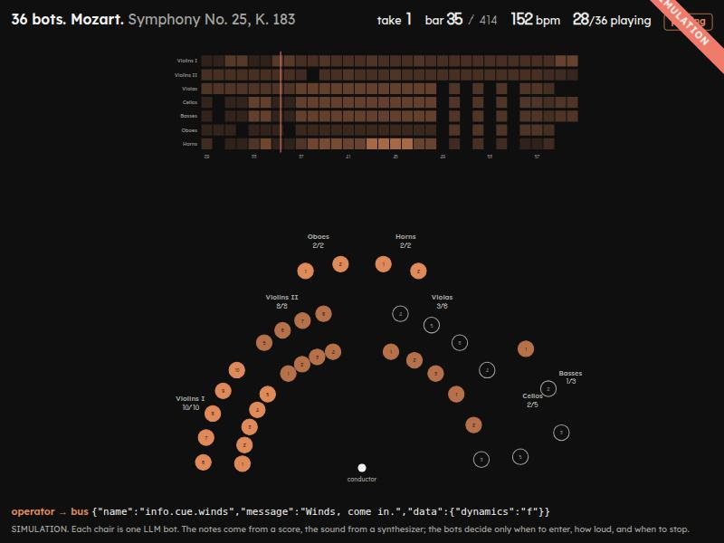
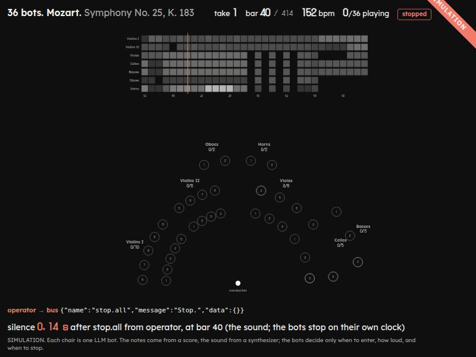

# score-service

The orchestra's world: the score by lines and phrases, the clock, the phrases each chair asked for, a voice per chair and the sound. Each chair's bot reaches it as four MCP tools on loopback; the operator reaches it only through the team's bus.

> SIMULATION. Each chair is one LLM bot that plays its own line of the score, phrase by phrase, as Jev picks them. The conductor's hands are read by Jev from the headset's hand tracking. The notes come from the score, the sound from a synthesizer.

```text
chair's node ── AXLR ─┬─ POST /mcp/vn1-3 ──▶ score-service ──▶ FluidSynth (in memory, a channel per chair) ──▶ GET /audio.wav ──▶ OBS / ffplay
                      │   phrases · play · listen · stop   │ clock, lines, phrases, chairs
                      └─ axlr_judge ──▶ TypeSafe Jev       │ (the service never sees Jev; the bot reports its pick in play)
operator ─ POST /v1/groups/orchestra/events ─▶ control plane ─┘ the service long-polls the team's timeline:
                                                                 info.cue.* → a take with a count-in; stop.all → silence;
                                                                 info.tempo {bpm} → the clock
/stage ────────────────── GET /api/state?version=N&wait=20 ────▶ take, bar, tempo, each chair's phrase now and next, Jev's pick
                                                                 as reported, the facts, the last bus event
/hands (Quest 3S) ─────── WebSocket /ws/hands (a posture) ────▶ Jev reads it ─▶ the service cues or pauses at once, publishes info.cue.* as the operator
```

| File | What it is |
|---|---|
| [`score.py`](score.py) | the MIDI read into one part per section and one line per chair, cut into 8-bar phrases with what each holds |
| [`orchestra.py`](orchestra.py) | the clock, the chairs' voices and phrases: `phrases`, `play`, `listen`, `stop`, `cue`, `stop_all`, `set_tempo`, `render` |
| [`synth.py`](synth.py) | FluidSynth rendering into memory (a channel per chair: program, pan, tuning, volume), the live WAV stream, the render loop paced by the wall clock |
| [`bus.py`](bus.py) | the service's own subscription: the team's timeline, the conductor's cues, `stop.all`, a group's `stop.*` and `info.tempo`; and the hands' events, published as the operator |
| [`hands.py`](hands.py) | the conductor's hands: a posture → Jev's reading per hand → what it means (a cue, or a pause that is the service's alone), done at once, or why nothing was done ([the orchestra's README](../README.md#6-the-conductors-hands)) |
| [`ws.py`](ws.py) | a WebSocket (RFC 6455) on the service's own HTTP server, standard library only: the headset's one connection |
| [`jev.py`](jev.py) | Jev called by the service itself: a state, choice questions, a pinned model; the key never shown |
| [`server.py`](server.py) | HTTP on loopback: `/mcp/<chair>`, `/api/state`, `/api/score`, `/api/take`, `/audio.wav`, `/stage`, `/hands`, `/api/hands`, `/ws/hands` |
| [`static/`](static/) | the stage page: `stage.html`, `stage.js`, `stage.css`, Lexend and DotGothic16 (OFL, licences beside them); the conductor's page `hands.html`, `hands.js`, its math `posture.js` (tested by `node --test posture.test.mjs`) the orchestra in the room `room.js`, and what is around it: a mirror lake under the aurora `aurora.js` (the default: one sky function for the dome and its reflection, lit by the orchestra), a rave in an abandoned factory `rave.js` (moving heads, lasers, a VJ screen and a crowd on the beat), a cartoon meadow `meadow.js` or a zen world, one giant tree over a luminous meadow under the stars, `zen.js`, on three.js r180 (`stage3d-3.three.*`, MIT, licence beside it) |
| [`mcp_http.py`](mcp_http.py) | the MCP tool table, copied from [the fleet](../../drone-fleet/app/mcp_http.py) as the [adapter template](../../world-adapter/README.md) says |
| [`check_take.py`](check_take.py) | piece 3's check by hand: two chairs' phrases, a `stop.all`, how long the sound took to go |
| [`config.json`](config.json) | the sections, their chairs, pans and lines, the phrase length, the count-in, the dynamics, the voices' spread, the tempo range, the soundfonts and gain, the team, the control plane |
| [`score/`](score/README.md) | the MIDI, its source and its licence |

## The music

Mozart, Symphony No. 25 in G minor, K. 183, first movement: from the [Mutopia Project](https://www.mutopiaproject.org/cgibin/piece-info.cgi?id=1380), **public domain** ([source and licence](score/README.md)). The plan named No. 40; Mutopia has no full score of it, and the operator chose No. 25.

| Section | Chairs | Each chair's line (track) | Sound (GM program) | Pan |
|---|---|---|---|---|
| Violins I | 10 | `eight`, in unison | 40 violin | −0.9 … −0.5 |
| Violins II | 8 | `nine`, in unison | 40 violin | −0.45 … −0.2 |
| Violas | 6 | `ten`, in unison | 41 viola | 0.15 … 0.4 |
| Cellos | 5 | `eleven`, in unison | 42 cello | 0.45 … 0.75 |
| Basses | 3 | `eleven` an octave down, in unison | 43 contrabass | 0.6 … 0.9 |
| Oboes | 2 | Oboe I: the upper note of `one`'s chords; Oboe II: the lower | 68 oboe | −0.15 … −0.05 |
| Horns | 2 | Horns I–II: `two`; Horns III–IV: `three` | 60 French horn | 0.05 … 0.15 |
| **36** | | | | |

Every chair is a voice of its own: a FluidSynth channel (General MIDI's drum channel 9 of each sixteen skipped) with its section's instrument, its place on the stage, a tuning a few cents off its neighbours' (−6 … +6 across a section) and an onset 0–15 ms late, so that ten violins sound as ten and one as one. A chair sounds only the notes of the phrases its bot asked for, at their own bars; nothing sounds that no bot asked for. Its volume is its dynamic (`p` 0.45, `mf` 0.7, `f` 1.0) over the square root of the chairs that share its line, so the ten violins at `f` are as loud as one oboe at `f`, and one violin of ten is 10 dB under the ten. The synthesizer's gain is 0.14: all 36 chairs at `f` over the first 40 bars peak at −2.9 dBFS, unclipped, and the 36 voices render 44 times faster than real time on gx10.

A phrase is 8 bars, about 12.6 s at 152: 52 phrases, phrase 1 bars 1–8, the same bars in every line. [`/api/score`](#the-stage) lists each line's phrases with their notes, bars of rest and range.

## The tools, as a chair sees them

The chair is the URL: each chair's node names `http://127.0.0.1:8790/mcp/<chair>` in its own `mcp.json` ([`stage.sh mcp`](../stage/stage.sh)), so a chair can only speak for itself.

| Tool | Arguments | Does |
|---|---|---|
| `phrases` | `bar?` | the chair's state and the phrases it may play next, from the playhead or from `bar`: the next three after what it has, or the one already begun if two bars are left (marked `late`), each with its bars, notes, bars of rest and range; and `ask`, the question for Jev |
| `play` | `phrase`, `dynamics?` (`p`, `mf`, `f`), `judge?` (`choice`, `probability`, `confidence`) | schedules that phrase of the chair's line at its own bars; a phrase already begun is joined at the next bar (`lateBars`). When nothing has played yet, it starts the music with the count-in. `judge` is what `axlr_judge` answered, as the bot read it |
| `listen` | `bars?` (8) | blocks until the chair's fork opens, the bars pass, the chair is stopped or the music stops, at most 20 s; answers the bar, the tempo, its state, its phrase now and next, its section's (`Violins I: 7 of 10 playing`), and at the fork the candidates and `ask` |
| `stop` | — | this chair stops at once and its next phrases are dropped; the section goes on with the others |

`ask` is `{state, question, options}`, ready for `axlr_judge`: the state says the work and the tempo, the chair and its line, the bar, what the chair has, its section, the conductor's last cue for it and each candidate (`- phrase 2: bars 9–16, starts in 1.6 bars, 52 notes over F#4–D6, 0 bars of rest`); the options are `phrase 2: bars 9–16` and so on. A chair's fork opens when its last phrase begins, 0 to 7 beats later by chair (`phrases.forkSpreadBeats`), so the 36 do not ask at once; with an 8-bar phrase that leaves a chair about 10 s to ask Jev and play before the phrase it chooses begins.

A refusal (an unknown chair, phrase 0 or 53, a phrase already over or already the chair's, `fff`, a `play` after `stop.all`) is a tool error the model reads, never an exception.

The clock starts with the conductor: the first `info.cue.*` on the bus when nothing plays starts a take with a count-in of 8 bars (`countIn.bars`), from bar 1 or from the cue's `data.bar`, so every chair cued can choose its first phrase before the music reaches it. A `play` when nothing has played yet does the same (for a check without the bus). There is no stop button: the only way to stop everyone is the control plane's `stop.all` on the team. The service hears it on the bus and silences every chair at once (all sound off, no release), drops every chair's phrases and refuses any `play` until the next cue; the bots hear it as an urgent task each and call `stop` seconds later ([piece 2](../README.md#2-stopall-on-a-long-task)). Another `stop.*` stops a group and the others play on: the chairs it is addressed to (`to`), or else the section or family its name ends with (`stop.vn1`, `stop.winds`); they are silent at once and paused: muted, nothing else. A paused chair keeps its phrases and its bot goes on choosing; the cue that names it sounds again at its next note, where the score is. The conductor's fist pauses this way with no event at all. A `stop.*` that names neither is read as `stop.all`. A cue with `dynamics` while the music plays sets that level on the chairs it names at once, and on the phrases they already asked for.

## What the service saw, and what the bot reported

`/api/state` has, for each chair, besides `state`, `dynamics` and `enteredBar`:

| Field | What it is | Source |
|---|---|---|
| `line` | the line the chair plays (`Violins I`, `Oboe II`) | the config |
| `phrase.playing`, `phrase.next` | the phrase sounding now and the next one asked for: number, bars, the bar it was joined at, `lateBars`, its dynamics, how many bars until it | the service: what the chair's own `play` did (`phrase.source`) |
| `judge` | Jev's pick for the chair's last phrase: `choice`, `probability`, `confidence`, the phrase played, the bar, and `matchesPhrase` (the choice names the phrase played) | the bot, in `play`'s `judge`: the service never sees Jev (`judge.source`; also `judgeSource` at the top) |

and at the top `countIn` (bars left before the first bar) and `phraseBars`. `GET /api/take?take=N` lists every `play` (with its `leadSeconds`, how long before its first bar it came) and every phrase begun in a take, its start, count-in and cut: what [`../chairs/measure_take.py`](../chairs/measure_take.py) measures.

## Run

FluidSynth's library (`libfluidsynth.so.3`) and a General MIDI soundfont are system packages; the Python side is a venv:

```bash
python3 -m venv ~/.local/share/axlr-stage/venv
~/.local/share/axlr-stage/venv/bin/pip install -r requirements.txt
~/.local/share/axlr-stage/venv/bin/python server.py --control-plane https://127.0.0.1:7879 --team orchestra --record take.wav
ffplay -nodisp http://127.0.0.1:8790/audio.wav       # or OBS: Media Source, input http://127.0.0.1:8790/audio.wav
```

| Soundfont | Licence | Package |
|---|---|---|
| `FluidR3_GM.sf2`, used when present | MIT | `fluid-soundfont-gm` |
| `TimGM6mb.sf2`, the fallback | GPL-2 | `timgm6mb-soundfont` |

The soundfont renders the sound; it is not shipped here. It sounds like a General MIDI synthesizer, and the page says so.

## Check

```bash
~/.local/share/axlr-stage/venv/bin/python -m unittest -v test_score_service test_hands test_ws    # no synthesizer, no network, no Jev
(cd static && node --test posture.test.mjs)                                             # the hands' math
python3 check_take.py --team stage --wav take.wav                                # with the service running and following team stage
```

`check_take.py` publishes `stop.all` on the team it is given: every Enabled chair of that team hears it. Three runs on gx10 (29 Oct 2026, with `enter`, before phrases; TimGM6mb, 152 bpm, one bar 1.58 s): violin I chair 1 enters at bar 1, oboe chair 1 at the next bar three seconds later, both sound together on the one clock; the operator's `stop.all` at bar 10:

| Run | event → cut (bus) | cut → under −60 dBFS | total | under one bar |
|---|---|---|---|---|
| 1 | 0.33 s | ≤ 0.1 s | ≤ 0.43 s | yes |
| 2 | 0.30 s | ≤ 0.1 s | ≤ 0.40 s | yes |
| 3 | 0.30 s | ≤ 0.1 s | ≤ 0.40 s | yes |

The cut is measured from the event's `createdAt` on the control plane to the service's cut on the same host's clock; the sound in the WAV is read from the cut's frame. That is the stop's latency, not the audio path's: OBS adds its own buffer, labelled apart. All 36 chairs at `f` peak at −1.8 dBFS, unclipped.

## The stage

`http://127.0.0.1:8790/stage` on the host the service runs on: one SVG, nothing from the network.

| Part | What it shows | From |
|---|---|---|
| the chairs | 36 dots in their sections around the podium: an outline waiting, dashed when a phrase is scheduled, copper while playing (fainter at `p`), grey once stopped; under each its phrase now and next (`3→4`), in its tooltip its line and Jev's pick as the bot reported it; each section's count playing | each chair's state in `/api/state`: what the chair's own `play` and `stop` did, never a guess |
| the pick | the last `play`: which chair, which phrase, its bars, how late, and Jev's probability «as the bot reported it» | the service's facts |
| the score strip | each part's notes per bar over 32 bars, copper for a section that sounds, the playhead | `/api/score`; the playhead moves on at the service's tempo between two answers and snaps back at each |
| the bus | the operator's last event, as published: name, message, data | the service's own subscription |
| the cut | «silence 0.14 s after stop.all from operator, at bar 40»: the sound's clock; the bots stop on their own | the service's cut |
| the ribbon | SIMULATION, always, and the label under the stage | `label` in the config |

`?hud=0` keeps the stage, the strip and the ribbon only, for a recording with OBS; `?theme=dark` or `light`, else the system's.





Checked on gx10, 29 Oct 2026: 24 chairs entered by hand lit at once; `info.cue.winds` published on the bus lit the four winds as their bots entered; `stop.all` turned every chair grey and the page showed the silence at 0.14 s.

