<p align="center"><picture><source media="(prefers-color-scheme: dark)" srcset="assets/brand/axlr-bots-emblem-stacked-ink-dark.svg">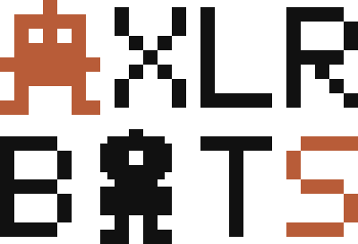</picture></p>

<p align="center"><strong>The control panel of AXLR Bots: see the fleet, send tasks, say yes or no to a bot, from one window.</strong></p>

[](../LICENSE)

AXLR Bots Panel is a native desktop application for [AXLR Bots](../README.md), Underpass's control plane for bots that live as infrastructure. It talks to a running control plane through its operator API (HTTPS with the fleet CA, the bearer token from its file) and shows nodes, bots, tasks and executions in few words: one line per row, a glyph and a word for every status, colour only where something needs a look. A row opens beside its list, in an inspector with tabs, so you search, read and act without leaving the list. It is written in Rust with [Iced](https://iced.rs) and draws with the GPU or without one.

<p align="center">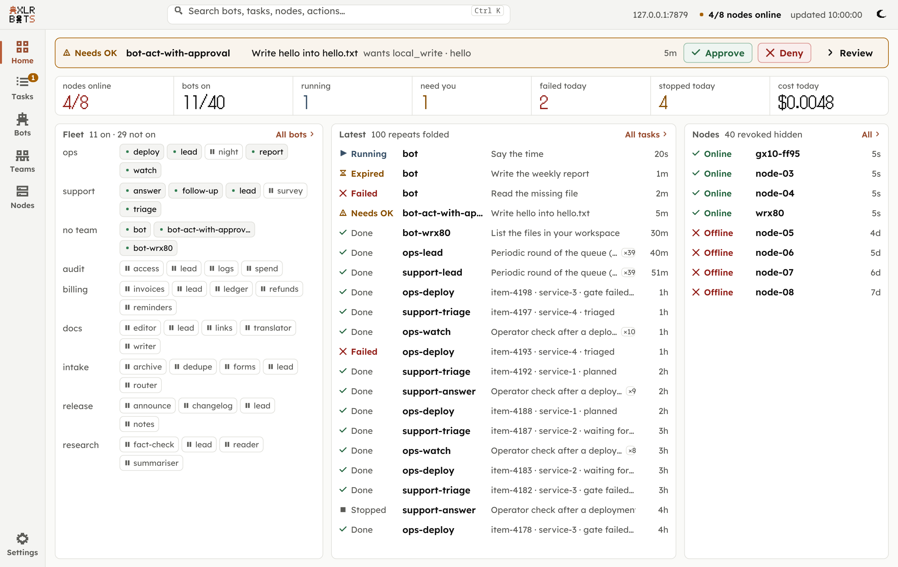</p>

## Install

User-level, no root. You need Rust 1.88 or newer and a control plane with its operator address on (`axlr-bots serve --api-listen 127.0.0.1:7879`, as the [install runbook](../docs/runbooks/install.md) sets up). Build the control plane from the same commit as the panel: the two ship together in this repository. A control plane older than the panel's routes answers the first **Connect** with *Check settings: this control plane has no /v1/overview*.

```bash
cd panel
make install        # ~/.local/bin/axlr-bots-panel, the icon, and the menu entry "AXLR Bots"
```

`cargo install --path .` installs the binary alone. `make uninstall` removes what `make install` put.

## Run

```bash
axlr-bots-panel
```

The first run opens **Settings** with three values read from this host's install: the API address (`https://127.0.0.1:7879`), the fleet CA (`~/.local/state/axlr-bots/ca/ca.crt`) and the token file (`~/.local/state/axlr-bots/api.token`). **Connect** checks them against the control plane and saves them in `~/.config/axlr-bots-panel/settings.json`; connected, it rests until a value changes. The token stays in its file: the panel reads it and never shows or logs it. The address is mutual TLS: the panel also presents an operator certificate, `operator.crt` and `operator.key` in `~/.config/axlr-bots/operator/` (where `axlr-bots ca operator issue <name>` leaves them; `$AXLR_BOTS_OPERATOR_DIR` moves the place), or the files named by `controlPlane.certFile` and `controlPlane.keyFile`. A missing file says how to issue one; a control plane that refuses the certificate says so (*the control plane refused the operator certificate*). The control plane takes the certificate's name as who decides, so a *Decide as* that names another person is refused. A `config.toml` an older panel wrote is read once and left in place.

The settings file holds the panel's own settings only, as flat keys dotted by section, like an editor's `settings.json`; a bot's configuration lives in the bot's definition, never here:

```json
{
  "controlPlane.apiUrl": "https://127.0.0.1:7879",
  "controlPlane.caFile": "/home/op/.local/state/axlr-bots/ca/ca.crt",
  "controlPlane.tokenFile": "/home/op/.local/state/axlr-bots/api.token",
  "controlPlane.certFile": "/home/op/.config/axlr-bots/operator/operator.crt",
  "controlPlane.keyFile": "/home/op/.config/axlr-bots/operator/operator.key",
  "controlPlane.actor": "alice",
  "look.theme": "light",
  "look.density": "comfortable",
  "look.motion": "on",
  "newBot.defaultModel": "anthropic/claude-haiku-5.5",
  "newBot.models": ["anthropic/claude-haiku-5.5", "codex/gpt-6-luna"]
}
```

| Key | Does |
|---|---|
| `controlPlane.*` | where the operator API is and how to trust it; the three go together, and only Connect saves them, once the control plane answers |
| `controlPlane.actor` | who you decide as (**Decide as** on the Settings screen): sent as `X-Axlr-Actor` with every request, the name a bot's `approvals.approvers` lists. Optional; `null` or absent sends none, and a bot that lists approvers then refuses the panel's Approve and Deny. It is your word, not a login ([who may decide](../docs/runbooks/approvals.md#who-may-decide)) |
| `look.theme` | `light` or `dark`, kept as you switch; `--theme` overrides it for one run |
| `look.density` | how tall the lists' rows are: `comfortable` (36 px, the default) or `compact` (30 px), switched under **Look** on the Settings screen |
| `look.motion` | the hover glow: `on` (the default) or `off`, switched under **Look** (**Hover glow**). On, the row, card or tile under the pointer has a faint light that moves behind its words; off, nothing moves and the panel asks for no frame at all |
| `newBot.defaultModel`, `newBot.models` | what the New bot form proposes and the models it offers as one-click chips; on this host they start from the local AXLR's `~/.config/axlr/settings.json` (its `model` and the ids of its `local_models`, never a key). A bot keeps its own model in its definition |

The Settings screen edits the file in place (**Edit as JSON**, with the line and column of a mistake; an unknown key is one), **Export…** writes it where you say and **Import…** reads one back: the look and the New bot defaults take at once, new control plane values wait for Connect. Plain JSON: no comments, no trailing commas.

| Flag or variable | Does |
|---|---|
| `--theme light\|dark` | start in that theme; light is the default (the sun and moon button switches it) |
| `--screen overview\|nodes\|node:<id>\|bots\|bot:<id>\|tasks\|task:<id>\|teams\|team:<name>\|settings` | open that screen once connected; `task:<id>` and the others with an id open the list with that row in the inspector |
| `ICED_BACKEND=tiny-skia` | draw on the CPU, for a host without a working GPU driver |

The panel reads the control plane every 3 seconds, in the background; the window never waits on the network. The top bar names the control plane it talks to and the version that control plane runs (`· v0.4.0`, on hover its commit and the least AXLR it asks of the nodes): the nodes are measured against it, so a restart onto a new version moves the marks with it. Versions compare as Semantic Versioning orders them, a leading `v` or not; a development build, a Go pseudo-version or a build with local changes is never compared, and shows no mark.

## The window

One frame holds every screen. The **top bar** has the emblem, the search button in the middle (*Search bots, tasks, nodes, actions… `Ctrl K`*, which opens the command palette), then the control plane and its version, the nodes online, when it last read the fleet, and the sun and moon that switch the theme. The **rail** on the left goes to Home, Tasks, Bots, Teams and Nodes, with Settings at its foot; an accent bar marks where you are, and the number of tasks that need you sits on Tasks as a badge.

The page never scrolls as a whole. A list keeps its bar and its header in sight and only its rows scroll; Home fits the window; in the inspector only the open tab's body scrolls.

## Screens

| Screen | Light | Dark |
|:--|:--:|:--:|
| **Home**: what needs you first, as an amber block with **Approve**, **Deny** and **Review** on each waiting task, or one quiet line *✓ Nothing needs you*; then one strip of seven numbers (nodes online, bots on, running, need you, failed today, stopped today, cost today), each a link to what it counts; then three columns: **Fleet**, every bot as a small tile by team (on: solid with a dot; paused: muted), **Latest**, the newest 20 tasks with their repeats folded, and **Nodes**, the live ones (the revoked are counted, not listed). A click on a tile, a line or a number opens it |  | 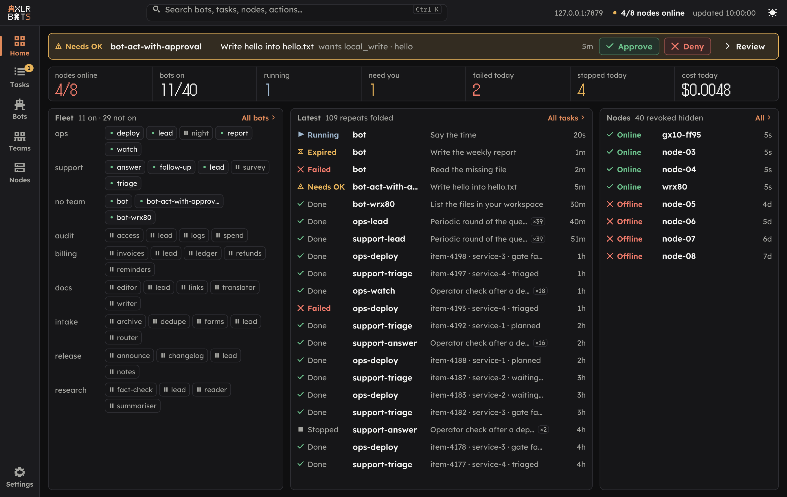 |
| **Tasks**: one line per task: Status · Bot · What · Started by (the trigger's glyph and name) · At (your clock) · Age, and its acts (✓ ✕ on one that waits for you, Stop on one still open). *What* is the event's own message when an event started the task, then the objective, muted. **Fold repeats** (on by default) folds the tasks of one bot that the same trigger started and that stand the same into the newest, with a `×N` badge; the note line says how many (*Newest 200 tasks · 110 repeats folded*). **Group** goes round none, trigger, bot and status, under headers with counts that close on a click. Status chips with counts filter; **New task** sends one (one idempotency key per form; **Urgent** sends it first) | 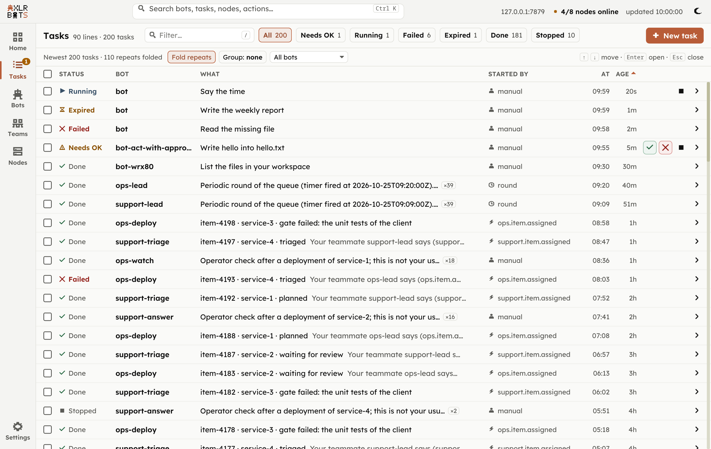 | 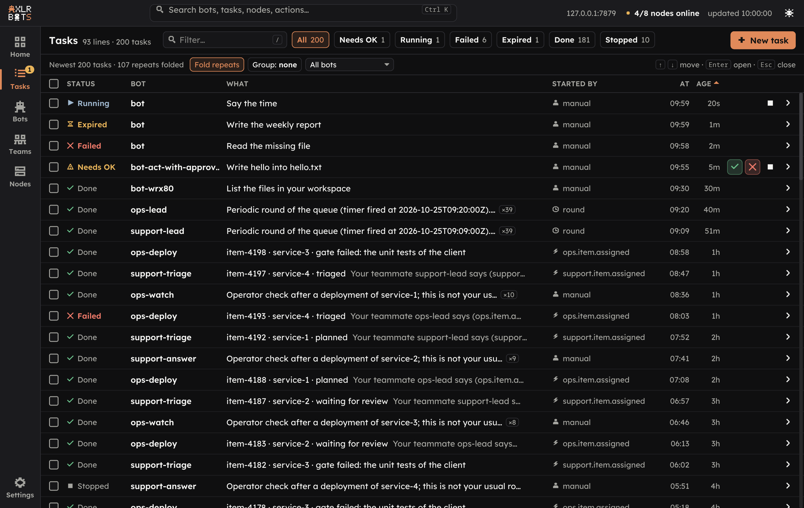 |
| **A task in the inspector**: a click or Enter on a row opens it beside the list, which stays, narrower. The header has the status, the bot, what started it and the acts (**Approve** and **Deny** while it waits, **Stop** while it is open, **Run again**, and **Talk to it**, which opens its bot's chat, while it runs), the title on at most two lines and the objective under it; then its facts (Node, Started, Took, Cost, From, Team, and the task and trace ids with a copy button); then the tabs **Activity · Answer · Files · Runs · Timeline · Raw** | 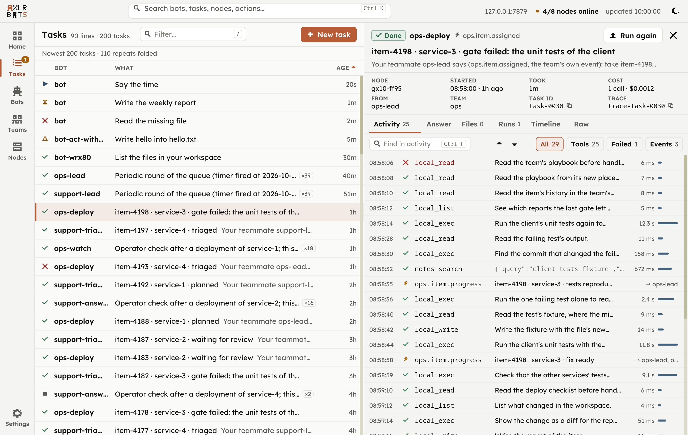 | 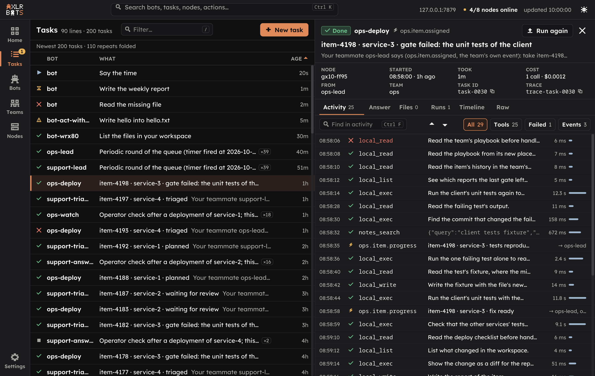 |
| **Activity**: what the run did, one line per step ([live progress](../docs/architecture/live-progress.md)): your clock, ✓ ✕ or ▶, the tool, the step's *why* (the `why` its call gave, else its arguments, muted), how long it took with a small bar; the events it emitted and what it said sit in the same stream, in order. A click opens the step in place: its arguments, why it failed, the bots it asked (**Open task**), **Copy step**; **Copy activity** copies it all. **Find in activity** (`Ctrl F`) marks every match and counts them (`1/7`), Enter and Shift+Enter (or ↑ ↓) go to the next and the one before; the chips All · Tools · Failed · Events keep one kind. A running task follows its newest step; scrolling up stops that and offers **↓ Jump to latest**. **What it says so far** shows the model's words as they come (**Select words** holds them still to select a part of, **Formatted** goes back, **Copy words**). A decision queued for a node that is away says so on top, in your clock: *Waiting for node web-1, offline since 11:20* | | |
| **A task that waits for you**: the call it stopped on, each argument with its copy button, **Copy call**, and **Approve** or **Deny** in the header | 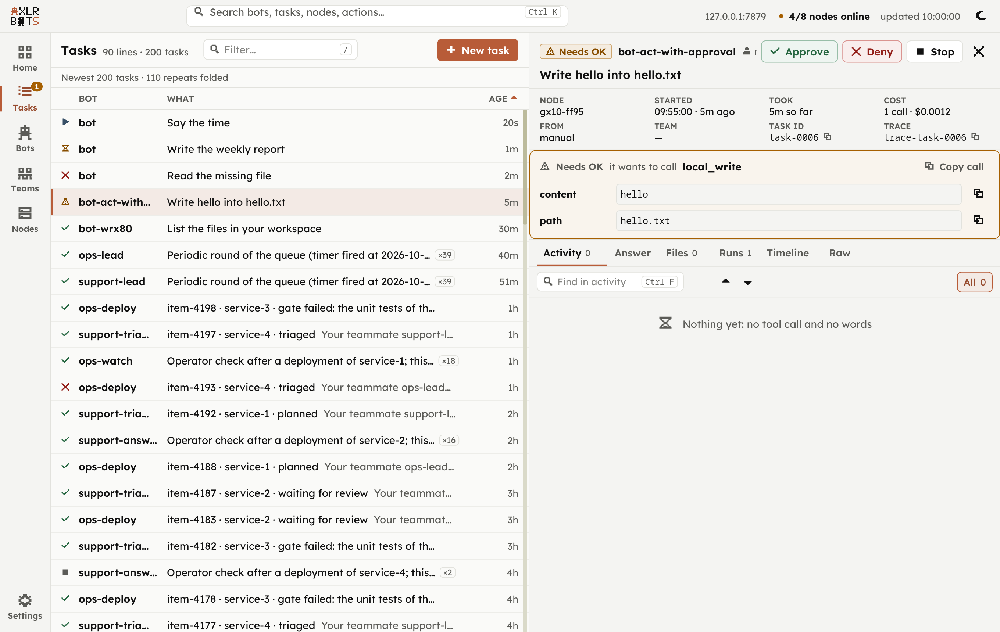 | 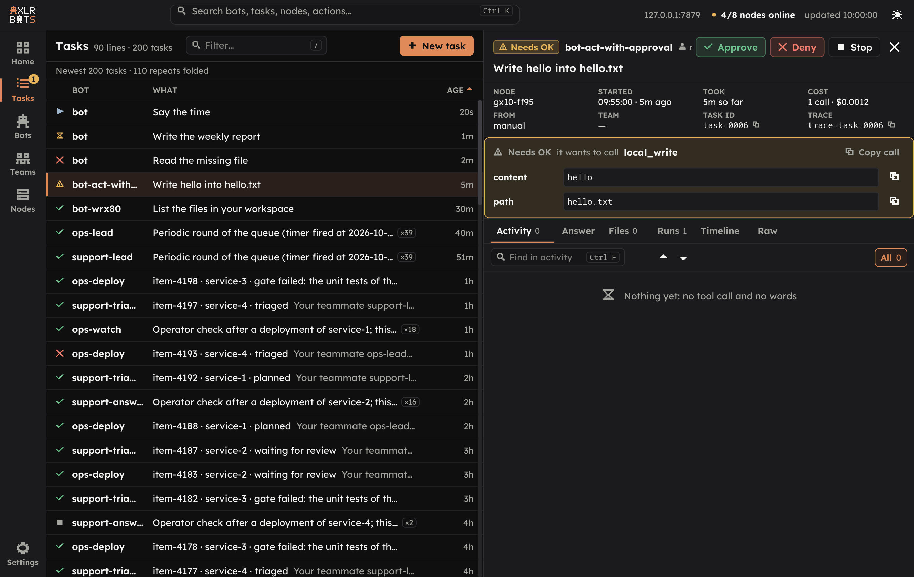 |
| **A post before it goes out**: when the waiting call publishes something (an argument named `--text`, `--message`, `--body` or `--post`, on any program), the call shows it **as it would read**: the bot as author, the words with their links, one box per attachment (`--card`, `--image`, `--cover`, `--diagram`: the pictures are drawn on the node, so each shows what it is), the character and link count, and **Copy text**. No network is special: the panel draws the draft, not X or Mastodon | 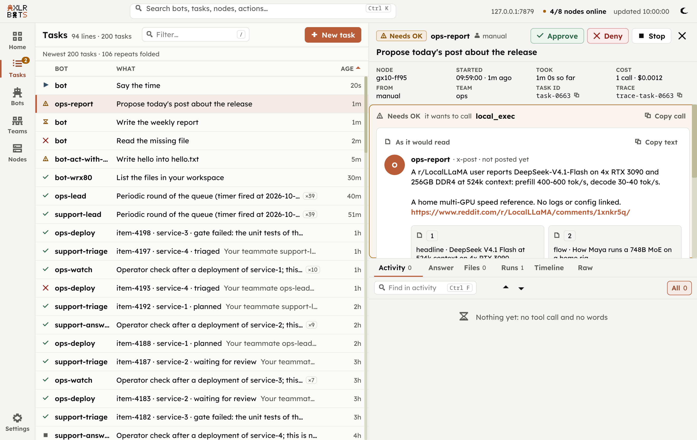 | 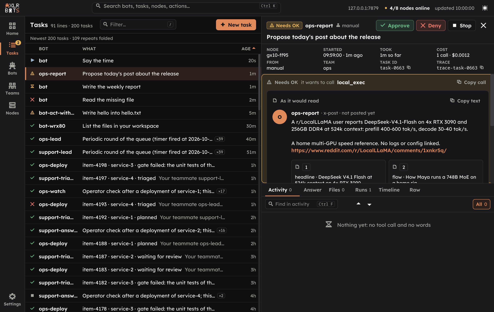 |
| **Answer, Files, Runs, Timeline, Raw**: the answer as Markdown, or as text to select a part of (**Select text**, **Copy answer**); what a task an event made knew and read before (**Knew**, **Read before**); the files its runs delivered (name, type, size) with **Save** on those the control plane keeps; every run with its node, outcome, tool calls and why each ran or not (Allowed by its rules, You approved it, It asked you, Blocked by its rules, You denied it), usage and cost (*cost unknown* for a run stopped before it said, and a total with such runs reads *≥ $0.42*, as Home's cost today does), trace and policy; the timeline of its lifecycle (**Copy timeline**); and **Raw**, the task as JSON (**Copy JSON**) | | |
| **Copy**: a button beside each block copies it: the task, the answer, the call waiting and each argument, a failure, a run's error, a step, the activity, the timeline, a bot's mission, an error banner. A bot's mission, a team's members and a new host's token select in part too (drag, Ctrl+C) | | |
| **Bots**: grouped by team under headers that say *ops · 4 on · 1 paused* and close on a click; a team with no bot on starts closed. Status · Bot · Level · Model · Runs on · Starts by, and on each row turn on or pause, Stop, open. Chips All · On · Paused. **New bot** opens the form over the list; **From file** adds one from a definition file (its `version` goes with it). A bot whose staged definition is newer than its own has the update mark beside its status, its tip `v1.2.0 → v1.3.0 ready` | 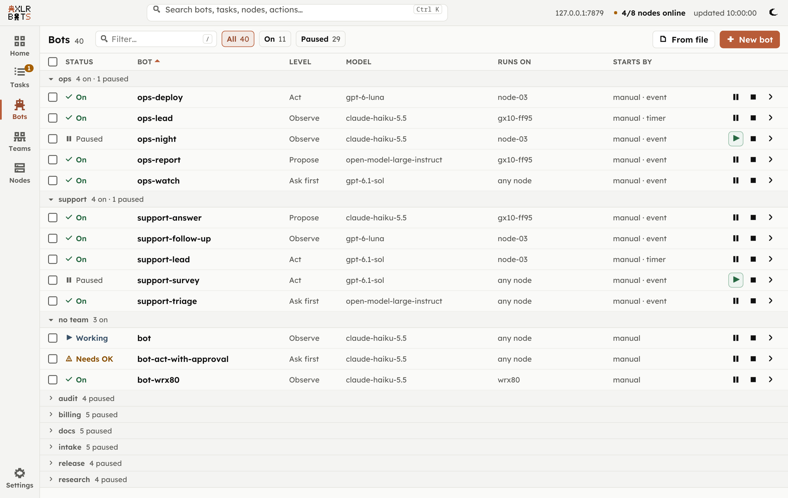 | 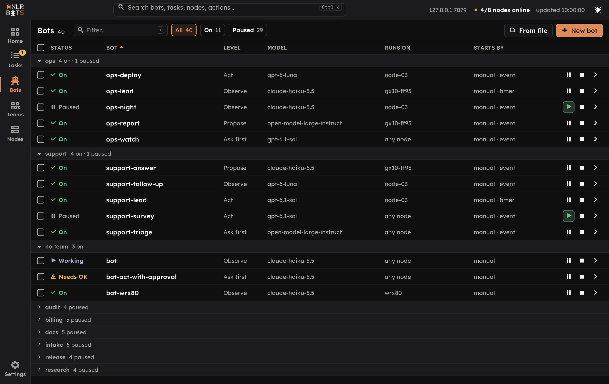 |
| **A bot in the inspector**: the header has its status, team and node, and **Pause** or **Turn on**, **Stop** (it also cancels its open tasks), **Edit**, **Delete**, and **Update to v1.3.0** when a newer definition is staged ([staged changes](../docs/reference/bot-definition.md#staged-changes)), which asks first. Tabs: **Now** (right now: waits for you, working on a task with its newest step, queued, idle or paused, with **Urgent order**; its latest work; what starts it; the chat at the foot), **Work** (its tasks), **Mission** (what it does, its team), **Rules & tools** (how much it may do alone: Ask me before acting, Act on its own within its rules, Only watch and report; its triggers, placement, tools and their rules, model and budgets), **Listens & emits** (its topics, the names it emitted, its events as they happen: **Update ready**, **Update dropped**, **Updated** with the versions). **Edit** changes its mission and its tools, each one "Runs on its own", "Asks you first" or "Never runs", and saves nothing over a change made meanwhile; **Delete** says first how many tasks it cancels and which bots still name it, and goes only once the bot's id is typed | 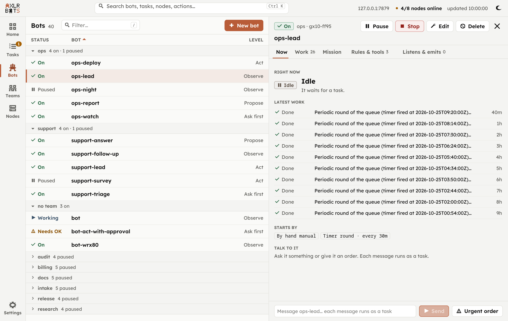 | 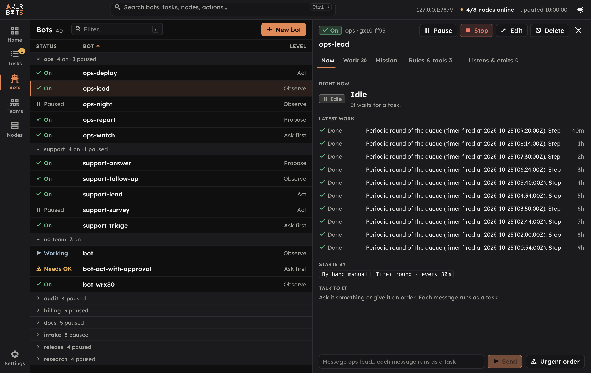 |
| **Talk to it**: on a bot's Now tab, a chat. Each message runs as a new task of the bot, carrying the last three turns so it keeps the thread; its answer, or where the task stands, shows under it, and a click opens the task. When the bot runs a task, a message goes to that run, which reads it between its steps (AXLR's `--steer-file`, relayed by the node), and what the run says back shows as it says it (`bot.task.said`); on a control plane or node without it, the message runs as a new task. **Urgent order** (type it in one line) runs as an urgent task that goes first and stops what the bot was doing | | |
| **New bot**: three questions a person can answer: a name in any words, what it should do in their words, where it runs. The bot's id is made from the name and shown under it (lowercase, no accents, hyphens for spaces, up to 64 characters), a name whose id another bot has cannot be added, and a team typed as `NANOTEAM` says it will be saved as `nanoteam`. It asks before acting by default; how much it may do alone, its tools and its model sit under **Advanced**, closed. It warns under «Where does it run?» when the chosen node named its providers and none serves the model typed, and adds the bot all the same | 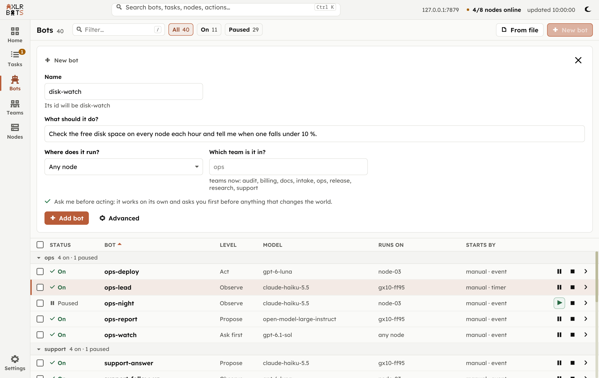 | |
| **Nodes**: Status · Node · Host · Seen · AXLR · Agent (the node agent's own version) · Providers (OpenRouter, the Codex proxy, Jev, its local models), online first. Revoked nodes are hidden (*40 revoked nodes are hidden. Show them*, and a **Revoked** chip). **New host token** makes a one-time token with copy buttons. A node behind the fleet has the update mark beside its status, and its tip says on what and the version to reach: its agent older than the control plane's version, its AXLR below the minimum the control plane asks for (`serve --min-axlr-version`). In the inspector: when it was seen, its versions, its certificate's expiry, its labels, its providers, the bots that run there, and **Revoke**, which asks first | 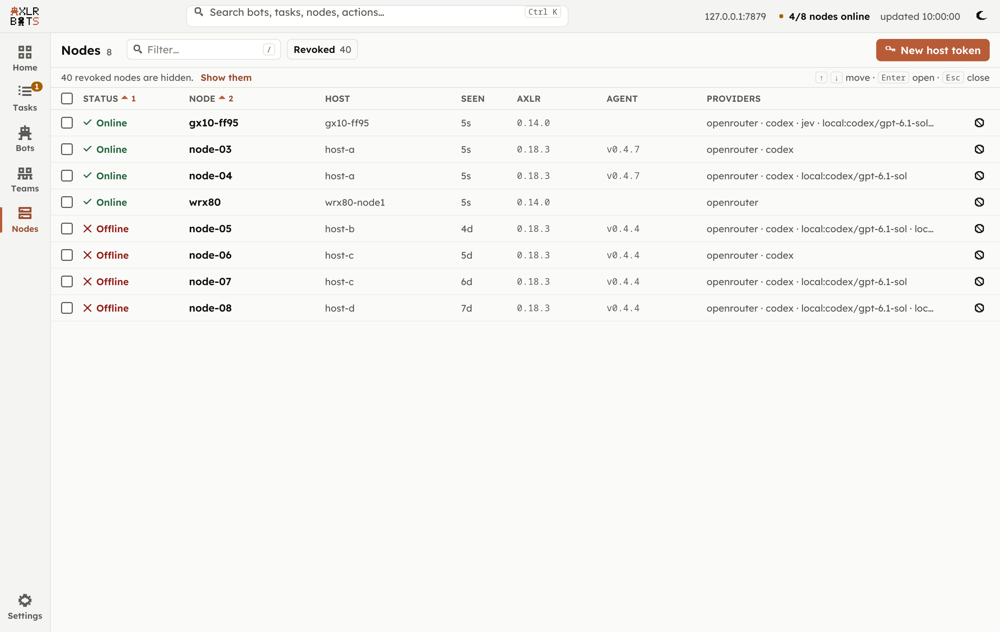 | 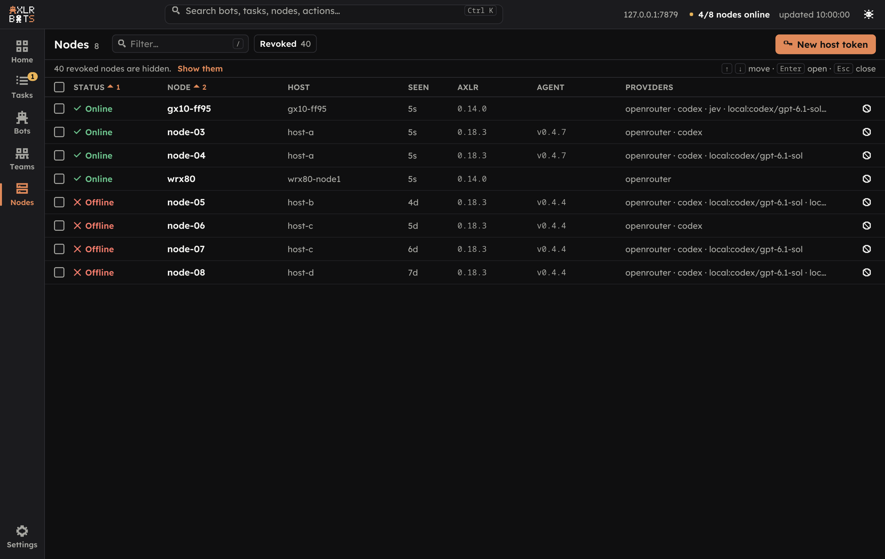 |
| **Teams**: each team the bots name, with its bots and how many are on (a team of one bot has a mark whose tip asks whether its name is a typo); the list always shows one team in the inspector, the first at start. **What happens**: the team's timeline as it happens (who told whom what, the urgent tasks, what was stopped and why, what each event did: «got a task», «told … while it worked», «noted for …»), the operator's **Shortcuts**, and **Publish an event** in the header. **Who is in it**: its members (what each is for, its tools, where it runs, **Urgent order** beside each) and its **Topics** ([publish/subscribe](../docs/architecture/pubsub-events.md)): who publishes, who listens and how, the last event, **nobody listens** in red. A bot's team is set in New bot and on its Mission tab ([guide](../docs/runbooks/teams-and-events.md)) | 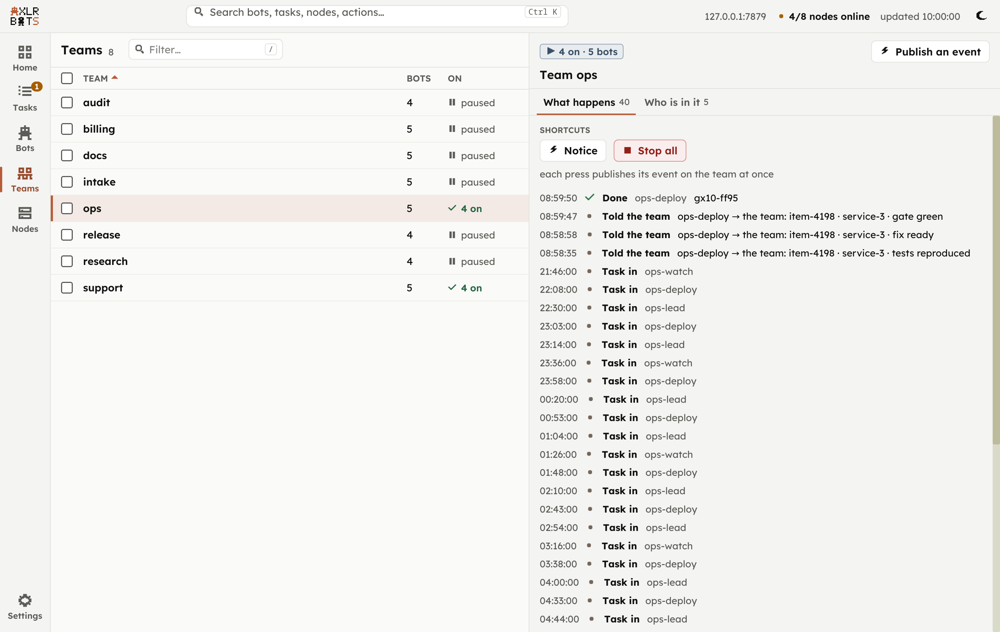 | 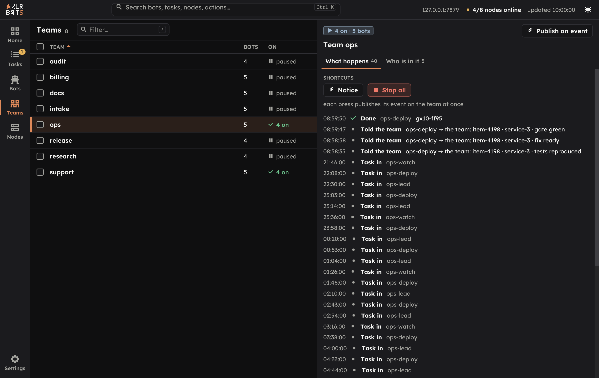 |
| **Command palette** (`Ctrl K` or the search button): one field over the window; results grouped Actions · Bots · Teams · Nodes · Tasks with what matched marked; ↑ ↓ Enter, Esc closes. Words found anywhere come first, then a close fuzzy match (three letters or more). Tasks are found by their message, objective, id, trace id and trigger among the newest 200, and it says so; a pasted task or trace id jumps to its task. The actions go to each place, start a task or a bot, switch the theme, and show the tasks that need you or that failed | 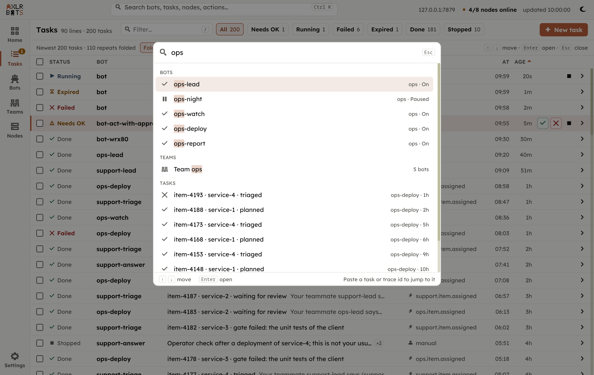 | 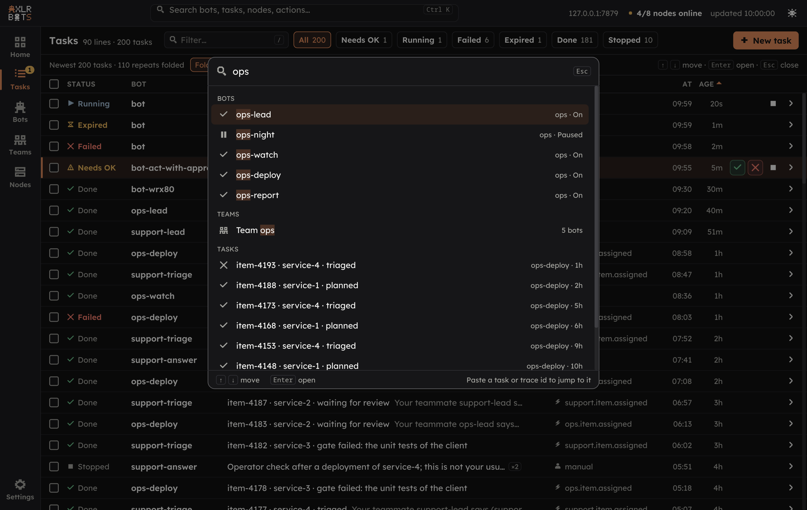 |
| **Topics**: a bot's **Listens & emits** shows what it listens to (topic · mode · from, **Remove**) and **Listen to a topic** (the mode defaults by the topic's kind, shown as you type); a bot's ask to listen is a card with **Approve** / **Deny**, and counts in "need you". **Publish an event** on a team: `stop.all` stops every Enabled member (each gets an urgent task, and its queued tasks are dropped); `stop.*` and `danger.*` stop the bots that hear them, `warn.*` reaches them while they work, `info.*` is a note for their next task. **Shortcuts**: one button per event written in `~/.config/axlr-bots-panel/shortcuts.toml` (`[[shortcut]]` with `team`, `label`, `name`, `message`, optional `data`), each press published at once with a key of its own, a `stop.*` or `danger.*` in red; a bad file is a banner at start, no file no buttons. Against an older control plane the Topics part says so and nothing else changes | | |
| **Desktop notices**: when a task starts waiting for your OK ("bot asks for your OK", what it wants to call) or a teammate warns, the desktop shows a notice with the control plane it comes from; a click opens the task or the team and brings the panel forward. The first read after connecting stays quiet | | |
| **Settings**: the control plane (Connect rests while connected with these values), the look (theme, rows, hover glow), what New bot proposes, and the settings file: edit as JSON, export, import, reset | 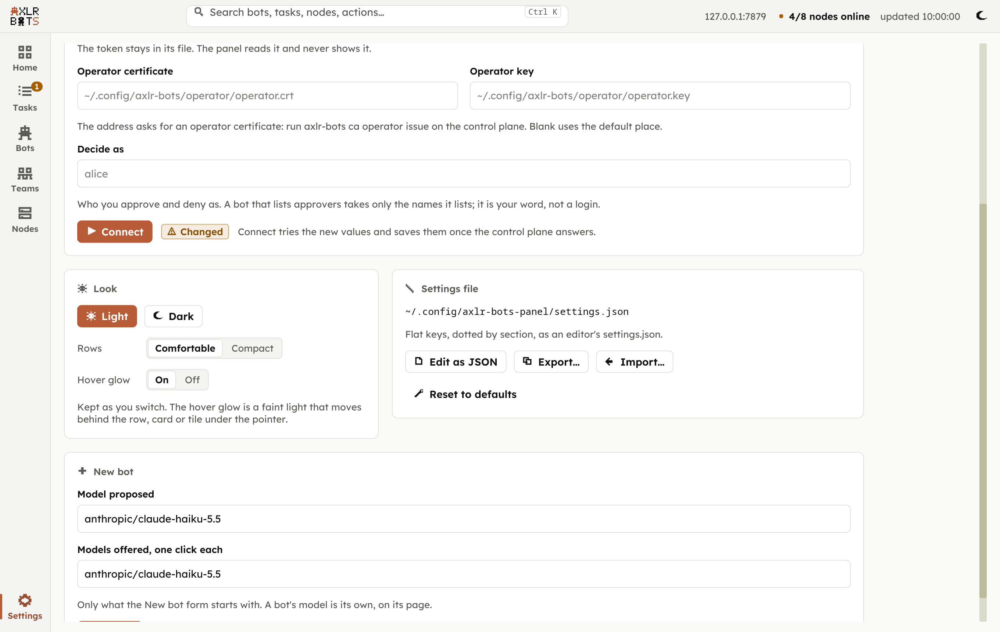 | 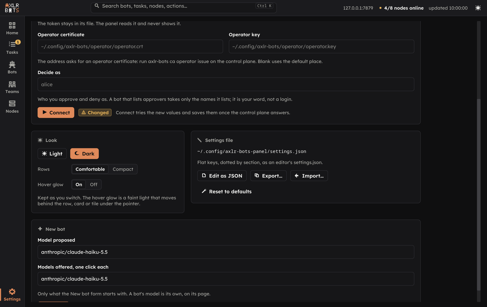 |
| **Settings as JSON**: the file as it is, edited in place; Apply says where a mistake is | 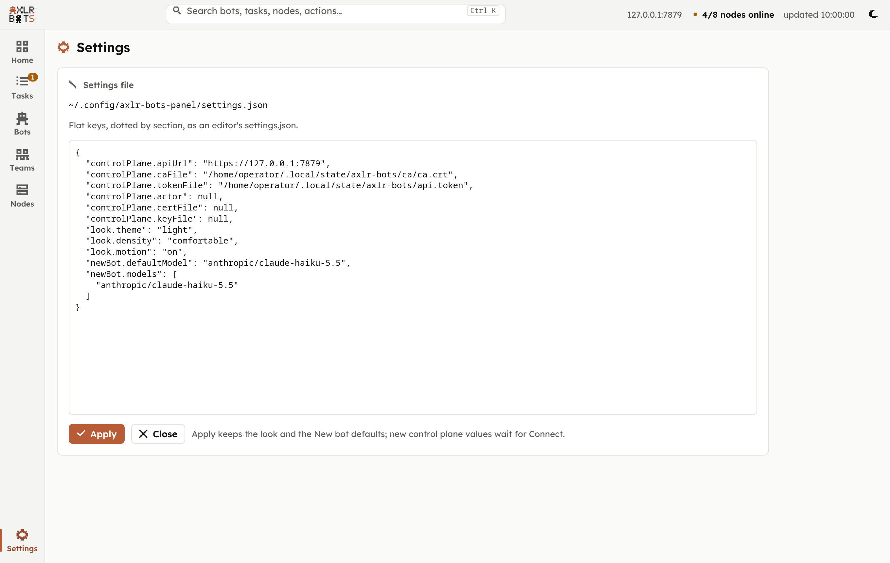 | |

The screenshots are drawn headless from the panel's in-memory fleet of a real size (eight teams, forty bots, eight live nodes and forty revoked, the newest two hundred tasks with the same timer round again and again), with the panel's typefaces at its window size, light and dark; one ignored test draws them again (see Development). [The live run](docs/live-run.md) shows a task sent to a node and a write approved, both from an earlier version of the panel.

## Keyboard

A key a field took first never becomes one: the filter and the find keep the letters typed into them (`/`, `j` and `k` too), Left, Right and Esc, and let the up and down arrows and the Ctrl shortcuts through.

| Key | Does |
|---|---|
| `Ctrl K` | opens the command palette |
| `/` | puts the keyboard in the list's filter |
| `↑` `↓`, `j` `k` | move the cursor over the rows on show and bring its row into sight; with a row open, the inspector follows |
| `Enter` | opens the row under the cursor in the inspector; in a dialog, does what it asks |
| `Esc` | closes the palette, a dialog, a form, a bot's Edit or Delete card, then the inspector, then lets go of the cursor; in the filter or the find it empties the field as it leaves it |
| `←` `→` | the inspector's tab before or after |
| `Ctrl F` | finds in a task's activity |
| `Enter`, `Shift Enter`, `↑` `↓` | in the find, the next match and the one before |

## Made to be read fast

Ink on a warm white page, graphite at night; the emblem's copper is the one accent, and it marks the place you are in, the row under the cursor and the main act of a screen. Every status is a glyph and a word, in one name everywhere (Queued, Running, Needs OK, Done, Failed, Expired, Stopped). Colour only where something needs a look: Needs OK and Expired in amber, Failed and Offline in red, Running in slate, On and Online in green; Done, Stopped, Paused and Revoked stay quiet, a muted word beside their glyph.

The lists (Tasks, Bots, Nodes, Teams) are one line per row, 36 px tall (30 px with `look.density` set to `compact`), under a header that stays. Each has one bar: its title and count, a filter field (`/`; it filters as you type, every word must be found in the row's columns or ids, the words found are marked, and Esc empties it as it leaves it), status chips with counts (only the statuses there are), the list's options and its main act. A click on a header sorts by it, again the other way, a third time not at all; Shift+click adds the column after the others, and each sorted header shows its arrow and, with more than one, its place. The order stays while the lists are read again. A box on each row, and one in the header for every row shown, picks rows; the bar over the foot then says how many, offers **Clear** and the acts that fit the list (Bots: Turn on, Pause, Stop, Delete; Tasks: Approve, Deny, Stop; Nodes: Revoke; Teams: Turn on, Pause or Stop their bots). An act that fits only some rows says so (**Pause 3 of 5**) and leaves the others alone. One dialog names the count and the first rows, then one call per row, four at a time, and one banner says how it went (**4 paused · 1 failed** and why). Picked rows stay picked by id while the list is read again, drop out when their row goes, and are let go on another screen or with Esc. The Tasks list holds the newest 200 tasks; its counts, order and Select all cover those, and the screen says so. A folded line's box picks every task it holds.

The row, card or tile under the pointer, and the inspector's header, have a faint light behind their words: slow waves between the copper and the slate, brightest under the pointer, that fade in in a quarter of a second and out in under half. The words stay as legible as without it. It moves only while the pointer is on something and goes to sleep when the pointer rests for ten seconds; a panel nobody touches draws nothing new. It is a small picture made on the CPU and stretched smooth, so it looks the same with the GPU or without one. `look.motion` set to `off` turns it off.

Words are set in [Lexend](https://www.lexend.com) (made for reading fluency) and big numbers in [DotGothic16](https://github.com/fontworks-fonts/DotGothic16), a thin pixel face in the spirit of the emblem; both are embedded with the binary (`assets/fonts`, SIL Open Font License, the licences beside them). Body text is 14 px, secondary text 13 px and labels 12 px, left-aligned, never italic; a number of Home's strip is 26 px. The two themes keep every text colour at 4.5:1 or more against its background, and a pill's word against the pill's own tint (tests check it). Lines are 1 px, corners slightly rounded, nothing casts a shadow. The icons are 16 × 16 pixel glyphs in the house style of the emblem (`assets/icons/make_icons.py` draws them). The banner after an act floats over the page's foot without moving it.

## How it works

```text
 ui (Iced)          App::apply(message) → state + effects      views draw the state
    │                                    │
    ▼                                    ▼
 application        use cases: RefreshFleet · LoadTaskDetail · SubmitTask · DecideTask · CancelTask · SwitchBot
                    RegisterBot · ApplyStaged · MintEnrollmentToken · RevokeNode · FollowBotEvents · FollowTaskEvents · Connect …
    │  ports: ControlPlane · Clock · KeySource · FilePicker · DefinitionReader · ConfigStore · Connector
    ▼
 adapters           grpc (tonic + rustls, fleet CA only, operator client certificate, bearer token) · system (clock, uuid keys, files,
                    XDG file dialog) · config (JSON settings, defaults from the axlr-bots unit and the local AXLR) · fake (in memory)
    │
    ▼
 domain             Node · Bot · Task · Execution · ExecutionResult · Event · Overview · EnrollmentToken …
                    value types mirroring the operator API's JSON, validated as they are read
```

- **Hexagonal, one file per type.** The domain depends on nothing but serde and chrono; the use cases see the control plane through the `ControlPlane` port; the adapters implement the ports; `main.rs` wires them.
- **The update logic does no input or output.** `App::apply` turns a message into the new state and a list of effects; the runtime runs the effects as Iced tasks. Tests drive `apply` message by message against the in-memory control plane, and draw every screen with Iced's headless simulator.
- **Nothing twice.** A task form keeps one idempotency key from the moment it opens, so sending twice names one task. A refresh carries a generation, and an older answer is dropped.
- **Acts that cannot be undone ask twice**: revoking a node, stopping a task, denying a call.
- **Nothing moves at rest.** The hover glow (`ui/organic`) asks for frames, a little under thirty a second, only while a glow is changing; a pointer that rests, or `look.motion` set to `off`, asks for none.

The routes the panel reads beyond the original operator API (the task list across bots, a task's timeline, the overview, pausing a bot, a node's certificate expiry) are documented in the [operator API reference](../docs/reference/operator-api.md).

## Development

```bash
cd panel
make check          # cargo fmt --check, cargo clippy -D warnings, cargo test (two jobs)
make coverage       # cargo llvm-cov over domain, application, adapters and the update logic
AXLR_PANEL_LIVE=1 cargo test --test live_control_plane -- --nocapture   # read the running control plane
ICED_TEST_BACKEND=tiny-skia TZ=UTC cargo test ui::screenshot_tests::screenshots -- --ignored --exact  # draw docs/screenshots again
cargo run --example organic                                             # the hover glow in a window of its own
```

The HTTPS adapter is tested against a local TLS server with a CA made for the test, including a server whose certificate chains to another CA (refused) and a wrong token (`401`).

## License

Apache License 2.0, like the rest of AXLR Bots; see [LICENSE](../LICENSE) and [NOTICE](../NOTICE). Part of [Underpass AI](https://underpassai.com).
